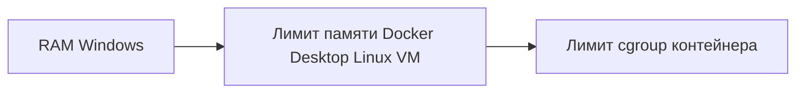

# Локальный Browser MCP

Локальная панель управления браузером и MCP-сервис. Контрольная служба и browser worker работают в Linux-контейнерах Docker Desktop; модель llama.cpp работает отдельным процессом в Windows и использует GPU. Модель в Docker не запускается. Browser worker запускает headed Camoufox в Linux с программным рендерингом; аппаратный GPU браузера для этого запуска не требуется.

## Память Docker Desktop

Память контейнера ограничивается на нескольких уровнях: физическая память Windows задаёт общий ресурс, лимит Docker Desktop задаёт потолок Linux VM, а cgroup каждого контейнера задаёт его собственный предел.



В проверенном окружении Docker Desktop 4.91 использует LinuxKit VM через VMM (`UseLibkrun=true`): `docker info` показывает `MemTotal=8384647168` байт (около 8 GiB). Это текущее значение машины, а не рекомендуемое значение по умолчанию. Лимит 48 GiB в `.wslconfig` к этой VM не применяется; активного дистрибутива Docker Desktop WSL сейчас нет. Фактический backend и лимиты могут отличаться на другой машине.

Проверьте текущий лимит VM и лимит контейнера командами:

```powershell
docker info --format '{{.MemTotal}}'
docker inspect --format '{{.HostConfig.Memory}}' <container-name>
```

Первая команда выводит доступную VM память в байтах; вторая — лимит контейнера в байтах (`0` означает, что явный лимит не задан). Текущий кандидат проверен в VM около 8 GiB с browser cgroup 4 GiB и maintenance: 15-минутный soak завершился за 900,07 с, 5 902 цикла, пик памяти 50,40%, OOM 0. Это ограниченный результат только для зафиксированной конфигурации. Базовый Compose по умолчанию оставляет browser limit 2816 MiB и выключенный maintenance; overlay кандидата включает 4 GiB и maintenance. При пересоздании кандидата указывайте его явно вместе с direct-egress overlay.

## Запуск установленного readiness-кандидата

Кандидат использует уже собранные образы browser-mcp-readiness-control:candidate и browser-mcp-readiness-browser:candidate. Для пересоздания сервисов с сохранением volumes указывайте все три Compose-файла; без readiness overlay browser limit вернётся к базовым 2816 MiB, а memory maintenance будет выключен:

```powershell
docker compose -f deploy/compose.yaml -f deploy/compose.direct.yaml -f deploy/compose.readiness-candidate.yaml up -d --no-build
```

Не добавляйте `--build`: базовые Dockerfile собирают обычные образы, а не readiness candidate tags.

## Быстрый запуск

1. Запустите Docker Desktop с Linux containers.
2. Убедитесь, что Windows llama.cpp доступен по OpenAI-compatible API на `http://127.0.0.1:8080/v1`. Модель должна поддерживать vision, если нужны задачи со скриншотами. Клиент запрашивает список через `/v1/models` и по умолчанию выбирает alias `auto`; имя `fara-browser` не требуется.

   Для отдельного Fara-профиля можно запустить специальный скрипт:

   ```powershell
   .\scripts\start-fara.ps1 -Background
   ```

   Этот скрипт запускает Fara-конфигурацию. Для стандартного клиента оставьте общий OpenAI-compatible endpoint и selector `auto`.

3. Проверьте Compose-конфигурацию без создания секретов, volumes или контейнеров:

   ```powershell
   .\scripts\start-services.ps1 -Direct -CheckOnly
   ```

4. Запустите сервисы. Флаг `-Direct` включает прямой исходящий маршрут браузера для локальной разработки:

   ```powershell
   .\scripts\start-services.ps1 -Direct -Build
   ```

5. Откройте панель: [http://localhost:8090](http://localhost:8090). Окно browser viewer доступно по [http://localhost:8090/desktop](http://localhost:8090/desktop), MCP endpoint — [http://localhost:8090/mcp](http://localhost:8090/mcp). Панель создаёт локальную сессию автоматически и сохраняет проверки Host/Origin и CSRF.

   В просмотрщике видны текущая задача и компактные кнопки управления. Встроенное окно в панели повторно использует один iframe.

6. Чтобы включить API key для model server, передайте путь к существующему файлу:

   ```powershell
   .\scripts\start-services.ps1 -Direct -Build -ModelKeyFile 'C:/path/to/model-key.txt'
   ```

   Для Windows `llama-server` с Fara-профилем передайте key-файл в `start-fara.ps1 -ApiKeyFile 'C:/path/to/model-key.txt'`. Подробности по локальным портам см. в [docs/13-local-endpoints.md](docs/13-local-endpoints.md).

## Панель и расширение Chrome

В панели можно запускать задачи, смотреть состояние, вручную открывать браузер и передавать управление. Просмотр использует снимок браузерной страницы; это не удалённый рабочий стол ОС и не VNC.

Для выбора cookie из открытых вкладок установите локальное расширение:

1. Откройте `chrome://extensions`.
2. Включите «Режим разработчика» и нажмите «Загрузить распакованное расширение».
3. Выберите папку `chrome_extension` в этом проекте.
4. Откройте расширение, укажите локальный адрес сервиса, создайте pairing code в панели и завершите pairing в расширении.
5. Обновите список вкладок/сайтов и вручную отметьте сайты и cookies, которые хотите импортировать.

Панель показывает только свойства cookies и передаёт значения выбранных записей непосредственно в Camoufox; значения не отображаются и не попадают в отчёт. Расширение устанавливается только в исходный Chrome и не внедряет скрипты в страницы. В Camoufox оно не устанавливается. Установка и привязка выполняются пользователем.

## Наблюдение за задачей

Откройте существующий просмотрщик [http://localhost:8090/desktop](http://localhost:8090/desktop). После обновления UI один раз нажмите Ctrl+R. В просмотрщике видны текущая или последняя задача, её состояние и число шагов. Кнопка «Забрать управление» явно передаёт управление человеку; «Вернуть управление» освобождает его. Автоматический запуск отдельного окна Chrome и автоматическая передача управления не выполняются. Роли и порядок работы агентов проекта описаны в [AGENTS.md](AGENTS.md).

Последний интеграционный прогон через MCP (`6dcc05d5-4768-419f-bb80-3ca84baa55a8`) завершился со статусом `succeeded`: 20 шагов за 101,44 секунды, все три проверки пройдены, исправлений не потребовалось. Модель посетила Python.org и Nodejs.org, затем заполнила демонстрационную форму Selenium без отправки; версии и точные значения полей отдельно сверены с источниками. Выполнено 106 тестов; в 43 замерах ресурсов наблюдались один контекст и одна страница без нарушений. Артефакты: [результат](runtime/demo/verified-rich-result.json), [запись](runtime/demo/verified-rich-live.gif), [ресурсы](runtime/demo/verified-rich-resources.json).

Размер браузерной страницы и скриншота — **1440×900**, как рекомендует [карточка Fara1.5-9B от Microsoft](https://huggingface.co/microsoft/Fara1.5-9B). Масштаб картинки в панели не меняет разрешение скриншота модели. Координаты модели из пространства 1000×1000 пересчитываются в пиксели этого окна.

## MCP

Streamable HTTP MCP endpoint: `http://localhost:8090/mcp`. Настройте MCP-клиент с Bearer token из `runtime/access/mcp-token.txt`. Ключ MCP отдельный от ключа входа в UI. Оба файла создаются контейнером и копируются скриптом запуска в локальную папку `runtime/access` с ACL только для текущего пользователя.

## Команды управления

```powershell
# Только проверить Docker Compose config; без секретов/контейнеров/volumes
.\scripts\start-services.ps1 -Direct -CheckOnly

# Запустить/обновить сервисы
.\scripts\start-services.ps1 -Direct

# Пересобрать образы
.\scripts\start-services.ps1 -Direct -Build

# Посмотреть контейнеры
docker compose -f deploy/compose.yaml -f deploy/compose.direct.yaml ps

# Остановить контейнеры, сохранив данные и credential volumes
docker compose -f deploy/compose.yaml -f deploy/compose.direct.yaml down
```

`runtime/access/` содержит локальные секреты и не предназначен для публикации. Worker credential volume создаётся скриптом bootstrap. Docker Desktop должен быть запущен; для сборки образов требуется доступ к опубликованным Docker/Python browser artifacts.

## Текущие ограничения

- Один профиль браузера (`default`) и один worker; нет пула профилей или планировщика нескольких browser workers.
- Базовый Compose блокирует egress браузера. `-Direct` явно выбирает прямой development-маршрут; управление внешним proxy, назначение proxy на браузер и прозрачная проверка маршрута пока не реализованы.
- `browser-use-undetected` проверен только по PyPI metadata и wheel; его совместимость с форком WebRobot не доказана и не интегрирована. См. [отчёт совместимости](docs/04-framework-compatibility.md).
- Браузер выполняет только подтверждённые операции в рамках доступных UI/API. Сервис не обещает безошибочный результат, автоматические покупки или универсальную совместимость с сайтами.
- Chrome extension требует ручной установки и pairing. Поддержка конкретной конфигурации браузера пользователя должна проверяться отдельно.
- Доступ к сервисам ограничен localhost. Это локальный MVP, не удалённое многопользовательское развёртывание.

## Документация

- [Обзор сервиса](docs/01-service-overview.md)
- [Инженерное руководство MVP](docs/02-mvp-engineering-guide.md)
- [Отчёт совместимости Browser Use](docs/04-framework-compatibility.md)
- [Настройка локального Chrome extension](chrome_extension/README.md)
- [Ограничения ресурсов во время работы](docs/05-runtime-limits.md)
- [План проверки совместимости с антибот-системами](docs/15-antibot-compatibility-test-plan.md)
- [План устранения production gaps](docs/16-production-remediation-plan.md)
