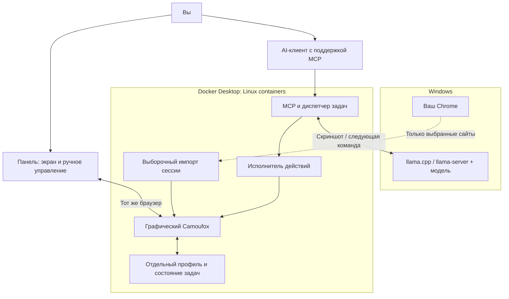
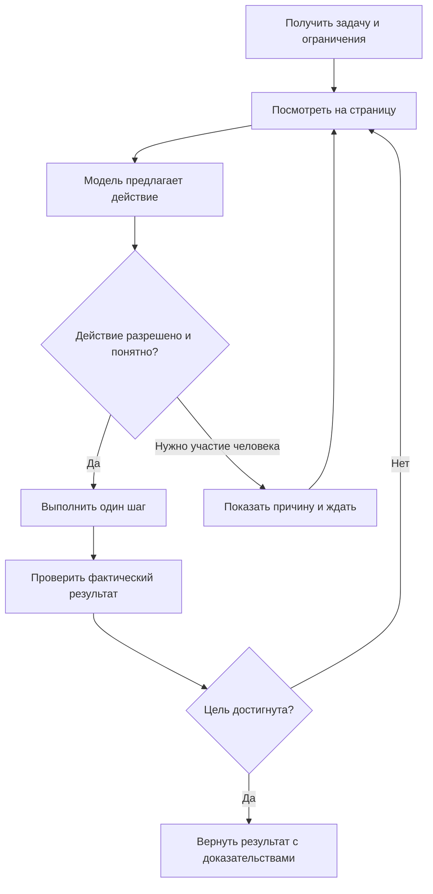
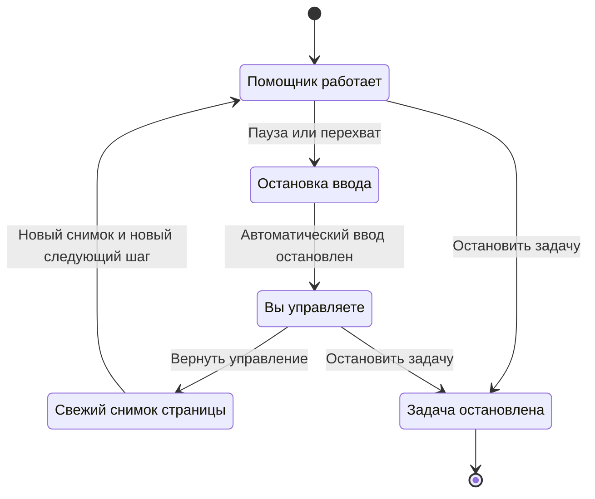
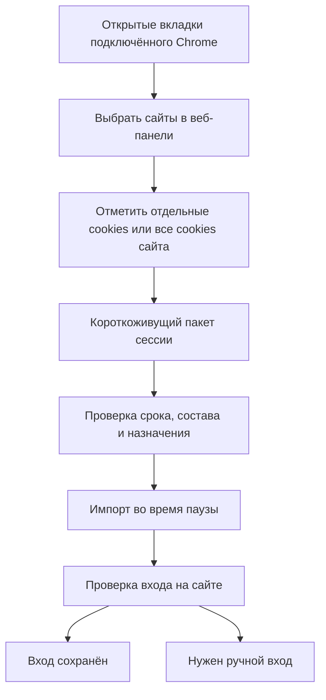
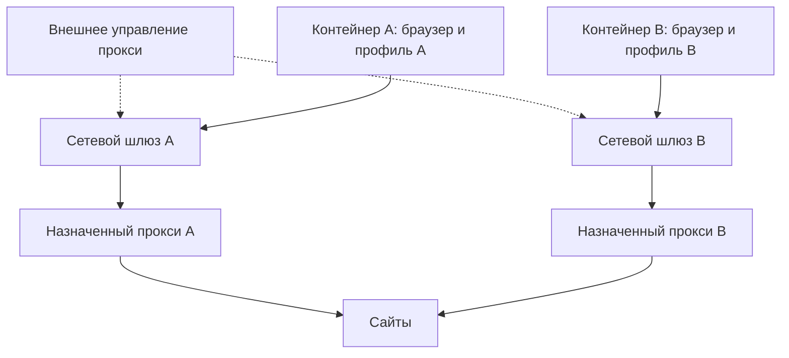

# Браузерный помощник через MCP: как устроен сервис

Дата: 27 октября 2026 года. Версия документа: 1.3.

Это согласованное направление и план MVP. Начальная реализация создана, но полный пользовательский путь, совместимость компонентов и производительность требуют проверки на стенде. Подробные задания разработчикам находятся в [инженерном руководстве](02-mvp-engineering-guide.md).

## 1. Что получим

Вы поручаете помощнику задачу обычным языком: найти сведения на нескольких сайтах, заполнить форму, собрать корзину или подготовить заказ. Помощник выполняет действия в отдельном браузере, показывает ход работы и возвращает результат с подтверждениями.

В любой момент можно открыть его экран, приостановить автоматизацию и самому пользоваться мышью и клавиатурой. Вход в аккаунт, двухфакторное подтверждение и проверку сайта можно пройти вручную в том же окне. После возвращения управления помощник продолжит с текущего состояния страницы.

Первый выпуск рассчитан на одного пользователя, один сохраняемый профиль и одну активную задачу. Задача может переходить между сайтами последовательно. Сразу предусматриваем отдельный контейнер, профиль и назначенный сетевой маршрут для каждого браузера, чтобы позже запускать несколько таких экземпляров параллельно.

## 2. Что где работает

Исходный план платформы: Windows, WSL2, Docker, RTX 3090 и основной пользовательский браузер Chrome. Фактический runtime на 30 октября 2026 года: Docker Desktop 4.91 с LinuxKit VM через VMM (`UseLibkrun=true`); модель работает отдельным процессом в Windows. Linux-контейнеры Docker Desktop могут использовать backend на базе VMM или WSL2 — эти варианты не следует считать синонимами. На этой машине Docker Desktop WSL-дистрибутив не активен, а лимит 48 GiB из `.wslconfig` на LinuxKit VM не распространяется.

| Где | Что работает | Зачем |
|---|---|---|
| Windows | `llama-server` из llama.cpp и модель | Анализировать скриншоты и предлагать следующие действия; модель запускается вне Docker. |
| Windows или выбранный профиль Chrome | Ваш основной Chrome | При необходимости передавать ограниченный набор данных для входа на выбранные сайты. |
| Docker Desktop: Linux-контейнеры | MCP-сервис и диспетчер | Принимать задания, управлять выполнением, разрешениями, паузами и результатами. Фактический backend Linux VM зависит от конфигурации Docker Desktop. |
| Отдельный контейнер | Camoufox и его графический рабочий стол | Выполнять действия в изолированной браузерной среде. |
| Будущий внешний сетевой слой | Менеджер прокси и сетевой шлюз | В дальнейшем назначать каждому браузеру свой маршрут и хранить настройки прокси отдельно от browser worker. |
| Веб-панель | Экран браузера и кнопки управления | Позволять вам наблюдать, вмешиваться и авторизовываться вручную. |
| Выделенные тома Docker | Профиль помощника и служебные данные | Сохранять входы между перезапусками и восстанавливать сведения о задачах. |

Для первоначального стенда браузер может получить обычный исходящий маршрут только при явном выборе overlay `deploy/compose.direct.yaml`. Это прямой путь Docker наружу, без proxy gateway и transparent egress enforcement; default Compose оставляет browser без внешнего маршрута. Proxy manager и отдельное назначение маршрутов — будущий этап. Прямой путь не включается автоматически после сбоя proxy.

Модель получает изображения и текст по локальному HTTP API. Сырые cookies и пароли ей для этого не нужны. Браузерный контейнер не получает доступ к папке вашего Chrome, личным дискам Windows и API модели. Связь между компонентами проходит через ограниченные служебные интерфейсы.

**MCP** — способ подключения AI-клиента к сервису. **Camoufox** — браузер помощника. **llama.cpp** — программа, которая запускает модель. Это разные компоненты, и каждый можно проверять отдельно.

## 3. Как проходит одна задача

Рассмотрим поручение: «Найди подходящий товар до указанной цены, сравни предложения и подготовь заказ».

1. Сервис сохраняет задачу, ограничения по цене, разрешённые сайты и условия завершения.
2. Открывает браузер с отдельным профилем помощника.
3. Делает скриншот текущей страницы и передаёт его модели вместе с заданием и короткой историей действий.
4. Модель предлагает следующий шаг: перейти по адресу, нажать кнопку, ввести текст или прокрутить страницу.
5. Исполнитель проверяет, допустим ли шаг, и выполняет его.
6. Сервис проверяет изменение страницы, делает новый снимок и продолжает.
7. Если нужны ваши данные, ручной вход или решение, задача останавливается в понятном состоянии ожидания.
8. В конце сервис показывает результат: источники, выбранные товары, цену, заполненные поля или подтверждение операции.

Слова модели «готово» сами по себе не завершают задачу. Например, для формы нужно проверить значения и сообщение сайта, для корзины — состав и итог, для заказа — подтверждение и идентификатор операции. Если проверить результат не удалось, сервис так и сообщает.

## 4. Как вы вмешиваетесь

В панели предусмотрены пять основных действий:

| Действие | Что происходит |
|---|---|
| Наблюдать | Видно окно браузера, сайт и текущий этап; ввод с вашей стороны заблокирован. |
| Пауза | Агент прекращает выдавать новые браузерные действия. |
| Забрать управление | После остановки текущей короткой операции мышь и клавиатура передаются вам. |
| Продолжить | Ввод возвращается агенту; он заново наблюдает страницу и планирует следующий шаг. |
| Остановить задачу | Автоматическое выполнение завершается; последствия уже выполненных действий сохраняются. |

Одновременно браузером управляет один участник. Простого скрытия курсора агента недостаточно: система должна блокировать его команды на стороне исполнителя. Ответ модели, который пришёл после вашего вмешательства, нельзя выполнять по старому снимку.

Во время ручного входа модель не вызывается, постоянная запись экрана выключена. Скриншоты для следующего шага возобновляются после выхода из режима ручной авторизации. Видимая информация аккаунта после входа всё равно может попасть на рабочий скриншот, поэтому изображения считаются конфиденциальными.

## 5. Графический браузер и GPU

Обязательная возможность MVP — headed Camoufox, окно браузера, которое видно в панели, и рабочий ввод с клавиатуры и мыши. Записываем фактический renderer, включая software renderer.

Браузер может использовать программный рендеринг; аппаратный renderer — необязательная оптимизация и не блокирует выпуск. Windows-native модель llama.cpp использует CUDA на RTX 3090; это не подтверждает GPU-ускорение браузера.

Запись renderer нужна для диагностики и воспроизводимости. Скриншот окна сам по себе не определяет, аппаратный ли renderer.

Подключение GPU к browser-контейнеру можно исследовать отдельно. GPU override и команды настройки GPU не требуются для штатного MVP.

**Критерий G0.4:** видимый headed Camoufox, просмотр этого окна в панели, успешный ручной ввод, а фактический renderer записан. Software renderer проходит критерий.

## 6. Как сохраняется вход на сайты

Есть два равноправных пути.

**Прямой вход в браузере помощника.** Вы открываете панель, вводите данные и проходите подтверждение. Сессия сохраняется в отдельном профиле Camoufox. Это удобный вариант для сайтов, где перенос входа затруднён.

**Выборочный перенос из Chrome.** Вы разрешаете перенос для конкретного сайта. Компонент-мост получает только допустимые cookies и, если это необходимо и реализовано для данного сайта, выбранные данные хранилища. Расширение Chrome может работать с cookies через официальный API и разрешения на выбранные хосты. [Chrome cookies API][chrome-cookies]

В веб-панели будет раздел **«Импорт cookies → Из открытых вкладок Chrome»**:

1. Нажать «Обновить список»: появятся сайты из обычных открытых вкладок подключённого профиля Chrome во всех его окнах. Повторяющийся сайт показан один раз, с количеством вкладок.
2. Отметить нужные сайты. Для чтения списка используется расширение Chrome; обычная веб-страница не имеет прямого доступа к вашим вкладкам. [Chrome Tabs API][chrome-tabs]
3. Открыть список cookies каждого выбранного сайта. В нём видны имя, Domain, Path, срок действия и признаки Secure/HttpOnly. Значения cookies в таблице не показываются.
4. Отметить отдельные cookies либо явно нажать «Выбрать все cookies этого сайта». По умолчанию ничего не выбрано. Система не обещает сама точно определить минимальный набор для входа.
5. Выбрать профиль Camoufox, посмотреть итог «2 сайта, 5 cookies» и нажать **«Скопировать выбранное в Camoufox»**. Совпадающие cookies заменяются только в пределах явно выбранного набора; остальные сохраняются.
6. Получить отчёт: что скопировано, что пропущено, где нужна дополнительная авторизация. Во время активной задачи импорт ожидает безопасной паузы.

Пример выбора в панели:

| Выбор | Открытый сайт | Вкладок | Что переносить |
|---|---|---|---|
| ☐ | `shop-a.test` | 2 | Выбрать cookies… |
| ☐ | `shop-b.test` | 1 | Выбрать cookies… |

Новые разрешения Chrome подтверждаются в интерфейсе расширения; сам выбор сайтов и cookies остаётся в веб-панели. Служебные страницы, панель сервиса и вкладки инкогнито в этот список не входят. Другие Chrome-профили не смешиваются с подключённым.

Cookies относятся к хранилищу браузера и домену, а не к отдельной вкладке. Поэтому одна общая domain-cookie может отображаться для нескольких выбранных сайтов: она переносится один раз с исходной областью действия. Закрывшийся сайт или изменившийся набор cookies требует обновления выбора; новые cookies автоматически не добавляются.

Историю посещений, пароли, платёжные данные, расширения и весь кэш переносить не требуется. Копирование отдельного временного файла допускается только после подтверждения его необходимости для сценария и определения срока удаления.

Обновление можно запускать перед задачей, по настроенному интервалу или при потере входа. Перенос выполняется только в паузе, чтобы не затереть работающую сессию. В MVP данные передаются в одну сторону: Chrome → Camoufox; обратной синхронизации нет.

Некоторые сайты привязывают сессии к устройству или проверяют изменение среды. Поэтому даже корректный перенос cookies может закончиться повторным запросом входа. [Chrome DBSC][chrome-dbsc]

## 7. Какие браузерные проекты используем

Основной кандидат — указанный вами [browser-use-camoufox от WebRobot][fork]. Он сохраняет интерфейс Browser Use и добавляет слой взаимодействия с Firefox/Camoufox. Авторы сообщают о проверке базовых действий, но отмечают неполную поддержку ряда возможностей. [README проекта][fork]

[browser-use-undetected][undetected] также включён в план интеграционных испытаний. Это отдельная надстройка, ожидающая Browser Use. Совместимость её зависимостей с форком WebRobot нельзя считать готовой. [PyPI проекта][undetected]

На первом стенде разработчик проверяет оба проекта в отдельных окружениях, определяет совместимые версии и реальную полезную роль каждого. Если для совместной работы нужна доработка, она оформляется как конкретный патч с тестами. Простая установка двух пакетов не считается выполненной интеграцией.

Для первого выпуска фиксируем одну активную вкладку. Переходы по разным сайтам выполняются в ней. Авторизация с отдельными окнами и другие неподдержанные возможности должны получить явный обработчик или понятный переход к ручному режиму.

## 8. Как выбираем модель

Первый кандидат — **Microsoft Fara1.5-9B**. Модель воспринимает страницу через скриншоты и выдаёт команды действий; её обучение ориентировано на английский язык. Русские задания и интерфейсы проверяем отдельно. [Карточка Microsoft][fara-card]

Для запуска через llama.cpp найдена сторонняя GGUF-конверсия с модулем обработки изображений. Это кандидат для испытаний, а не подтверждение готовой работы на вашей машине. Файлы модели и модуля изображений должны относиться к одной проверенной конверсии. [Карточка конверсии][fara-gguf]

Последовательность выбора:

1. Проверить, что модель действительно видит изображение и выдаёт пригодную команду.
2. Проверить короткие задачи и точность попадания по элементам.
3. Сравнить качество доступных вариантов квантования и объём контекста.
4. Выполнить одни и те же формы, поисковые задания и корзины несколько раз.
5. Зафиксировать качество, время, расход памяти и число ваших вмешательств.

Fara1.5-27B — кандидат для сравнения при подходящих ресурсах. Дополнительную модель выбираем только после проверки её запуска в согласованном Windows/llama.cpp-окружении. Подмена способа размещения модели или использование облачного сервиса не происходит автоматически.

## 9. Как уменьшаем обнаружение автоматизации

Цель — снижать частоту блокировок и сохранять работоспособность авторизованного браузинга. Название библиотеки со словом `undetected` не является гарантией.

В план входят стабильный профиль, согласованность настроек браузера, корректное ожидание загрузки, разумная частота действий и проверка особенностей выбранного движка. Изменение конфигурации оцениваем по результатам реальных сценариев и частоте проверок сайта.

Настройки внешнего прокси и его пароли находятся за пределами браузерного контейнера. Целевой вариант — внешний сетевой шлюз, через который идёт трафик браузера без настройки upstream-прокси в самом Camoufox. Сайт при этом видит выходной адрес и особенности соединения; перенос управления наружу сам по себе не обеспечивает необнаружимость.

Случайные задержки и движения мыши не должны ухудшать точность. Собственная модель, камера удалённого рабочего стола и ручное вмешательство должны работать на одном и том же состоянии браузера. CAPTCHA и дополнительные подтверждения в MVP передаются вам через панель.

Для оценки фиксируем сайт, задачу, версии компонентов, факт блокировки или проверки и успешность завершения. Полную необнаружимость на любых сайтах обещать нельзя.

## 10. Как выполняются покупки и отправки

Обычные действия выполняются в рамках поручения без повторных вопросов. Для необратимых действий учитываются заранее выданные вами разрешения и ограничения.

Например, можно разрешить заказ у конкретного продавца, с заданным составом и максимальной суммой. Сервис проверит условия непосредственно перед действием. Если разрешения нет, сумма изменилась или результат неясен, он покажет вам подготовленное действие.

На первом MVP автоматическую финальную отправку проверяем на тестовом магазине. На реальных сайтах используем ручное подтверждение или специально проверенный сценарий. Произвольный обработчик кнопки на неизвестном сайте нельзя надёжно классифицировать только по внешнему виду.

При обрыве соединения после отправки заказа сервис сначала выясняет, был ли заказ создан. Повторять отправку вслепую нельзя.

## 11. Что входит в первый MVP

| Возможность | Условие готовности |
|---|---|
| MCP-подключение | AI-клиент видит инструменты, запускает задачу и получает её состояние. |
| Графический браузер | Окно видно в панели; ввод и изображение относятся к той же сессии. |
| Графический режим | Headed Camoufox виден в панели, ручной ввод работает, фактический renderer записан. Аппаратный browser renderer не обязателен. |
| Ручное вмешательство | После перехвата агент не вводит данные; после возврата получает свежий снимок. |
| Авторизация | Работает ручной вход и сохранение профиля; импорт Chrome проверен на выбранном сайте. |
| Выбор cookies в вебе | Панель показывает открытые сайты Chrome и переносит только явно отмеченные cookies в выбранный профиль Camoufox. |
| Выход браузера для начального стенда | Прямой-development маршрут выбран явно через `compose.direct.yaml`; он не является proxy gateway и не включает transparent enforcement. Default Compose остаётся без выхода. |
| Поиск | Есть переходы между сайтами, ссылки на источники и проверяемый итог. |
| Формы | Поля заполняются и проверяются, отсутствующие данные запрашиваются. |
| Покупки | Работает корзина, проверка суммы и согласованный порядок финальной отправки. |
| Восстановление | Перезапуск не запускает автоматически неизвестное незавершённое действие. |
| Результаты | Ошибка, ожидание человека и подтверждённый успех различаются явно. |

Массовые параллельные задачи, несколько пользователей, автоматическая оплата на любых сайтах и синхронизация всего Chrome-профиля выходят за первый выпуск.

## 12. Этапы разработки

| Этап | Что делаем | Что получаем на выходе |
|---|---|---|
| 0. Проверка основы | Фиксируем версии; испытываем Windows llama.cpp, соединение, графику и оба браузерных проекта. | Отчёт с доказательствами совместимости и перечнем необходимых патчей. |
| 1. Браузер и ручной режим | Поднимаем графическую сессию, профиль, экран и единственного владельца ввода. | Браузером можно безопасно управлять вручную и через исполнитель. |
| 2. Цикл агента | Соединяем наблюдение, модель, проверку команды, действие и проверку результата. | Выполняются короткие задания на тестовых страницах. |
| 3. MCP и задачи | Добавляем запуск, статус, паузу, продолжение, отмену и журнал. | AI-клиент управляет выполнением через MCP. |
| 4. Сессии и сценарии | Добавляем мост Chrome, формы, поиск, корзину и восстановление. | Проходят согласованные пользовательские сценарии. |
| 5. Приёмка | Повторяем набор задач, измеряем качество, скорость и блокировки. | Принимаем решение о готовности MVP и следующем этапе. |

Этап 0 — обязательная инженерная работа. Его результаты могут потребовать доработки адаптеров, но не дают разработчику права самостоятельно переносить модель в Docker или менять платформу.

### 12.1. Следующий этап: несколько браузеров со своими прокси

Для будущего параллельного запуска закладываем следующую схему:

У каждого браузера собственные профиль, экран, управление и назначение прокси. Модель остаётся общей в Windows; число одновременно открытых браузеров и число запросов к модели регулируются отдельно с учётом RTX 3090.

Возможное размещение менеджера прокси — на WSL2-хосте или в отдельных служебных контейнерах; это вариант будущей архитектуры, а фактический сетевой backend и маршрут на текущей машине отдельно не подтверждены. Он хранит реквизиты, проверяет доступность и выходной IP, назначает маршрут и учитывает занятость. Внутрь браузерного контейнера не передаются адрес upstream-прокси, его логин/пароль, PAC или proxy-расширение; браузер использует обычное сетевое подключение через свой внешний шлюз.

Маршрут закрепляется за сессией. Его не меняют посреди входа, формы или заказа. При отказе прокси соответствующий браузер приостанавливается; другие продолжают работу. Смена маршрута проходит через остановку и проверку состояния сессии. Автоматического перехода на прямое соединение нет.

В панели позже появится список браузеров: профиль, назначенный прокси, выходной IP, состояние и отдельные кнопки управления. Выбор cookies из Chrome всегда относится к явно выбранному целевому профилю, а не ко всем браузерам сразу.

В MVP проверяем один такой изолированный сетевой маршрут. Для следующего этапа добавим несколько экземпляров и проверим, что они не смешивают трафик, профили и управление. Прозрачный сетевой выход в конкретном Docker/WSL2-окружении должен быть доказан отдельным стендом; одной настройки контейнерной сети для этого недостаточно.

## 13. Как поймём, что сервис получился

Проверяем 30 заранее описанных задач: 10 поисковых, 10 форм и 10 сценариев корзины/оформления на тестовом магазине. Каждую повторяем три раза. Все данные для основного набора заданы заранее, аккаунты авторизованы; русские задания входят в этот набор. Ручные входы, вмешательство и сбои проверяем отдельно.

Предлагаемая цель приёмки — не менее 90% автономно и полностью выполненных запусков на основном наборе. Успех после помощи человека считается отдельно. Дополнительные обязательные условия: отсутствие двойных заказов и команд агента после подтверждённого перехвата управления.

Измеряем полное время задачи, время одного шага, долю успешных запусков, число исправлений и вмешательств, расход видеопамяти и частоту блокировок. Численные цели по скорости утверждаем после первого стенда: сейчас измерений на этой машине нет.

Успех на тестовом наборе не означает такой же процент на произвольных сайтах. Новые сайты добавляем с собственными проверками.

## 14. Что нужно решить на первом стенде

| Вопрос | Как получаем ответ |
|---|---|
| Работает ли Fara в Windows llama.cpp с изображениями? | Изображение с известными элементами → корректная команда → успешное действие. |
| Хватает ли RTX 3090 при одновременной работе браузера? | Замеряем память и задержки под общей нагрузкой. |
| Ускоряется ли графика внутри нашего рабочего стола? | Проверяем рендерер в Camoufox и функциональный WebGL-тест. |
| Можно ли использовать форк для локального видимого сохраняемого браузера? | Проверяем запуск, профиль, скриншот и ввод; документируем нужные патчи. |
| Совместима ли надстройка undetected? | Проверяем зависимости и полезные функции отдельно, затем испытываем совместную интеграцию. |
| Какие входы переносятся из Chrome? | Испытываем разрешённый набор сайтов; фиксируем, где нужен прямой вход. |
| Проходит ли трафик только через назначенный внешний прокси? | Проверяем выходной IP, сетевые протоколы и отсутствие прямого выхода при отказе маршрута. |

Неизвестные ответы обозначены явно, чтобы инженеры проверили их до развития зависимых функций.

## 15. Основные источники

Проверка публичной документации выполнена 27 октября 2026 года. Ссылки на изменяемые ветки служат для изучения; в реализации нужно закрепить конкретные версии и контрольные суммы.

- [Форк WebRobot][fork] и [надстройка browser-use-undetected][undetected].
- [Fara1.5-9B от Microsoft][fara-card] и [сторонняя GGUF-конверсия][fara-gguf].
- [Мультимодальность llama.cpp][llama-vision] и [llama-server][llama-server].
- [Docker GPU в WSL2][docker-gpu], [WSLg][wslg] и [сеть WSL][wsl-network].
- [Chrome cookies API][chrome-cookies], [привязка сессий к устройству][chrome-dbsc].
- [Chrome Tabs API][chrome-tabs] для списка открытых сайтов.
- [Streamable HTTP в MCP][mcp-http] и [noVNC][novnc].

[fork]: https://github.com/WebRobot-Ltd/browser-use-camoufox
[undetected]: https://pypi.org/project/browser-use-undetected/
[fara-card]: https://huggingface.co/microsoft/Fara1.5-9B
[fara-gguf]: https://huggingface.co/Tdamre/Fara1.5-9B-GGUF
[llama-vision]: https://github.com/ggml-org/llama.cpp/blob/master/docs/multimodal.md
[llama-server]: https://github.com/ggml-org/llama.cpp/blob/master/tools/server/README.md
[docker-gpu]: https://docs.docker.com/desktop/features/gpu/
[wslg]: https://github.com/microsoft/wslg
[wsl-network]: https://learn.microsoft.com/en-us/windows/wsl/networking
[chrome-cookies]: https://developer.chrome.com/docs/extensions/reference/api/cookies
[chrome-tabs]: https://developer.chrome.com/docs/extensions/reference/api/tabs
[chrome-dbsc]: https://developer.chrome.com/blog/dbsc-windows-announcement?hl=en
[mcp-http]: https://modelcontextprotocol.io/specification/2026-07-28/basic/transports/streamable-http
[novnc]: https://novnc.com/info.html
