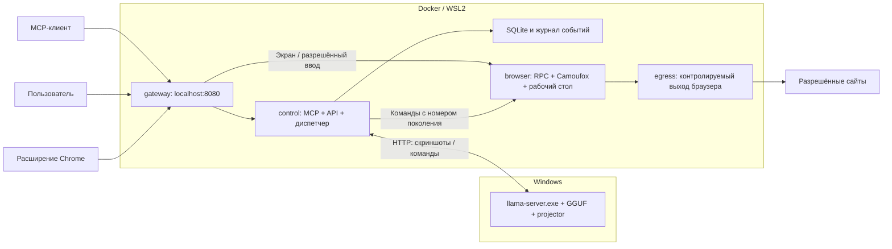
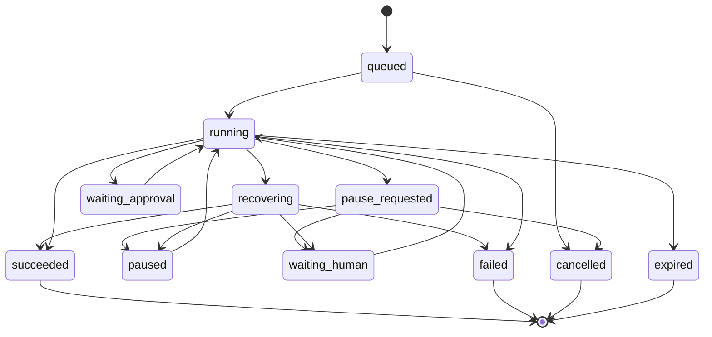
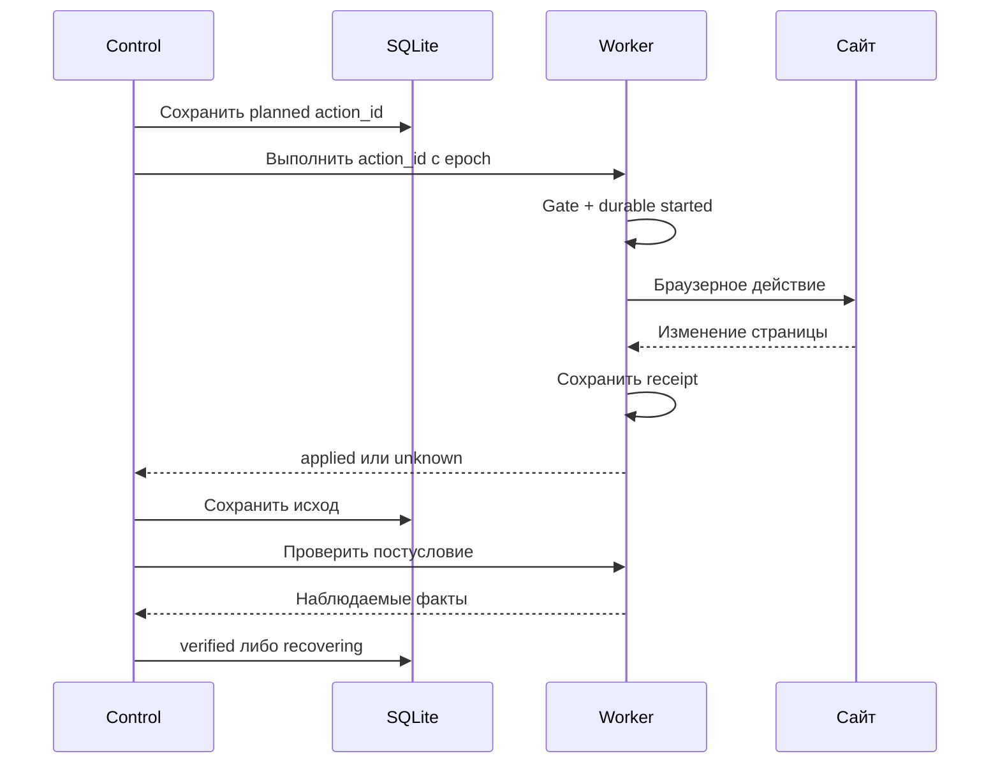

# MCP-сервис браузерной автоматизации: руководство по реализации MVP

Дата: 27 октября 2026 года. Версия: 1.3. Назначение: технический план для инженеров, включая junior-разработчиков.

Общее объяснение продукта и схемы для нетехнического читателя: [обзор сервиса](01-service-overview.md).

## 0. Статус документа и правила чтения

Этот документ задаёт технические требования и критерии реализации. В рабочей папке уже есть начальная реализация сервера, worker, UI и Compose; полный пользовательский путь, сетевой маршрут и renderer на конкретном стенде требуют отдельных проверок. Команды ниже не означают, что соответствующий результат уже достигнут.

Порядок запуска текущей реализации описан в [README](../README.md), фактически настроенные ограничения памяти, страниц и очередей — в [операционных ограничениях](05-runtime-limits.md).

Используются три обозначения:

- **Решение** — согласованное требование или выбранная архитектура MVP.
- **Факт источника** — сведения из публичной документации; рядом дана ссылка.
- **Проверить на стенде** — гипотеза, которую нельзя выдавать за работающую интеграцию.

Не подменять неизвестную точку интеграции придуманным параметром библиотеки. Результатом проверки должны стать небольшой исполняемый пример, закреплённые версии и проверяемое свидетельство.

### Как пользоваться руководством

| Задача читателя | Разделы |
|---|---|
| Понять ограничения, поднять первый стенд | 0–5 |
| Реализовать данные, MCP и browser worker | 6–8 |
| Подключить Fara и цикл действий | 9–10 |
| Сделать ручное управление и разрешения | 11–12 |
| Переносить сессии и проверять результат | 13–14 |
| Обрабатывать сбои и искать причину ошибки | 15–16 |
| Получить задания, тесты и условия готовности | 17–20 |
| Проверить основания технических утверждений | 21 |

### 0.1. Неизменяемые требования

1. Модель работает **в Windows, в llama.cpp/llama-server, вне Docker**.
2. MCP, диспетчер и браузер работают в Docker под WSL2.
3. Windows-native модель использует RTX 3090; browser renderer может быть программным. Аппаратное ускорение browser необязательно.
4. Источник пользовательских сессий — Chrome. Путь и ОС конкретного Chrome-профиля не зашиваются в код.
5. В контейнере запускается видимый Camoufox с отдельным сохраняемым профилем.
6. Пользователь видит этот же браузер, может забрать ввод, авторизоваться и вернуть управление.
7. WebRobot `browser-use-camoufox` — основной интеграционный кандидат; `browser-use-undetected` обязательно проходит отдельную оценку совместимости и полезных функций.
8. Один пользователь, один профиль, одна активная задача, одна активная вкладка в первом MVP.
9. Успех подтверждается состоянием сайта, а не одним сообщением модели.
10. Секреты, cookies, скриншоты и личные данные не публикуются в журнале или репозитории.
11. В веб-панели есть выбор сайтов из открытых вкладок Chrome и выбор отдельных cookies для копирования в Camoufox. Вкладки всех обычных окон подключённого Chrome-профиля учитываются; профиль источника не смешивается с другими.
12. Интерфейсы сохраняют browser_id и назначение маршрута для будущих отдельных proxy-маршрутов. MVP может явно выбрать обычный direct-development маршрут через `deploy/compose.direct.yaml`; это не proxy gateway и не transparent egress enforcement. Никакого автоматического direct fallback при сбое proxy.

Изменение размещения модели, отказ от обязательного браузерного проекта или замена платформы требует отдельного решения владельца проекта. Мелкие реализации внутри этих границ выбирает инженер.

### 0.2. Что не нужно строить в MVP

Не нужны Kubernetes, распределённая очередь, несколько пользователей, собственный модельный сервер, автоматическая оплата на произвольных сайтах, массовое извлечение данных профиля и параллельный рой браузерных агентов. Для управления задачами достаточно одного процесса диспетчера и SQLite.

## 1. Проверенные сведения и открытые вопросы

| Компонент | Что известно из источников | Что требуется доказать локально |
|---|---|---|
| Fara1.5-9B | Модель воспринимает скриншоты; имеет собственные команды и английскую ориентацию обучения. | Русские задания, конкретный GGUF, правильное изображение и пригодный следующий шаг. |
| llama.cpp | Документированы мультимодальный ввод, отдельный projector и HTTP-сервер. | Нативная Windows CUDA-сборка + выбранная Fara-конверсия + RTX 3090. |
| Сторонний Fara GGUF | Конвертер публикует Q8_0, Q4_K_M и соответствующий F16 projector; заявляет проверку определённой сборкой. | Качество и потребление ресурсов нашего сочетания версий. |
| WebRobot | Заявлены базовые Camoufox/BiDi-действия. Прокси реализован внутри процесса. | Локальный headed-запуск, сохраняемый контекст и путь координатных действий. |
| Undetected | Отдельная надстройка над Browser Use, использующая Camoufox. | Совместимые зависимости и конкретная функция, которую она реально добавляет. |
| Графика контейнера | Headed browser и Xvfb software rendering позволяют открыть и управлять окном. | G0.4 подтверждает видимое окно, ручной ввод и фиксирует фактический renderer; аппаратный renderer необязателен. |
| Chrome-сессии | Есть официальный API расширений для cookies; существуют привязанные к устройству сессии. | Какие данные и какие входы переносимы в Camoufox. |

Источники: [Fara][fara], [llama.cpp multimodal][llama-vision], [GGUF-конвертер][gguf], [форк][fork], [код прокси][fork-proxy], [надстройка][undetected], [Docker GPU][docker-gpu], [WSLg][wslg], [Chrome cookies][chrome-cookies], [DBSC][dbsc].

**Важное ограничение форка:** README сообщает об успешном live-pod запуске, тогда как описание Firefox в `BrowserProfile` исследованной ветки отмечает незавершённые launch/session paths. Это расхождение требует проверки конкретного commit. В коде прокси также есть незавершённые участки; существующий модуль нельзя считать готовым внешним CDP WebSocket-сервером. Worker использует проверенную интеграцию внутри процесса либо отдельно реализованный транспорт. [Профиль браузера][fork-profile], [исходный код прокси][fork-proxy]

**Ограничение второй библиотеки:** имя зависимости `browser-use` и импорт `browser_use` не гарантируют, что пакетный менеджер выберет форк `browser-use-camoufox`. Проверяем метаданные и владельца импортируемых файлов. [Метаданные форка][fork-metadata], [PyPI undetected][undetected]

## 2. Архитектура процессов



### 2.1. Обязанности сервисов

| Сервис | Реализация | Ответственность |
|---|---|---|
| `gateway` | Небольшой reverse proxy | Единственная опубликованная точка входа, маршруты панели, MCP, API и рабочего стола. |
| `control` | Python 3.12, официальный MCP SDK, ASGI, Pydantic, httpx, SQLite | Задачи, цикл агента, разрешения, данные, вызовы модели, события, API панели. |
| `browser` | Python worker, Camoufox, проверенный форк, приватный compositor/display, VNC | Владение профилем, вкладкой, снимками, командами и вводом человека. |
| `egress` (будущее) | Внешний сетевой шлюз и connector к назначенному upstream-прокси | Отдельный будущий слой для контролируемого proxy-маршрута; в текущем MVP не считается реализованным или проверенным. |
| Windows llama.cpp | Нативный `llama-server.exe` | Инференс; Docker им не управляет и не хранит его веса. |

`gateway` может использовать Caddy или nginx. Он обслуживает вход панели/MCP и не является браузерным egress. Обычный forward proxy также не становится transparent-шлюзом без отдельной маршрутизации/connector. Конкретное решение для Docker/WSL2 закрепляется сетевым стендом.

У `control` один процесс ASGI и один исполнитель очереди. Несколько HTTP-обработчиков допустимы, но они используют один `AppServices`, один `TaskRepository` и один диспетчер. Не создавать отдельный цикл агента на каждом HTTP-запросе или подключении MCP.

### 2.2. Сетевые границы

- `frontend`: gateway ↔ control.
- `driver`, внутренний: control/gateway ↔ browser; RPC и VNC не публикуются на хост.
- `browser-egress`, внутренний: browser ↔ внешний сетевой шлюз.
- `egress-uplink`: только шлюз имеет выход к назначенному upstream-прокси.
- Control имеет маршрут к настроенному Windows model API; browser его не получает через proxy.

В browser не задаются `HTTP_PROXY`, `HTTPS_PROXY`, PAC и параметры `BrowserProfile.proxy` для upstream. Default Compose держит browser в изолированной сети. Для первоначального MVP обычный direct-development uplink подключается только явным выбором `deploy/compose.direct.yaml`; этот путь не имеет proxy assignment или transparent enforcement и не объявляется контролируемым proxy-маршрутом. Он не является автоматическим fallback при ошибке proxy. HTTP, HTTPS, WebSocket, DNS, UDP, IPv4/IPv6, перенаправления и обращения к приватным адресам остаются отдельными сетевыми проверками. Приватные служебные интерфейсы дополнительно требуют собственную аутентификацию.

Если для SSO или ресурса необходим дополнительный домен, показать запрос расширения списка. Задача поиска может переходить по разным заранее разрешённым сайтам. Wildcard-доступ ко всему Интернету не является исходной конфигурацией испытаний.

### 2.3. Внешний менеджер прокси и подготовка к N браузерам

В этой секции **внешний** означает «вне браузерного контейнера»: WSL2-хост или отдельные доверенные служебные контейнеры. Управление прокси не переносится в JavaScript страницы, модельный prompt, Camoufox extension или процесс browser worker.

Разделить два слоя:

- `ProxyManager` — будущий интерфейс назначения маршрутов, хранения secret references, ограничений совместного использования, health и leases. Он остаётся browser_id-aware и готовым к нескольким браузерам.
- `EgressGateway` — будущий слой маршрутизации для конкретного browser_id, подключения к upstream и блокировки обхода. Он может потребовать системных сетевых полномочий; они не выдаются browser/control.

В MVP direct-development маршрут можно включить явным Compose overlay `deploy/compose.direct.yaml`. Он подключает обычную внешнюю сеть Docker и помечает маршрут `direct-development`; это осознанный режим для первичного стенда, а не прокси, не transparent gateway и не подтверждение сетевой изоляции. Default Compose остаётся без browser uplink. Сбой будущего proxy-маршрута не переключает browser на direct.

#### Контракт назначения

| Поле | Смысл |
|---|---|
| `browser_id` | Экземпляр браузерного контейнера; существует независимо от конкретной задачи. |
| `profile_id` | Профиль, эксклюзивно закреплённый за этим экземпляром. |
| `proxy_assignment_id` | Непрозрачный идентификатор назначения, без URL/пароля upstream. |
| `route_generation` | Поколение сетевого маршрута; меняется при переназначении. |
| `proxy_ref` | Внешняя ссылка на конфигурацию; browser/model её содержимое не получают. |
| `lease_expires_at` | Срок назначения и правила продления/приостановки. |
| `observed_exit_ip`, `health` | Очищенная диагностика для оператора; проверена внешним слоем. |

В реестре сразу хранить эти поля даже при одном browser. Схема приложения не должна предполагать единственный глобальный `current_page`, `current_proxy` или активный desktop без session/browser id.

В браузерный контейнер не передаются upstream hostname/port, credentials, provider API key, PAC, proxy extension и список пула. Он видит обычные интерфейсы/шлюз и может наблюдать свой выходной IP. Скрыть управление и реквизиты от browser process возможно; обещание полного отсутствия признаков прокси для сайта из этого не следует.

#### Реальный сетевой путь

Требуемая цепочка: `browser_N → внешний gateway_N/маршрут N → назначенный upstream_N → сайт`. Browser не имеет альтернативного прямого uplink. Трафик управления и screen stream идёт по отдельному разрешённому каналу и не становится обходным Internet-прокси.

Для внешнего сетевого слоя рассмотреть маршрутизацию/туннель или transparent connector, умеющий работать с нужным HTTP CONNECT/HTTPS/SOCKS upstream. Не считать поддержку TCP одновременно поддержкой UDP/QUIC. Возможности DNS и UDP задаются capability-матрицей маршрута: неподдержанный протокол явно блокируется и проверяется на совместимость браузера, а не уходит напрямую.

Docker-сеть сама по себе не создаёт такой connector. Изолированные сети, правила выхода, DNS и маршруты нужно проверить на выбранном daemon и WSL2-стеке. На общей bridge-сети контейнеры по умолчанию могут обращаться друг к другу, поэтому одна сеть на все будущие browser workers не обеспечивает нужного разделения. [Docker networking][docker-network], [bridge driver][docker-bridge], [Compose networks][compose-networks]

Будущий результат proxy-стенда — `compose.egress.yaml` плюс версия сетевого провижионера. Пока он не реализован, MVP может открывать сайты только после явного выбора direct-development overlay. Это не proxy fallback: при выбранном proxy route его отказ должен останавливать сетевой выход браузера.

#### Резервирование, смена и сбои

1. Диспетчер резервирует профиль и browser slot; запрашивает назначение у ProxyManager.
2. Доверенный launcher/сетевой агент создаёт выделенные сети и маршрут. Browser/control не получают Docker socket или общие сетевые полномочия ради этого шага.
3. Внешний probe проверяет маршрут именно из сетевого пути нового browser, выходной IP, ограничения и отсутствие bypass. Проверка из произвольного соседнего контейнера недостаточна.
4. Только после готовности назначение связывается с session и разрешаются browser navigation/actions.
5. В будущем proxy mode назначение закреплено на время сессии. Ошибка proxy/lease блокирует новые действия и сетевой выход этого экземпляра; автоматически переключаться на direct route нельзя.
6. Переназначение требует паузы, выяснения исхода незавершённых действий, завершения старых сетевых потоков и нового route_generation. Старые screenshots/actions/desktop leases инвалидируются через session/control epoch.
7. После смены заново проверяются выход, страница и авторизация. Продолжение заказа с неизвестным результатом до recovery запрещено.

Разные proxy references могут фактически иметь один выходной IP. Условие «разные IP» проверяется и показывается отдельно, а не выводится из разных названий прокси. Для одной сессии предпочтительно стабильное назначение; автоматическая ротация посреди формы/входа не входит в MVP.

#### Параллельность следующего этапа

Каждый browser получает собственные контейнер, profile volume, worker ledger, display, входной gate и сетевое назначение. На один profile_id по-прежнему разрешён один активный lease; общий writable profile directory между браузерами запрещён. Ручной takeover одного browser не приостанавливает остальные.

Для N workers создавать отдельные `driver_N`/`browser-egress_N` либо равноценную доказанную сетевую изоляцию. Общий ProxyManager допустим; общий egress-процесс допустим только с раздельными политиками и маршрутизацией по аутентифицированному назначению. Нельзя выбирать upstream по одному непроверенному заголовку браузера.

Модель остаётся в Windows llama.cpp. Ввести независимые лимиты `max_browser_instances`, `max_active_tasks`, `max_model_requests_in_flight`; в MVP все равны 1. На следующем этапе браузеры могут ждать загрузки страниц параллельно, а запросы модели проходить через ограниченную справедливую очередь. Увеличивать `--parallel` llama.cpp только после замеров памяти/скорости 3090.

Панель следующего этапа показывает browser/profile, proxy assignment, выходной IP, health, активную задачу и адрес своего desktop. Каталог Chrome и import job всегда адресованы конкретному profile/browser; импорт не размножается автоматически на все workers.

Минимальные проверки следующего этапа: два экземпляра одновременно сохраняют раздельные cookies и выходы, недоступность proxy A не меняет route B, нет прямого fallback, перехват A не влияет на B, старое назначение не исполняет команды после переназначения. Реализация динамического пула N и проверенного proxy-маршрута не входит в начальный MVP; интерфейсы с отдельными идентификаторами остаются подготовленными для этого этапа.

## 3. Структура будущего репозитория

```text
docs/
  01-service-overview.md
  02-mvp-engineering-guide.md
  evidence/                    # очищенные отчёты стендов, без аккаунтных данных
deploy/
  compose.yaml
  compose.direct.yaml          # явный ordinary direct-development overlay для MVP
  compose.gpu.yaml             # необязательный renderer/GPU эксперимент
  compose.egress.yaml          # будущий проверенный proxy/egress маршрут
  gateway/
  egress/
  images/control.Dockerfile
  images/browser.Dockerfile
config/
  service.example.yaml
  artifacts.lock.example.json
  artifacts.lock.json          # проверенные версии, хеши; без секретов
  sites/                      # правила проверенных сайтов и тестового магазина
src/browser_mcp/
  config.py
  app.py                      # единственный ASGI composition root
  domain/models.py
  domain/errors.py
  domain/state_machine.py
  application/task_service.py
  application/agent_loop.py
  application/control_service.py
  application/policy_service.py
  application/session_service.py
  application/chrome_catalog_service.py
  application/browser_registry.py
  application/proxy_assignments.py
  application/verification.py
  model/llama_client.py
  model/fara_protocol.py
  model/history.py
  model/prompts/
  mcp/server.py
  api/routes.py
  persistence/sqlite.py
  persistence/migrations/
  telemetry/redaction.py
  telemetry/events.py
worker/
  app.py
  session.py                  # единственный владелец BrowserContext/Page
  fork_adapter.py             # конкретная интеграция с WebRobot
  action_executor.py
  control_gate.py             # блокировка автоматического и ручного ввода
  desktop.py
  auth_state.py
  health.py
integrations/
  egress/                     # контракты внешнего сетевого провижионера
  undetected/                 # отдельный lockfile и отчёт совместимости
  patches/                    # минимальные проверенные изменения зависимостей
chrome_extension/
  manifest.json
  service_worker.js
  open_sites.js               # вкладки → origins и cookie stores
  cookie_catalog.js           # метаданные и повторное чтение выбранных cookies
  popup/
ui/
  src/                        # статическая панель; браузер не вызывает модель
scripts/
  probe_model.py
  probe_worker.py
  verify_import_owner.py
  check_artifact_hashes.py
  diagnose_graphics.sh
  benchmark.py
tests/
  unit/
  integration/
  e2e/
  fixtures/pages/
  fixtures/model_responses/
pyproject.toml
uv.lock
.gitignore
.env.example
```

Реальные `.env`, `secrets/`, runtime-профили, screenshots, browser traces, session packages и базы данных добавить в `.gitignore` и `.dockerignore`. Одного `.gitignore` недостаточно: Docker build context тоже не должен содержать личные данные.

## 4. Этап 0: доказать работоспособность основы

Зависимые функции разрабатывать после прохода соответствующей проверки. Отчёты хранят конфигурацию и очищенные результаты; статусы до запуска — `NOT_RUN`, затем `PASS`, `FAIL` или `PARTIAL` с объяснением.

| Проверка | Исполняемый результат | Условие PASS |
|---|---|---|
| G0.1 Инвентаризация | Версии Windows, WSL, драйвера, Docker; выбранный Docker context | Понятно, где работает daemon; GPU виден Windows. |
| G0.2 Модель | `probe_model.py` и тестовая картинка | Windows llama.cpp обработал изображение и вернул допустимую Fara-команду. |
| G0.3 Сеть | Запрос из control к Windows | Прошли авторизованный image-запрос и отрицательная проверка без ключа. |
| G0.4 Графика | Headed Camoufox, панель просмотра и ручной ввод | Окно видно в панели, изображение и ручной ввод работают; фактический renderer записан. Software renderer допустим. |
| G0.5 Форк | Минимальный worker на WebRobot | Один локальный сохраняемый контекст, скриншот, координатный ввод, перезапуск. |
| G0.6 Надстройка | Изолированный эксперимент undetected | Известны зависимости, результат совместимости и проверенная полезная роль. |
| G0.7 Общая нагрузка (необязательная GPU-проверка) | Серия image-запросов, browser renderer и ручной ввод | Записаны renderer и ресурсы; аппаратное ускорение не является release gate. |
| G0.8 Внешний proxy-маршрут (будущий этап) | Один browser через назначенный proxy и отрицательные сетевые тесты | Внутри browser нет upstream-конфигурации/секретов; нет direct fallback, проверены DNS и поддержанные протоколы. Не блокирует начальный MVP. |

Если компонент не прошёл проверку, разрешена узкая доработка адаптера/форка и повтор только затронутых проверок. Нельзя закрыть этап словом «должно работать».

### 4.1. Инвентаризация

В PowerShell, только чтение:

```powershell
wsl.exe --status
wsl.exe --list --verbose
nvidia-smi --query-gpu=name,memory.total,driver_version --format=csv
docker context show
docker version
docker compose version
```

В выбранной WSL-дистрибуции записать версию ядра и доступные графические устройства. Наличие `/dev/dxg` и библиотек WSL ещё не доказывает ускорение Camoufox. Не устанавливать обычный Linux display-driver NVIDIA поверх Windows-драйвера без сверки с инструкцией WSL. [NVIDIA WSL guide][nvidia-wsl]

Нужно выбрать и записать один вариант: Docker Desktop с WSL2 backend либо Docker Engine в дистрибуции WSL2. Смешивать команды двух разных daemon нельзя.

### 4.2. Закрепление артефактов

Создать `artifacts.lock.json`, содержащий:

- commit/tag и SHA-256 архива Windows llama.cpp; вывод `--version`;
- репозиторий и revision модели, имена и SHA-256 GGUF/projector;
- источник и хеш Fara system prompt, tool schema, chat template;
- commit форка WebRobot и всех наших патчей;
- wheel/version/hash undetected и его фактические `Requires-Dist`;
- версии Python, Camoufox wrapper, Playwright, browser binary и проверенного MCP SDK;
- digest базовых Docker-образов, версию Mesa/compositor/VNC;
- вариант сети и графики, выбранные по результатам стенда.

В `artifacts.lock.example.json` допускаются `null` для ещё неизвестных значений. В рабочем lockfile проверка сборки отклоняет незаполненные значения и плавающие теги `latest`, `main`, `master`. Публичные ссылки в этом документе не являются lockfile.

### 4.3. Windows llama.cpp: начальный запуск

Кандидат для эксперимента: сторонние `Fara1.5-9B-Q8_0.gguf` и соответствующий `Fara1.5-9B-mmproj-F16.gguf`. Q4_K_M сравнивается как вариант экономии ресурсов. Автор конверсии указывает сборку `b10066` и заявляет свои испытания; это не наш тест Windows/3090. [Конверсия и её проверка][gguf]

Сначала проверить SHA-256 скачанных файлов, используя сведения закреплённой revision, затем выполнить `llama-server.exe --version` и `--help`. Флаги сверять с выбранной сборкой, а не с изменяемой веткой документации.

Пример будущего запуска в PowerShell. Пути условные, ключ должен уже находиться в защищённом локальном файле:

```powershell
$llamaBinary = 'C:\browser-agent\llama\llama-server.exe'
$llamaModelFile = 'C:\browser-agent\models\Fara1.5-9B-Q8_0.gguf'
$llamaProjectorFile = 'C:\browser-agent\models\Fara1.5-9B-mmproj-F16.gguf'
$llamaKeyFile = 'C:\browser-agent\secrets\model-api-key.txt'
$llamaBindAddress = '127.0.0.1'
$llamaArguments = @(
    '-m', $llamaModelFile,
    '--mmproj', $llamaProjectorFile,
    '--alias', 'fara-browser',
    '--host', $llamaBindAddress,
    '--port', '8081',
    '--api-key-file', $llamaKeyFile,
    '--ctx-size', '8192',
    '--image-min-tokens', '1024',
    '--parallel', '1',
    '--n-gpu-layers', '99'
)
& $llamaBinary @llamaArguments
```

Это стартовые параметры исследования, не обещание достаточного контекста или памяти. `image-min-tokens=1024` взят из рекомендаций автора выбранной конверсии; его доступность сверяется с pinned build, влияние на grounding проверяется в G0.2. При фоновом запуске использовать скрытое окно и штатную остановку процесса. В сервис не включать запуск модели через Docker.

Мультимодальная загрузка в llama.cpp требует подходящего projector. Документация сервера описывает API, аутентификацию и параметры запуска. Встроенные agent/tools/MCP-функции самого llama-server нам не нужны: управление браузером принадлежит `control`. [Multimodal][llama-vision], [server][llama-server]

#### Что реализовать в `probe_model.py`

1. Прочитать URL и ключ из конфигурации/secret-файла, не печатать ключ.
2. Загрузить локальную PNG-картинку с известными полями и двумя различимыми кнопками.
3. Отправить data URL в `image_url` через `/v1/chat/completions`.
4. Использовать закреплённые Fara prompt/schema и template; задать короткую задачу на этой картинке.
5. Проверить статус ответа, обработку изображений и валидность одной команды.
6. Заменить положение/подпись кнопки на второй картинке и проверить изменение предсказания. Одинаковая команда без учёта картинки не проходит тест.
7. Зафиксировать задержку, peak VRAM, длину контекста и параметры генерации.
8. Проверить ошибку при неверном ключе. `/health` может быть публичным и для этой проверки не подходит.

Не посылать серверу URL картинок с сайтов: изображение передаётся в base64, серверу не требуется дополнительный внешний сетевой запрос. Не считать обычный текстовый ответ доказательством мультимодальной работы.

### 4.4. Сеть Docker → модель Windows

`MODEL_BASE_URL` — обязательная настройка, а не вычисляемая догадка.

| Среда | Кандидат адреса | Что проверить |
|---|---|---|
| Docker Desktop/WSL2 backend | `http://host.docker.internal:8081/v1` | DNS из контейнера, доступность bind-адреса Windows, firewall, авторизация. |
| Docker Engine внутри WSL2, NAT | Адрес Windows из default route WSL | Достижим ли он из bridge-контейнера; шлюз Docker может указывать только на Linux. |
| Mirrored WSL networking | Маршрут через localhost возможен для WSL | Он не делает localhost обычного контейнера адресом Windows; проверка из control обязательна. |

Источники: [Docker host networking how-to][docker-host], [WSL networking][wsl-network].

Первый тест модели выполняется на Windows loopback. Пример с `127.0.0.1` и контейнерный адрес `host.docker.internal` не являются доказанно рабочей парой: loopback bind оставляется для контейнерного доступа только если прошёл реальный запрос из control. Иначе выбирается минимально доступный Windows bind-адрес и ограниченное правило firewall. При необходимости слушать несколько интерфейсов сохранить bearer-аутентификацию и ограничить источники трафика. Не открывать порт модели в публичную сеть и не включать произвольный CORS.

Проверять весь путь авторизованным image-запросом из будущего `control`. Успешный `ping`, запрос из WSL-shell или `/health` недостаточен. После перезапуска WSL повторить сетевой тест; адрес в NAT может измениться.

### 4.5. Графический стенд

Требуемый результат — **приватный рабочий стол контейнера с headed Camoufox и аппаратным рендерингом**. Нельзя подменить его одним Xvfb и считать требование выполненным.

Порядок работы:

1. Проверить GPU и драйвер на Windows.
2. Проверить доступный WSL-графический стек.
3. Поднять отдельный compositor/display внутри контейнера. Исследовать Mesa/D3D12 и необходимые устройства/библиотеки WSL; точные mounts и версии являются результатом стенда.
4. Не отдавать контейнеру весь пользовательский рабочий стол Windows/WSLg. Разделяемые display-сокеты и их полномочия отдельно описать в отчёте.
5. Запустить headed Camoufox в этой графической сессии и подключить экран через VNC/noVNC.
6. Проверить сведения рендерера браузера и локальную страницу с WebGL, canvas и анимацией. Информация `glxinfo` относится к утилите, а не автоматически к браузеру.
7. Проверить отсутствие software renderer в фактическом пути Camoufox. Снять очищенный отчёт конфигурации графики.
8. Одновременно нагрузить Fara image-запросами, менять страницы, печатать и перехватывать управление.
9. Закрепить рабочие параметры в `compose.gpu.yaml` и версии в lockfile.

`/dev/dxg` и Linux `/dev/dri` — разные пути, их нельзя механически взаимозаменять. Общий `gpus: all` подтверждает только предоставление устройства runtime, а не правильную настройку OpenGL. Не требовать Linux-модули NVIDIA display-driver там, где используется графический стек WSL. [GPU Docker][docker-gpu], [NVIDIA WSL][nvidia-wsl], [WSLg][wslg]

Если аппаратный приватный display на согласованной конфигурации не получен, записать G0.4=`FAIL` и конкретную причину. Допускается софтовый стенд для разработки API, но выпуск с выполненным требованием GPU им не объявляется.

### 4.6. Стенд WebRobot и undetected

Для форка создать отдельное Python-окружение, установить именно закреплённый исходник `browser-use-camoufox`, проверить импорт `browser_use.__file__`, фактические distributions и зависимости. Не выполнять инструкцию upstream `uv add browser-use` внутри этого окружения.

Сначала исследовать `BrowserSession`, `BidiCdpProxy` и `PlaywrightBrowserAdapter` в закреплённом исходнике. Найти и подтвердить реализацию подключения, на которую прокси ссылается как `BidiBrowserConnection`: её поддерживаемый конструктор и способ настройки ещё не установлены этим аудитом. Определить, как получить `Page` уже существующего headed persistent-контекста. Не передавать BiDi URL в `connect_over_cdp` без доказанной реализации.

Реализовать `worker/fork_adapter.py` со следующим минимальным результатом:

- worker запускает или присоединяет **один** Camoufox-контекст;
- тот же контекст виден на удалённом экране;
- адаптер использует работающий путь WebRobot для наблюдения/действия, а не только импортирует пакет;
- доступны скриншот viewport, координатный клик, текст, клавиша, прокрутка, переход и проверка состояния;
- после корректного закрытия/старта сохраняется тестовый вход;
- неподдержанная команда возвращает типизированную ошибку, а не успешный no-op.

Если нужен патч: сохранить его в `integrations/patches/`, описать изменённый API и сделать контрактный тест на локальной странице. Самостоятельно запускать второй `Agent.run()` из Browser Use параллельно нашему циклу Fara нельзя.

Для undetected использовать отдельное окружение. Получить wheel и фактический `METADATA/Requires-Dist`; сравнить ожидаемые API со закреплённым форком. Установка addon поверх окружения форка запрещена до этой проверки: его зависимость может подтянуть upstream. Для общего сервиса нужна явно разрешённая зависимость либо минимальная адаптация проверенной функции с сохранением лицензии. В общей среде должен быть **один владелец** модуля `browser_use`.

Варианты результата G0.6:

| Результат | Дальнейшее действие |
|---|---|
| Совместимость подтверждена | Закрепить зависимости; подключить проверенную функцию и контрактный тест. |
| Нужен небольшой адаптер | Сделать минимальный патч метаданных/API в отдельной версии; проверить, что upstream Browser Use не установлен рядом. |
| Существенная несовместимость или нет полезной функции | Записать факты и вынести решение о способе использования второго проекта владельцу; не объявлять обязательную интеграцию завершённой. |

`pip --no-deps` само по себе совместимость не создаёт. Прохождение отдельной демонстрации надстройки не подтверждает её работу в общем сервисе.

## 5. Конфигурация и развёртывание

### 5.1. Логическая конфигурация

Пример будущего `service.example.yaml`. Это наша схема настроек; названия не являются параметрами сторонних библиотек. Значения таймаутов — стартовые для измерений.

```yaml
service:
  mode: single_user
  data_dir: /var/lib/browser-mcp
  public_origin: http://localhost:8080
model:
  base_url: http://host.docker.internal:8081/v1
  alias: fara-browser
  api_key_file: /run/secrets/model_api_key
  connect_timeout_s: 5
  response_timeout_s: 90
  max_response_tokens: 2048
  recent_screenshots: 2
  context_budget_tokens: 8192
browser:
  browser_id: browser-001
  profile_id: default
  viewport_width: 1440
  viewport_height: 900
  device_scale_factor: 1
  max_active_pages: 1
  require_hardware_renderer: false
egress:
  mode: direct-development
  proxy_ref: null
  require_ready: true
  direct_fallback: false
capacity:
  max_browser_instances: 1
  max_model_requests_in_flight: 1
tasks:
  max_active: 1
  default_timeout_s: 900
  default_max_steps: 80
  action_timeout_s: 10
  model_parse_retries: 1
  max_stagnant_steps: 3
sessions:
  snapshot_ttl_s: 300
  max_snapshot_bytes: 1048576
  periodic_refresh_enabled: false
artifacts:
  persist_screenshots: false
  failure_artifact_ttl_hours: 24
  metadata_ttl_days: 7
```

Неизвестные ключи, отсутствующий secret-файл, непроверенный lockfile и отрицательные лимиты должны останавливать старт. Готовность model API проверять отдельно от живости control.

### 5.2. Compose как контракт развёртывания

Ниже архитектурный каркас целевой конфигурации. Он описывает будущий proxy route и не является исполняемым Compose-файлом проекта. Текущие рабочие Compose-файлы живут в `deploy/`; direct-development маршрут доступен только при явном выборе `compose.direct.yaml`. Один сетевой bridge не обеспечивает transparent proxy.

```yaml
name: browser-mcp
services:
  gateway:
    image: ${GATEWAY_IMAGE:?set-pinned-image}
    ports:
      - "127.0.0.1:8080:8080"
    networks: [frontend, driver]
    volumes:
      - ./gateway:/etc/browser-gateway:ro
    read_only: true
    tmpfs: [/tmp]
    cap_drop: [ALL]
    security_opt: ["no-new-privileges:true"]
    init: true
    restart: unless-stopped
  control:
    build:
      context: ..
      dockerfile: deploy/images/control.Dockerfile
    networks: [frontend, driver, model-uplink]
    volumes:
      - control-data:/var/lib/browser-mcp
      - ../config/service.local.yaml:/etc/browser-mcp/service.yaml:ro
    secrets: [model_api_key, mcp_api_key, worker_api_key]
    read_only: true
    tmpfs: [/tmp]
    cap_drop: [ALL]
    security_opt: ["no-new-privileges:true"]
    init: true
    restart: unless-stopped
  browser:
    build:
      context: ..
      dockerfile: deploy/images/browser.Dockerfile
    networks: [driver, browser-egress]
    volumes:
      - browser-profile:/var/lib/browser-profile
      - worker-state:/var/lib/browser-worker
    secrets: [worker_api_key]
    shm_size: 1gb
    read_only: true
    tmpfs: [/tmp, /run]
    cap_drop: [ALL]
    security_opt: ["no-new-privileges:true"]
    init: true
    restart: unless-stopped
  egress:
    image: ${EGRESS_IMAGE:?set-pinned-image}
    networks: [browser-egress, egress-uplink]
    volumes:
      - ./egress:/etc/browser-egress:ro
    secrets: [upstream_proxy_credentials]
    read_only: true
    tmpfs: [/tmp, /run, /var/log]
    cap_drop: [ALL]
    security_opt: ["no-new-privileges:true"]
    init: true
    restart: unless-stopped
networks:
  frontend:
    internal: true
  driver:
    internal: true
  browser-egress:
    internal: true
  model-uplink: {}
  egress-uplink: {}
volumes:
  control-data: {}
  browser-profile: {}
  worker-state: {}
secrets:
  model_api_key:
    file: ../secrets/model-api-key.txt
  mcp_api_key:
    file: ../secrets/mcp-api-key.txt
  worker_api_key:
    file: ../secrets/worker-api-key.txt
  upstream_proxy_credentials:
    file: ../secrets/upstream-proxy-credentials.json
```

Browser/control/gateway запускаются от непривилегированного UID, закреплённого Dockerfile. Сетевому слою при необходимости выдаются узкие системные полномочия в проверенном override; browser их не получает. Secret-файлы доступны только требуемому процессу; реквизиты upstream получает только egress. Desktop-аутентификация и UI-session реализуются в control/gateway, browser проверяет отдельные короткоживущие lease-токены.

В Compose нет сервиса модели. Аппаратный browser GPU не обязателен; `compose.gpu.yaml` может быть отдельным необязательным экспериментом, если он понадобится. Для MVP важны headed browser, просмотр окна и ручной ввод. Не подключать Docker socket, весь `/mnt/c`, Chrome user-data-dir и `privileged: true`.

Default `browser` не содержит proxy environment/PAC/credentials и остаётся без внешнего uplink. Для стендовой работы пользователь может явно включить `deploy/compose.direct.yaml`, который задаёт `EGRESS_READY=true`, `ROUTE_GENERATION=1` и `PROXY_ASSIGNMENT_ID=direct-development` и подключает обычную внешнюю Docker-сеть. Этот маршрут не является proxy или transparent egress. Он включается только явно, никогда автоматически после отказа proxy. Проверенный proxy provisioning остаётся отдельным будущим слоем.

В Dockerfile браузера сохранить штатный sandbox Firefox; не отключать его ради прохождения запуска. Healthchecks добавить после реализации соответствующих endpoint. Порядок запуска не заменяет retry готовности зависимостей.

### 5.3. Готовность сервисов

- `/health/live`: процесс control отвечает, без сведений об аккаунтах.
- `/health/ready`: SQLite доступна, worker подключён, профиль не конфликтует, модель готова, а явно выбранный route mode сообщает готовность. Direct-development readiness означает только, что этот режим выбран; оно не подтверждает proxy или transparent enforcement.
- Worker health: browser process жив, активная страница доступна, display и input gate согласованы.
- После restart задача не переходит автоматически в выполнение: сначала восстановление и новая проверка состояния.

Команды из WSL для явного выбора direct-development маршрута:

```bash
docker compose --env-file .env.local -f deploy/compose.yaml -f deploy/compose.direct.yaml config --quiet
docker compose --env-file .env.local -f deploy/compose.yaml -f deploy/compose.direct.yaml build
docker compose --env-file .env.local -f deploy/compose.yaml -f deploy/compose.direct.yaml up -d
```

Команды выполняются из корня проекта. Пути bind mounts в Compose разрешаются относительно файла в `deploy/`; путь `--env-file` — относительно текущего рабочего каталога. Итоговый README реализации должен сохранять эти соглашения.

## 6. Модель данных и хранение задач

### 6.1. Основные сущности

| Сущность | Обязательные данные |
|---|---|
| `Task` | UUID, владелец, goal, profile_id, статус, лимиты, исходные разрешения, условия успеха, timestamps, version. |
| `BrowserSession` | browser_id, session_id, worker_instance_id, profile_id, proxy_assignment_id, route_generation, active_page_id, control_owner, control_epoch, geometry, health. |
| `Observation` | observation_id, session_id, epoch, page_id, revision, URL, время, геометрия, screenshot_hash, эфемерное изображение. |
| `Action` | action_id, task_id, observation_id, epoch, типизированные параметры, риск, статус выполнения, результат проверки. |
| `Approval` | action_id, хеш preview, ограничения, оператор, срок, использовано ли разрешение. |
| `SessionSnapshot` | profile_id, разрешённые origins, состав, время, expiry, nonce, версия формата; payload отдельно. |
| `Event` | монотонный event_id, task_id, тип события, время UTC, очищенные данные. |

Идентификатор задания приложения не зависит от транспортной сессии MCP. Переподключение клиента не создаёт новую задачу автоматически.

Сроки и timestamps хранятся в UTC. Панель отображает локальное время пользователя; исходное значение сохраняется. Для таймаутов внутри процесса использовать monotonic clock.

### 6.2. Минимальные таблицы SQLite

Создать миграциями таблицы `tasks`, `task_events`, `actions`, `approvals`, `profile_leases`, `session_imports`. Таблица конфигурации профилей хранит метаданные и правила; действительные browser cookies остаются в выделенном профиле worker.

Ключевые ограничения:

- `UNIQUE(principal_id, idempotency_key)` для создания задачи;
- `UNIQUE(task_id, action_id)` и `UNIQUE(task_id, event_seq)`;
- один lease на `profile_id`, с токеном поколения и владельцем;
- approve и consume выполняются транзакционно;
- обновления статуса используют ожидаемую `version` (optimistic concurrency).

Включить WAL и `foreign_keys`, установить bounded busy timeout. Длинный вызов модели или браузера не держит SQL-транзакцию. На диске хранится журнал намерений/результатов, но это не транзакция с внешним сайтом.

### 6.3. Статусы задачи

| Статус | Значение | Допустимые следующие статусы |
|---|---|---|
| `queued` | Задание сохранено и ждёт единственного исполнителя | `running`, `cancelled`, `expired` |
| `running` | Агент наблюдает, планирует или выполняет | `pause_requested`, `waiting_human`, `waiting_approval`, `recovering`, `succeeded`, `failed`, `expired` |
| `pause_requested` | Заблокирована выдача новых действий, завершается/прерывается текущая короткая операция | `paused`, `waiting_human`, `cancelled`, `expired`, `recovering` |
| `paused` | Автоматизация остановлена, ввод может быть никому не выдан | `running`, `waiting_human`, `cancelled`, `expired`, `recovering` |
| `waiting_human` | Нужен ответ, вход или ручное действие | `paused`, `running`, `cancelled`, `expired`, `recovering` |
| `waiting_approval` | Подготовлено конкретное действие, но нет достаточного разрешения | `running`, `waiting_human`, `cancelled`, `expired`, `recovering` |
| `recovering` | После сбоя выясняется текущее состояние и результат незавершённого действия | `paused`, `waiting_human`, `succeeded`, `failed`, `cancelled`, `expired` |
| `succeeded` | Все условия успеха подтверждены | Терминальный |
| `failed` | Невосстановимая ошибка или исчерпан допустимый бюджет | Терминальный |
| `cancelled` | Выполнение отменено; история уже совершённых действий сохранена | Терминальный |
| `expired` | Истёк общий срок | Терминальный |

Для отмены выполняющейся задачи сначала перевести её в `pause_requested` с причиной `cancel`, закрыть выдачу действий и подтвердить остановку worker, затем записать `cancelled`. При недоступном worker состояние остаётся `recovering`, пока не установлено прекращение выполнения. Нельзя показывать остановку как подтверждённую при неизвестном состоянии процесса.



Диаграмма показывает основные маршруты; полная таблица выше определяет контракт. Terminal-статусы не меняются. Для нового запуска создаётся новая задача с новым idempotency key.

### 6.4. Входной контракт задачи

Следующий JSON — пример **аргументов нашего инструмента**, без JSON-RPC-оболочки MCP. `.test`-домены используются только в тестовом окружении.

```json
{
  "profile_id": "default",
  "goal": "Сравни два товара и подготовь корзину до 10000 RUB, без финальной покупки",
  "goal_language": "ru",
  "allowed_origins": [
    "https://shop-a.test",
    "https://shop-b.test"
  ],
  "user_inputs": {
    "product_query": "настольная лампа"
  },
  "secret_refs": [],
  "success_conditions": [
    {"kind": "cart_total_at_most", "amount_minor": 1000000, "currency": "RUB"},
    {"kind": "purchase_not_submitted"}
  ],
  "policy_grant_id": null,
  "limits": {"timeout_s": 900, "max_steps": 80},
  "idempotency_key": "demo-cart-001"
}
```

Схема Pydantic должна запрещать лишние поля и проверять:

- goal: непустая строка, до 4000 символов; origins: до 50 явно заданных HTTPS origins;
- origins без userinfo, query и path; нормализация IDNA/порта, запрет опасных схем и приватных адресов;
- секреты передаются ссылками на хранилище, не сырой строкой cookies или паролем в goal;
- ввод пользователя отделён от текста найденных страниц;
- timeout: 30–3600 секунд, max_steps: 1–200; server-side ограничения имеют приоритет;
- денежные значения: целое число минимальных денежных единиц и валюта; float для сравнения денег не используется;
- `policy_grant_id` может ссылаться только на существующее разрешение этого владельца;
- условия успеха имеют отдельные схемы; неизвестный `kind` отклоняется;
- idempotency key: 8–128 символов; повтор с иным содержимым даёт `IDEMPOTENCY_CONFLICT`.

`user_inputs` не является каналом конфигурации. Поля из этой структуры нельзя интерпретировать как команды shell, настройки сети или новый prompt высшего приоритета.

## 7. MCP-инструменты и API панели

### 7.1. Выбор протокола

Использовать официальный Python MCP SDK и Streamable HTTP по `/mcp`. Версии клиента и SDK закрепить в отчёте. Поддерживаемую ревизию согласовывает SDK; не писать вручную протокольную сессию, initialize и framing.

В ревизии MCP 2026-07-28 изменились протокольные сессии и HTTP-потоки; старые примеры могут отличаться. Поэтому проверка совместимости включает реальный выбранный клиент и SDK, а прикладные task_id остаются независимыми. [Текущий Streamable HTTP][mcp-http], [Python SDK][mcp-sdk]

Если выбранный клиент умеет только stdio, добавить тонкий локальный stdio→наш API адаптер. Он не запускает второй browser/control и не выводит журналы в протокольный stdout. Это дополнительный способ подключения к тому же сервису.

### 7.2. Набор инструментов MVP

| Имя | Вход | Результат | Смысл |
|---|---|---|---|
| `browser_task_start` | Контракт §6.4 | task_id, статус, разрешённая ссылка на панель | Сохранить и поставить в очередь; быстро вернуть управление. |
| `browser_task_status` | task_id | статус, этап, потребность в человеке, метрики | Получить состояние без запуска новых действий. |
| `browser_task_events` | task_id, after_event_id, limit ≤100 | очищенные события, next_cursor | Прочитать прогресс; ответ ограничен по размеру. |
| `browser_task_result` | task_id | финальный результат либо текущая причина ожидания | Источники, проверенные факты, поля, итог и evidence_refs. |
| `browser_task_pause` | task_id | pause_requested/paused | Начать остановку автоматических действий. |
| `browser_task_resume` | task_id, expected_version | новый статус | Возобновить только после валидации состояния и владельца ввода. |
| `browser_task_cancel` | task_id | фактическое состояние отмены | Отменить выполнение по правилам §6.3. |
| `browser_task_answer` | task_id, question_id, answer | подтверждение принятия | Передать недостающие данные; не выдаёт платёжное разрешение. |
| `browser_session_status` | profile_id | здоровье, control_owner, активный сайт | Диагностика без раскрытия auth state. |

Низкоуровневые произвольные `evaluate_js`, shell, чтение файлов и экспорт cookies через MCP не публикуются. Это граница интерфейса приложения; внутри worker доступны только типизированные операции.

SDK формирует transport result. В нашем `structuredContent` должны быть versioned схемы. Объяснение ошибки, возвращённое текстом, не должно притворяться успешным браузерным действием. Метаданные tools и `readOnlyHint` не заменяют реальные проверки разрешений. [MCP tools][mcp-tools]

### 7.3. Пример статуса

```json
{
  "schema_version": 1,
  "task_id": "6a40593b-e8a3-4af6-8c17-dc823f4c23ae",
  "status": "waiting_human",
  "version": 12,
  "phase": "authentication",
  "step_count": 7,
  "control_owner": "human",
  "needs_human": {
    "kind": "manual_login",
    "message": "Войдите в аккаунт в открытом браузере и верните управление"
  },
  "panel_url": "http://localhost:8080/tasks/6a40593b-e8a3-4af6-8c17-dc823f4c23ae"
}
```

Ссылка не содержит bearer-ключ, cookie или одноразовое платёжное разрешение. Открытие панели требует отдельной авторизации оператора.

### 7.4. Операторские маршруты

Панель вызывает `/api/v1/...`; эти же операции не становятся автоматически MCP-tools.

| Маршрут | Назначение |
|---|---|
| `POST /operator/session` | Создать локальную защищённую сессию оператора. |
| `POST /tasks/{id}/takeover` | Забрать ввод после подтверждённой остановки agent-команд. |
| `POST /profiles/{id}/takeover` | Открыть ручной режим без активной задачи, например для первичного входа. |
| `POST /tasks/{id}/release-control` | Закрыть ручной ввод и подготовить продолжение. |
| `POST /tasks/{id}/approvals/{action_id}` | Подтвердить конкретный preview с version/hash и expiry. |
| `POST /profiles/{id}/grants` | Выдать ограниченное заранее разрешение, например на тестовую покупку. |
| `POST /profiles/{id}/session-imports` | Принять короткоживущий пакет от спаренного расширения. |
| `GET /chrome/sources` | Показать подключённые источники Chrome и их доступность. |
| `POST /chrome/sources/{source_id}/open-sites/refresh` | Заказать свежий список открытых сайтов, без значений cookies. |
| `GET /chrome/sources/{source_id}/open-sites` | Получить ревизию списка, origins и число вкладок. |
| `POST /chrome/sources/{source_id}/cookie-catalogs` | Заказать метаданные cookies только явно выбранных сайтов. |
| `GET /chrome/cookie-catalogs/{catalog_id}` | Показать cookies, их доступность и срок каталога. |
| `POST /profiles/{id}/cookie-import-jobs` | Зафиксировать выбранные cookie_ids и начать импорт после паузы. |
| `GET /profiles/{id}/cookie-import-jobs/{job_id}` | Показать состояние и отчёт по импорту. |
| `POST /extension/pairing` | Одноразовое сопряжение расширения с нужным профилем и scope. |
| `POST /desktop/lease` | Получить короткий разрешённый режим подключения к desktop. |

URL и форму endpoints закрепить OpenAPI. Все изменения проверяют origin, аутентификацию, CSRF для cookie-сессии и ожидаемую версию. Сырые события рабочего стола проходят отдельный input gate, а не через public MCP.

Операторская сессия имеет HttpOnly, SameSite cookie и короткий срок. Для удалённого доступа потребуется HTTPS и отдельный профиль развёртывания; в этом MVP публикация только на localhost. Bearer MCP-клиента не даёт права выпускать operator approvals.

## 8. Worker: наблюдение и выполнение действий

### 8.1. Владелец браузерной сессии

`worker/session.py` хранит один контекст и активную `Page`. Ни UI, ни MCP-handler, ни модель не создают дополнительные независимые браузеры. Браузерный профиль блокируется на уровне процесса и приложения.

Наш интерфейс `BrowserAdapter` должен предоставить:

```python
from typing import Protocol

class BrowserAdapter(Protocol):
    async def start(self, profile_id: str) -> None: ...
    async def observe(self) -> "Observation": ...
    async def execute(self, command: "ExecutionCommand") -> "ExecutionReceipt": ...
    async def verify(self, query: "VerificationQuery") -> "VerificationResult": ...
    async def import_auth_state(self, snapshot: "ValidatedSnapshot") -> None: ...
    async def stop(self) -> None: ...
```

Это **наш** контракт, не утверждение о наличии таких методов в библиотеке. `fork_adapter.py` связывает его с реально проверенными методами WebRobot/Camoufox.

Результат `execute` содержит `action_id`, started_at, finished_at, page_id, outcome (`applied`, `rejected`, `unknown`), наблюдаемое изменение и код ошибки. `unknown` никогда не конвертируется в `applied` по отсутствию исключения.

### 8.2. Нормализованные действия

| Внутренний тип | Параметры | Проверка |
|---|---|---|
| `navigate` | HTTPS URL | Допустимый origin, политика сети и redirects. |
| `click` | x, y, button, count | Координаты viewport, актуальность цели, риск действия. |
| `mouse_move` | x, y | Геометрия и владение вводом. |
| `drag` | start/end, длительность | Границы, ограничения действий; сначала только локальный fixture. |
| `type_text` | текст либо secret_ref, replace/insert | Фокус, разрешённое поле, длина; текст не интерпретируется как клавиатурная команда. |
| `press_key` | allow-listed key/chord | Enter, сочетания отправки и навигация адресной строкой требуют анализа риска. |
| `scroll` | dx, dy, position | Максимальная величина и актуальная страница. |
| `history_back` | без параметров | Новое наблюдение после навигации. |
| `wait` | секунды | Ограниченный интервал, прерываемый паузой и deadline. |
| `ask_user` | question_id, вопрос | Переход в ожидание, никаких кликов. |
| `remember_fact` | факт + source_ref | Данные с источником; не создаёт новое разрешение. |
| `finish` | предлагаемый итог | Запускает независимую проверку условий успеха. |

Неизвестный тип, лишние аргументы, координаты NaN/Infinity, отрицательные размеры или выход за viewport отклоняются до browser API. Один шаг — одно типизированное действие, без пакета из 20 кликов.

`web_search` из протокола Fara преобразуется в переход на настроенную разрешённую поисковую страницу; ключевые слова кодируются как query. Платный search API не подключается автоматически. Ссылки выдачи остаются недоверенными входными данными и проходят проверки URL.

### 8.3. Геометрия и скриншоты

Начальный viewport — 1440×900, device scale factor 1; это настройка эксперимента под Fara. Основа: Microsoft указывает такой распространённый размер обучающих скриншотов. [Fara tool schema][fara]

Модель получает снимок **содержимого активной вкладки**, без панелей ОС и адресной строки. Координаты относятся к этому viewport. Remote desktop показывает весь рабочий стол; масштабирование панели на вашем мониторе не должно менять геометрию вкладки.

Каждый Observation содержит width, height, device scale, page_id, URL, observation_id и revision. Resize, смена активной страницы, навигация, импорт сессии или ручное управление инвалидируют прежнее наблюдение. Запрещено просто умножать координаты на новое разрешение и выполнять старую команду.

Screenshot кодируется как PNG. В модель передаётся data URL, в обычный журнал — только метаданные/хеш. Временные bytes освобождаются после ограниченной истории.

### 8.4. Всплывающие окна, диалоги, файлы

Ограничение одной вкладки не означает, что новое окно нужно незаметно переиспользовать как старую страницу. При создании дополнительной страницы worker останавливает автоматизацию с `MULTI_PAGE_UNSUPPORTED`. Пользователь может закончить OAuth вручную, закрыть лишние окна и явно выбрать основную страницу перед продолжением.

`alert/confirm/prompt`, file chooser и browser download получают явные обработчики. `confirm` с потенциальным внешним изменением не подтверждать автоматически. Загрузка пользовательского файла разрешается только из отдельного staging-каталога после указания конкретного файла; произвольный путь хоста не принимается.

В MVP без готового проверенного обработчика функция возвращает `CAPABILITY_UNAVAILABLE` и передаёт управление человеку. Отключённый watchdog не означает, что событие безопасно проигнорировать.

## 9. Fara-адаптер и контекст модели

### 9.1. Контракт модели

`model/llama_client.py` отвечает за transport, таймауты, auth и лимиты ответа. `model/fara_protocol.py` отвечает за смысл и валидацию Fara-команды. Клиент HTTP не выполняет команды самостоятельно.

Закрепить официальный prompt, tool schema и формат истории из выбранной revision Fara/MagenticLite. Не переписывать их произвольно ради generic tool calling. Доступность OpenAI-совместимого HTTP endpoint сама по себе не делает модель совместимой с JSON-ответами Browser Use.

Общий запрос имеет такую форму; это шаблон, а не готовый JSON для копирования:

```text
POST {MODEL_BASE_URL}/chat/completions
Authorization: Bearer <secret from file>

model = configured alias
messages = pinned Fara prompt + bounded history + goal + current PNG data URL
temperature = initial measured setting
max_tokens = configured response budget
stream = false for the first implementation
```

Учитывать, как выбранный llama.cpp chat template возвращает tool calls: как XML в `content`, как `tool_calls` или как другую проверенную форму. Поддержать только подтверждённые пути, привести их к одному объекту. Если одновременно присутствуют два представления, проверить согласованность и не выполнить действие дважды.

### 9.2. Разбор ответа

1. Ограничить общий размер HTTP-ответа.
2. Проверить ожидаемую структуру ответа сервера.
3. Выделить ровно одну разрешённую команду по закреплённому протоколу.
4. Разобрать JSON обычным parser; не использовать `eval`, shell и свободное извлечение произвольного кода.
5. Валидировать тип действия, аргументы и диапазоны.
6. Преобразовать в внутренний `Action` и передать policy service.
7. При ошибке разрешить одну уточняющую попытку без действий браузера. Затем `MODEL_OUTPUT_INVALID` и ожидание человека/ошибка по контексту.

В fixture-ответах должны быть валидная команда, неизвестное действие, два действия, повреждённый JSON, противоречащие `content`/`tool_calls`, переполненные координаты и ответ без команды. Поля с внутренними рассуждениями модели не сохраняются в пользовательском журнале; для объяснения достаточно принятого действия, его цели и фактического результата.

### 9.3. Ограничение контекста и памяти

Старт — 8192 tokens и 1–2 последних изображения. Это измеряемый профиль, а не гарантированная пригодность для Fara. Размер GGUF на диске не равен peak VRAM: отдельно учитываются projector, изображения, состояния внимания/модели, служебные буферы и графика.

История содержит цель, выданные ограничения, короткие проверенные факты с источниками и последние действия. Сводка не может изменить сумму разрешённой покупки, расширить domains или объявить уже выполненным непроверенный шаг. Исходный TaskSpec сохраняется отдельно и каждый раз остаётся источником ограничений.

Если контекст не помещается, сначала уменьшить историю и число изображений, затем сравнить меньшую квантовку. Не обрезать system prompt или tool schema незаметно. Сравнивать Q8_0/Q4_K_M на одинаковых задачах. Полный заявленный контекст модели не включать на 3090 без замеров.

### 9.4. Русский язык и альтернативы

Хранить исходное русское поручение. Если добавляется английская формулировка, проверять сохранность имён, адресов, сумм, единиц и ограничений; исходный запрос не теряется. Перевод задачи не решает автоматически понимание русской страницы.

Отдельная тестовая группа проверяет русский ввод, локализованные даты, запятую в цене, кириллицу, валюты и неоднозначные названия. Если Fara не проходит её, зафиксировать ограничение и сравнить другую совместимую с Windows llama.cpp мультимодальную модель через тот же внутренний интерфейс.

Fara1.5-27B — возможный сравнительный кандидат, а не обязательный локальный baseline. Общего рейтинга, который доказывает лучшую модель для наших сайтов и оборудования, здесь нет. Облачный API или перенос модели в Docker не используются как скрытая замена при неудаче стенда.

## 10. Цикл агента и защита от устаревших команд

### 10.1. Последовательность одного шага

```text
получить task lease и актуальное поколение worker
проверить deadline, статус, владельца ввода и лимит шагов
получить Observation активной страницы
вызвать модель без удержания блокировки браузерного ввода
после ответа повторно проверить статус и поколение
разобрать одну команду и определить допустимость
при необходимости дождаться конкретного разрешения
сохранить намерение действия в БД
отправить Action + observation_id + epoch + action_id worker-у
worker атомарно проверяет gate и записывает принятие команды
выполнить короткий ввод; длительное ожидание страницы прерываемо
получить receipt, затем проверить постусловие
сохранить результат и перейти к новому наблюдению
```

Вызов модели может занимать секунды; всё это время пользователь должен иметь возможность приостановить задачу. Нельзя удерживать общий mutex до окончания инференса или `page.goto`.

### 10.2. Обязательные поля команды worker

```json
{
  "worker_instance_id": "worker-boot-17",
  "browser_id": "browser-001",
  "proxy_assignment_id": "proxy-assignment-1",
  "route_generation": 1,
  "session_id": "session-42",
  "profile_id": "default",
  "task_id": "6a40593b-e8a3-4af6-8c17-dc823f4c23ae",
  "action_id": "action-008",
  "observation_id": "obs-007",
  "control_epoch": 21,
  "expected_page_id": "page-main",
  "action": {"kind": "click", "x": 420, "y": 180, "button": "left", "count": 1}
}
```

Worker отклоняет команду при несовпадении любого идентификатора текущей сессии, поколения, страницы или наблюдения. `action_id` обеспечивает идемпотентность служебного вызова, но не делает действие на сайте транзакционным.

При известных изменениях страницы — navigation, page switch, viewport change, auth import — наблюдение инвалидируется. Самопроизвольные изменения DOM и серверное состояние могут меняться между снимком и кликом. Для критического действия дополнительно сверяются актуальные ключевые поля и цель; при расхождении нужен новый шаг или новый preview. У универсального GUI нет математической гарантии отсутствия такого изменения.

### 10.3. Lease и fencing

- Каждый старт worker генерирует новый `worker_instance_id`.
- Каждая смена владельца ввода/сессии увеличивает `control_epoch`.
- Автоматический ввод разрешён только при действующем lease диспетчера. Стартовый TTL — 5 секунд, heartbeat — 1 секунда; измерить и настроить.
- Heartbeat продлевает lease, но не отменяет общего deadline задачи.
- При потере control worker закрывает автоматический ввод; после reconnect старые команды не принимаются.
- Повтор команды с тем же action_id возвращает известный receipt. Состояние `started/unknown` не исполняется повторно.
- Worker сравнивает fingerprint команды: тот же action_id с другими аргументами отвергается как `ACTION_ID_CONFLICT`.
- Worker ведёт небольшой собственный журнал действий в `worker-state`, чтобы пережить перезапуск. Control и worker не пишут одновременно в один SQLite-файл.

Номер поколения проверяется непосредственно перед фактическим вводом. Проверки только в control недостаточно: takeover может произойти между отправкой RPC и его исполнением.

### 10.4. Стагнация, таймауты и повторы

После трёх шагов без полезного изменения остановить цикл и определить причину: не загрузилась страница, не то поле, overlay, модель повторяет действие или проверка сайта. `wait` не считается прогрессом сам по себе.

Автоматически повторять можно наблюдение, сетевой вызов модели до действий и явно идемпотентную проверку. Браузерный click/submit не повторяется автоматически по одному transport timeout. После сомнения выполнить наблюдение и перейти в восстановление.

Финальный ответ модели `finish` вызывает verifier. При невыполненном условии задача либо продолжает допустимое исправление в своём бюджете, либо сообщает частичный/непроверенный результат. `succeeded` без подтверждений недопустим.

## 11. Ручное управление и панель

### 11.1. Модель владения вводом

Состояние worker `control_owner` принимает значения `agent`, `human`, `none`. Статус задачи и владелец ввода — отдельные поля: задача может ждать текстовый ответ без выдачи ручного управления.

Протокол takeover:

1. Control принимает авторизованный запрос оператора с expected_version.
2. Задача получает `pause_requested`; worker немедленно закрывает gate новых agent-команд и увеличивает epoch.
3. Длинный HTTP-запрос модели отменяется по возможности; его поздний результат будет отброшен в любом случае.
4. Текущая короткая операция ввода завершается либо прерывается. Ожидание загрузки не должно держать gate.
5. Worker подтверждает отсутствие новых автоматических input-событий, устанавливает owner=`human`.
6. Только после этого панель получает write-lease рабочего стола.

Если процесс не отвечает, показать «остановка не подтверждена», не давать противоречивый зелёный статус. Аварийное прекращение browser worker возможно как отдельное действие оператора; после него профиль восстанавливается по правилам §15.

При takeover уже отправленный запрос сайта может завершиться позже. Пауза прекращает новые действия, но не отменяет отправленный заказ и не замораживает сервер сайта.

### 11.2. Возврат агенту

1. Панель просит закрыть ручной ввод.
2. Worker отзывает write-lease, закрывает соответствующий поток ввода и освобождает удержанные кнопки/модификаторы.
3. Увеличивает epoch, устанавливает owner=`none`.
4. Проверяет единственную активную страницу и геометрию.
5. Оператор запускает «Продолжить агентом»: задача получает новый agent lease и свежий Observation.
6. Следующее действие рассчитывается заново.

`browser_task_resume` не должен перехватывать браузер у активного человека. Возвращать `CONTROL_OWNED_BY_HUMAN`, пока не пройден release. Панель может объединить оба этапа в одну кнопку, выполняя их последовательно и проверяя версии.

### 11.3. noVNC и серверная блокировка ввода

Просмотр рабочего стола организуется независимо от screencast-watchdog форка. noVNC — клиент; нужен VNC-сервер и WebSocket-маршрут. [noVNC][novnc]

Нужно реализовать серверно различимые read-only и read-write подключения к тому же display. Write-подключение получает короткий токен, связанный с profile/session/epoch/operator и состоянием `human`. На release оно закрывается до возобновления агента. Доступ к VNC напрямую не публикуется.

`viewOnly=true` в JavaScript-клиенте — элемент интерфейса, а не защита: пользовательский клиент может поменять его. Контрактный тест пытается передать клавиатурный/мышиный ввод через observer-подключение; сервер должен его отклонить. Если выбранный VNC-сервер не умеет безопасно разделить режимы, реализовать проверенный relay/gate либо выбрать сервер, который это обеспечивает.

Clipboard, загрузка/выгрузка файлов и изменение размера удалённого экрана выключены по умолчанию. Масштаб просмотра не изменяет viewport модели. Для ввода русского текста проверить Unicode и вставку длинных значений.

### 11.4. Минимальный интерфейс

На одном экране показать: задачу, текущий сайт, статус, владельца ввода, шаги, оставшееся время, экран браузера и кнопки управления. Отдельно отображать запрос недостающих данных, запрос подтверждения и неопределённый результат операции.

Экран авторизации имеет заметный режим «ручной вход». В нём модель не вызывается, persistent screenshots/traces выключены. После возврата агент видит текущую авторизованную страницу; это явно учитывается как обработка конфиденциальных изображений.

Кнопки не должны обещать завершение асинхронной операции раньше ответа worker. `pause_requested` показывается как переходное состояние; `paused` — как подтверждённое.

## 12. Разрешения и действия с внешними последствиями

### 12.1. Откуда берутся полномочия

Источники разрешений: доверенное поручение пользователя, серверные правила профиля и конкретный grant/approval оператора. Текст страницы, tool output, модельная сводка и сам запрос модели не создают разрешение.

`browser_task_start` может ссылаться на имеющийся grant, но не создавать его произвольным JSON-флагом `allow_all=true`. Расширение Chrome имеет только session-import scope и тоже не может выдавать разрешения на покупки.

### 12.2. Классы действий

| Класс | Пример | Поведение MVP |
|---|---|---|
| Наблюдение | Скриншот, чтение допустимых полей | Выполняется в пределах доступа задачи. |
| Обычное порученное действие | Переход, поиск, ввод известных данных, корзина | Допускается по исходной задаче и проверенному правилу сайта. |
| Внешняя отправка | Отправка формы, публикация, создание заказа | Требуется подходящее явное разрешение/preview. |
| Неопределённое последствие | Неизвестная кнопка или конфликт данных | Остановка для человека; не считать безопасным по подписи кнопки. |

Нельзя гарантированно распознать произвольный JavaScript обработчик по скриншоту. Для MVP финальная автоматическая покупка проверяется в тестовом магазине; на реальных сайтах — ручное исполнение либо отдельно проверенный site adapter. Ограничение фиксируется в списке возможностей конкретного сайта.

### 12.3. Preview и approval

Preview содержит сайт/продавца, тип действия, состав, количество, валюту, общую сумму с доставкой, назначение отправки и значимые пользовательские данные. Чувствительные поля маскируются.

Разрешение связывается с action_id, task/profile/session, control_epoch, хешем preview и коротким expiry (начально 120 секунд). Оно одноразовое. Непосредственно перед действием повторно проверить все значимые значения. Изменение цены, адреса, состава, продавца, страницы или версии требует нового preview, если не покрывается заранее выданными пределами.

Для заранее разрешённого сценария хранить merchant/origins, допустимые товары/операции, max amount в minor units, currency, срок и число использований. В рамках grant сервис продолжает без одинаковых повторных вопросов. Дополнительные разрешения требуются только при выходе за его границы.

### 12.4. Модель не является границей безопасности

Даже если Fara сама умеет останавливаться перед критическим действием, policy service и worker проверяют его независимо. Любая сгенерированная команда проходит схему, ограничения сайта, контроль владельца и проверку срока.

Секрет выдаётся executor только в разрешённое поле разрешённого origin по secret_ref. В URL, журнал и модельный prompt он не подставляется. Пароль предпочтительно вводит человек; сохранённые cookies используются самим браузером.

Страницы могут содержать инструкции, пытающиеся изменить задачу или вывести данные. Они рассматриваются как недоверенное содержимое. Дополнительно блокировать browser-доступ к model API, gateway/control API, metadata/private IP и `file:`-адресам; один prompt этого не обеспечивает.

## 13. Профиль, импорт Chrome и временные данные

### 13.1. Собственный профиль Camoufox

Worker сохраняет отдельный profile directory в Linux named volume. Одновременно его открывает только один browser process. Не монтировать Windows Chrome user-data-dir в Firefox/Camoufox: это разные форматы и среда выполнения.

Проверить штатный persistent-context API закреплённого Camoufox и фактическую интеграцию с форком. `storage_state` полезен для тестов и экспорта поддерживаемого состояния, но не равен копии полного профиля или универсальному переносу всех авторизаций. [Camoufox usage][camoufox], [Playwright auth][pw-auth]

При обычном restart профиль сохраняется. «Удалить cookies и выйти» — отдельное пользовательское действие. Регулярная очистка tmp не удаляет активный профиль.

### 13.2. Мост из Chrome: минимальная реализация

Для MVP выбрать Manifest V3 extension, который перечисляет открытые сайты через Tabs API, получает cookies через официальный API и отправляет выбранные значения напрямую в локальный session-import endpoint. Веб-панель управляет выбором; расширение служит мостом доступа к исходному Chrome. Нативная Windows-служба для чтения баз Chrome не требуется.

Последовательность:

1. Оператор открывает панель, создаёт одноразовый pairing code со сроком 2 минуты.
2. В расширении вводит код и связывает источник с целевым profile_id. Веб-панель затем показывает сайты открытых вкладок этого источника.
3. Оператор выбирает сайты и отдельные cookies по процессу §13.7. Расширение получает cookie-доступ только на выбранные хосты. Cookie-доступ не выдаётся через `<all_urls>` по умолчанию.
4. Сервис выдаёт ограниченный import token, не равный ключу MCP/модели. В расширении он хранится локально, не в sync storage.
5. После веб-команды «Скопировать выбранное» либо по отдельно включённому расписанию расширение повторно читает только выбранный набор и формирует отфильтрованный snapshot.
6. Control проверяет scope, размер, срок, nonce, origin расширения и целевой профиль.
7. Импорт ждёт подтверждённой паузы и эксклюзивного владения профилем.
8. Worker применяет только валидированные данные и проверяет вход.
9. Пакет удаляется из временной памяти/очереди; сохраняются только метаданные результата.

Источники API и permissions: [Chrome cookies][chrome-cookies], [Chrome optional permissions][chrome-permissions]. Сам факт входа в Chrome не делает snapshot гарантированно переносимым.

### 13.3. Формат snapshot

Ниже синтетический пример нашего канонического формата. Все значения демонстрационные.

```json
{
  "schema_version": 1,
  "profile_id": "default",
  "import_job_id": "import-job-demo-1",
  "source_id": "chrome-source-1",
  "selection_hash": "synthetic-selection-fingerprint",
  "issued_at": "2026-10-27T10:00:00Z",
  "expires_at": "2026-10-27T10:05:00Z",
  "nonce": "synthetic-example-0001",
  "allowed_origins": ["https://shop-a.test"],
  "cookies": [
    {
      "source_cookie_id": "cookie-01",
      "source_store_id": "0",
      "name": "demo_session",
      "value": "SYNTHETIC_NOT_A_REAL_SESSION",
      "domain": "shop-a.test",
      "path": "/",
      "host_only": true,
      "secure": true,
      "http_only": true,
      "same_site": "Lax",
      "expires_at": null,
      "partition_key": null
    }
  ],
  "storage_entries": []
}
```

Не принимать payload, который называет сайт `.example.com.evil.test` разрешённым `example.com`. Scope проверяется по нормализованному hostname/origin и корректной доменной принадлежности, а не `endswith` без границы. Cookie domain не расширяется при нормализации.

### 13.4. Семантика переноса

| Данные | Правило MVP |
|---|---|
| Обычные first-party cookies | Сохранять domain, hostOnly, path, secure, HttpOnly, SameSite и срок. |
| Session cookies | Отсутствие срока не превращать в бесконечный persistent cookie. |
| Partitioned cookies | По умолчанию отклонять с явным кодом; включать после тестов точной семантики Chrome→Firefox. |
| localStorage | Только именованные ключи конкретного origin по site adapter; не всё хранилище сайта. |
| IndexedDB/sessionStorage | Не переносить автоматически в первой реализации; при необходимости прямой вход или отдельный проверенный adapter. |
| Device-bound auth/passkeys | Не считать переносимыми; использовать ручную авторизацию в целевом браузере. |
| Пароли, платёжные реквизиты, история, расширения | Не включать в пакет. |
| Кэш и временные файлы Chrome | По умолчанию не копировать; конкретное исключение требует доказанной функции и срока удаления. |

Преобразование в Playwright cookie API покрыть тестами host-only/domain, secure и path; если семантику сохранить нельзя, вернуть отказ вместо ослабления scope. `HttpOnly` не извлекается через `document.cookie`; расширение использует разрешённый API. [Playwright BrowserContext][pw-context], [Chrome API][chrome-cookies]

Если сайт требует набор взаимосвязанных SSO-доменов, оператор разрешает его явно. Частичный snapshot не должен удалять несвязанные существующие cookies. Запрещено делать `clear_cookies()` для всего профиля перед каждым импортом.

Защита Chrome на Windows и привязка сессий к устройству ограничивают переносимость. Для MVP не разрабатывать чтение/расшифровку сырых cookie DB и не отключать защиту браузера. [Chrome App-Bound Encryption][chrome-encryption], [DBSC][dbsc]

### 13.5. Периодическое обновление и конфликты

Расписание выключено по умолчанию и включается пользователем для выбранных сайтов и идентичностей cookies. Расширение читает только этот scope. Для правил, сохранённых на экране «Из открытых вкладок», сайт должен оставаться открытым при каждом обновлении; закрытый пропускается. Новые cookies не добавляются в правило автоматически. Контрольные точки: перед задачей, после настроенного интервала либо после обнаруженной потери входа.

Если задача выполняется или человек управляет браузером, обновление ставится в ожидание. Snapshot с истёкшим TTL не импортируется позже: запросить свежий. Если Camoufox уже обновил собственную сессию, нельзя молча заменить её старым Chrome-cookie; пользователь выбирает «импорт из Chrome» как источник для данного домена, операция выполняется в паузе и проверяется.

Обратной синхронизации Camoufox→Chrome нет. Ошибка импорта не должна завершаться logout на обоих концах. При невозможности переноса вернуть `AUTH_RELOGIN_REQUIRED` и открыть ручной режим.

### 13.6. Хранение и очистка

- Snapshot по умолчанию живёт только в памяти, максимум 5 минут и 1 MiB. Не передавать его через URL, analytics или обычный event log.
- При необходимости дисковой очереди использовать шифрование, ключ вне browser-контейнера и явный TTL; это отдельная функция, не обязательная для MVP.
- Профиль Camoufox содержит auth state на диске. Linux-права, доступ к Docker и шифрование диска Windows/WSL входят в эксплуатационную защиту; том Docker сам по себе не является зашифрованным сейфом.
- Временные скриншоты по умолчанию не сохраняются. Failure artifacts разрешаются настройкой, имеют TTL 24 часа и выдаются только оператору.
- Метаданные задач хранятся 7 дней как стартовая настройка. Пользовательские результаты и их сроки задаются отдельно.
- На старте и по расписанию удалять просроченные записи/файлы внутри известного runtime-каталога. Не строить удаляемый путь из URL или свободного model output.
- Бэкапы профиля возможны только явно, со своим сроком и ограничением доступа. Очистка основного файла не удаляет его копии автоматически.

### 13.7. Веб-экран выбора из открытых сайтов

Это обязательная функция MVP. Маршрут панели: `/profiles/{profile_id}/import-cookies`. Управление списком и выбором находится в веб-панели; в Chrome нужно только установить/спарить расширение и при необходимости выдать ему новые разрешения.

#### Видимые элементы

| Элемент | Поведение |
|---|---|
| Источник | Подключённый Chrome-профиль, состояние online/offline и время последнего обновления. В MVP достаточно одного источника, source_id обязателен. |
| «Обновить список» | Запрашивает живой список обычных открытых вкладок всех окон этого профиля. |
| Таблица сайтов | Checkbox, origin, количество вкладок, состояние доступа к cookies. Сортировка и поиск по origin. |
| Таблица cookies выбранного сайта | Checkbox, имя, Domain, Path, срок/Session, Secure, HttpOnly, SameSite и переносимость. Значение отсутствует в API каталога и UI. |
| «Выбрать все cookies сайта» | Выбирает текущие допустимые строки этого каталога; не создаёт разрешение на будущие новые cookies. |
| Итог выбора | Число сайтов и уникальных cookies, профиль Camoufox и список совпадений, которые будут заменены. |
| «Скопировать выбранное в Camoufox» | Создаёт идемпотентную import job для неизменяемого выбранного набора. |
| Отчёт | Скопировано/пропущено/ошибка; причины по строкам и результат проверки входа. |

Ничего не отмечать автоматически при первом открытии. Не определять «авторизационные cookies» по универсальному списку имён. Пользователь может явно выбрать все показанные cookies; неполный выбор может не восстановить авторизацию.

#### Открытые вкладки и разрешения

Расширение получает вкладки своего профиля через `chrome.tabs.query` и связывает их с cookie store. Для чтения URL обычных вкладок используется разрешение `tabs`; `activeTab` недостаточно для перечня всех открытых сайтов. Доступ к cookies требует отдельных host permissions. [Tabs API][chrome-tabs], [permissions][chrome-permissions]

Для новых динамических HTTPS-хостов разрешён широкий **список возможных** `optional_host_permissions` в manifest, но фактический grant запрашивается на выбранные хосты. Это не означает выдачу `<all_urls>` при установке.

`permissions.request` требует пользовательского действия в контексте расширения. Web-клик или фоновая команда сервиса сами по себе не заменяют это действие. При нехватке доступа панель показывает «Ожидает разрешения в Chrome», а расширение предлагает кнопку выдачи нужных прав. [Chrome permissions request][chrome-permissions-api]

Полученный список нормализуется по `(source_id, store_id, origin)`; повторные вкладки группируются. Не отправлять полный URL с query/fragment, название страницы и историю посещений. `chrome:`, `chrome-extension:`, `file:`, пустые/служебные страницы и собственная панель исключаются. Incognito не поддерживается этим экраном MVP. Вкладки другого Chrome-профиля не перечисляются через текущий источник.

Веб-панель видит реальный scope: сайт обозначается HTTPS origin, а cookie — своим Domain и Path. Общая `.example.com` cookie может относиться к нескольким открытым поддоменам. Её копирование сохраняет исходную область действия; оно не превращает cookie в host-only для одного выбранного origin.

#### Каталог без значений

Каталог создаётся только для отмеченных сайтов. Результаты cookie API фильтруются локально в расширении по выданным правам, store и действительной применимости Domain/hostOnly к выбранным хостам. Не посылать backend полный cookie jar всех когда-либо разрешённых сайтов.

Должны учитываться parent-domain cookies и все допустимые Path выбранного сайта. Одного запроса с URL текущей страницы недостаточно, чтобы заявить полный каталог сайта: такой фильтр может исключить другие пути. Способ комбинации domain-filter запросов и локальной фильтрации закрепить контрактным тестом; если для parent-domain записи нужен дополнительный host grant, показать его пользователю, а не расширять доступ молча. [Cookie API: filters][chrome-cookies]

Cookie API возвращает значения в память расширения даже при построении каталога. Из этого ответа наружу отправляются только перечисленные метаданные; значения сразу освобождаются и перечитываются отдельно при фактическом экспорте. Отдельной Chrome-операции «прочитать только метаданные без значений» здесь не предполагается.

Идентичность cookie: `(source_id, store_id, name, domain, path, partition_key)`. Нельзя отбирать только по имени: одинаковые имена на разных путях/доменах — разные строки. Backend выдаёт случайный `cookie_id`, связанный с конкретным каталогом; это не значение cookie и не постоянный bearer-доступ к ней. Общие cookies дедуплицируются по идентичности и отмечаются во всех связанных группах сайтов.

Partitioned и иные неподдержанные записи видны с причиной недоступности, checkbox выключен. Host-only, SameSite и другие атрибуты показываются и сохраняются по правилам §13.4.

### 13.8. Контракт выбора и выполнения import job

Метаданные списка сайтов имеют `discovery_revision`, `captured_at` и `source_id`. Каталог имеет `catalog_id`, ревизию, TTL (начально 120 секунд), site_ids и доступные cookie_ids. В JSON ниже используются только синтетические идентификаторы.

```json
{
  "source_id": "chrome-source-1",
  "discovery_revision": "open-sites-18",
  "catalog_id": "catalog-27",
  "catalog_revision": "cookies-4",
  "selected_site_ids": ["site-a"],
  "selected_cookie_ids": ["cookie-01", "cookie-02"],
  "conflict_mode": "replace_selected_matches",
  "idempotency_key": "copy-selected-20261027-001"
}
```

Целевой profile_id задаётся URL `POST /profiles/{id}/cookie-import-jobs` и проверяется против pairing scope. Режим по умолчанию `replace_selected_matches`: заменять только явно выбранные совпадающие cookies, не очищать профиль и не удалять остальные. Перед исполнением сформировать preview совпадений из worker и привязать его к target profile revision. Если целевой профиль изменился, обновить preview до применения.

Алгоритм:

1. Проверить оператора, pairing/source/profile, ревизию/срок каталога, принадлежность выбранных ID и idempotency key.
2. Зафиксировать неизменяемый набор выбора и его хеш. Пустой или неподдержанный выбор отклонить до чтения значений.
3. Если браузер занят, показать `waiting_pause`. Не получать значения заранее на неопределённый срок ожидания.
4. После безопасной паузы получить эксклюзивный lease импорта; подготовить актуальный preview целевого профиля.
5. Повторно проверить TTL каталога после ожидания: если он истёк, показать `expired` и запрос обновления выбора. Затем заказать расширению свежие значения только выбранных идентичностей. Оно проверяет наличие подходящей открытой вкладки origin и свои разрешения.
6. Отсутствие любой подходящей открытой вкладки выбранного origin, удалённая cookie или изменение значимых атрибутов делает выбор устаревшим: `COOKIE_SELECTION_STALE`. Закрытие одной из дублирующих вкладок само по себе не запрещает импорт. Новая cookie не подставляется вместо старой. Обычная ротация значения той же cookie допускается: передаётся свежее значение.
7. Привязать snapshot к job_id, source_id и хешу выбора. Control заново проверяет состав; дополнительные cookie records отклоняются.
8. Проверить допустимость всех записей до начала изменений, применить выбранное в worker, увеличить revision/epoch и инвалидировать старые Observation.
9. Проверить вход только на выбранных разрешённых сайтах. Показать результат импорта отдельно от результата авторизации: успешное копирование не гарантирует вход.
10. Освободить lease, удалить значения пакета и отдать отчёт. Автоматически возвращать агенту управление не нужно: пользователь нажимает «Продолжить».

`POST /profiles/{id}/session-imports` используется как канал доставки результата этой job от расширения. Незапрошенные пакеты без действующей job/selection scope отклоняются. Само получение snapshot не создаёт новое разрешение на чтение или импорт.

Импорт не является распределённой транзакцией браузера. При ошибке после частичного применения статус `partial`, с точным перечнем применённых/неизвестных записей; не сообщать об откате без проверки и не повторять всю job вслепую.

Статусы job: `validating`, `waiting_permission`, `waiting_pause`, `reading_selected`, `applying`, `verifying`, `done`, `partial`, `failed`, `expired`, `selection_stale`. Ответ содержит только метаданные и counts, без raw cookie values. Отказ в разрешении, offline-расширение и пустой список — отдельные понятные состояния UI.

Для обмена расширение устанавливает исходящий аутентифицированный канал либо забирает scoped jobs с backend; входящий сервер в Chrome не нужен. Запросы и ответы привязаны к source_id/request_id/TTL, неизвестный тип команды отклоняется. Проверить lifecycle MV3, переподключение и доступность источника; не строить корректность на бесконечном `setInterval` в спящем service worker. Source token не разрешает task control, выпуск grants, произвольное чтение cookie jar или действия в Camoufox.

### 13.9. Критерии готовности экрана

- Свежий список показывает только подходящие открытые сайты подключённого профиля, группирует дубликаты и различает хранилища.
- До выбора сайтов в backend не передаются значения cookies; каталог также не содержит этих значений.
- Из трёх cookies можно выбрать две: в Camoufox оказываются только эти две, третья и несвязанные существующие cookies не меняются.
- Одинаковые имена на разных путях/доменах не смешиваются; общая domain-cookie не импортируется дважды.
- Закрытие вкладки/изменение каталога до копирования обнаруживается. Изменение только значения cookie приводит к чтению свежего значения.
- После потери host permission не происходит чтения/импорта; UI предлагает нужное действие в Chrome.
- Занятый профиль ждёт паузы; поздние команды агента не исполняются во время импорта.
- Повтор submit той же import job не дублирует применение. Частичная ошибка не маскируется статусом успеха.
- Периодическое правило сохраняет именно выбранные идентичности, не подбирает новые cookies и пропускает закрытый сайт.

## 14. Проверка результата и снижение блокировок

### 14.1. Verifier отделён от предложения модели

`application/verification.py` получает заранее объявленные условия успеха, проверенные факты страницы и receipts. Он не принимает текст `done=true` модели за доказательство.

| Сценарий | Проверка |
|---|---|
| Заполнение формы | Фактические значения полей, выбранные варианты, отсутствие ошибок валидации, стадия отправки. |
| Отправка формы | Сообщение подтверждения/идентификатор записи, ожидаемый URL/состояние. |
| Корзина | Товар, вариант, количество, продавец, цена, доставка, валюта, общий итог. |
| Заказ | Подтверждение и номер заказа; при доступности — запись в истории заказов. |
| Поиск информации | URL и время наблюдения источников, соответствие извлечённого факта, конфликты данных. |
| Авторизация | Признак выбранного аккаунта на разрешённом сайте; не только наличие cookie. |

Для локального стенда результат можно сверить с серверной базой тестового сайта. Для живого сайта verifier использует наблюдаемые элементы и проверенный site adapter; неподтверждённые факты помечаются явно.

Чтение DOM допускается отдельными заранее написанными read-only проверками. Это не меняет входную модальность Fara и не открывает модели произвольный JS. Источник, URL и наблюдение привязываются к факту до свёртки истории.

Не хранить полные query-параметры, fragments и страницы в общем журнале: они могут содержать токены. В результате пользователя давать нормальную ссылку на источник без секретов; служебные auth URL не выдаются как публичные evidence links.

### 14.2. Конфигурация среды

Закрепить browser binary, настройки профиля и графическую геометрию на время сессии. Проверить согласованность языка, timezone и других пользовательских настроек с выбранным профилем. Не менять параметры на каждом действии.

Скорость регулировать по готовности элементов и состоянию страницы. Сначала корректное ожидание и ограниченные повторы, затем измеряемые оптимизации. Случайные задержки и «очеловечивание» не включать без сравнения качества и времени.

Полезность undetected или патча оценивать A/B-сценариями с одинаковыми задачами и учётом различий окружения. Не считать отсутствие challenge в нескольких запусках доказательством необнаружимости. Ограничения live-проверок и объём наблюдений включать в отчёт.

### 14.3. Проверки сайта

При CAPTCHA, подозрении на блокировку, HTTP 429 или необычном auth flow остановить повторяющиеся действия. Зафиксировать `SITE_CHALLENGE`/`SITE_RATE_LIMITED`, открыть ручной режим или дождаться допустимого времени повтора.

В MVP не требуется внешний CAPTCHA solver. Надстройка, рекламирующая такую функцию, не получает автоматически API-ключи и доступ к аккаунтам. После ручной проверки агент продолжает с нового наблюдения.

## 15. Сбои, идемпотентность и восстановление

### 15.1. Жизненный цикл действия

Статусы `Action`: `planned` → `dispatched` → `started` → `applied` → `verified`. Альтернативные исходы: `rejected`, `failed_before_effect`, `unknown`.

Control сначала сохраняет намерение. Worker перед вводом сохраняет принятие action_id и после выполнения — receipt. Нельзя держать распределённую транзакцию с сайтом; между фактическим эффектом и записью receipt остаётся окно неопределённости.



### 15.2. Случаи восстановления

| Сбой | Обязательное поведение |
|---|---|
| Модель недоступна до действия | Ограниченный retry; браузер не кликает; затем пауза/ошибка. |
| Ответ модели пришёл после takeover | Отбросить по epoch, без выполнения. |
| Потерян RPC до принятия worker | Проверить action ledger; только доказанное `not_started` допускает повтор той же команды. |
| Потерян RPC после клика | Считать исход неизвестным; получить receipt/наблюдение, не кликать повторно вслепую. |
| Control перезапустился | Выполнявшиеся задания → `recovering`, восстановить журнал и согласовать worker. |
| Browser/worker перезапустился | Новый instance/session, старые токены недействительны; профиль проверяется; auto-resume запрещён. |
| Отправка заказа могла выполниться | Проверить подтверждение/историю заказов; до решения новое оформление запрещено. |
| Сессия истекла | `waiting_human`, ручной вход либо новый разрешённый snapshot. |
| База недоступна | Не начинать новое внешнее действие без возможности записать намерение. |
| Deadline истёк | Закрыть новые agent-команды, дождаться/проверить текущий исход, вернуть `expired` с фактами. |

Отмена задачи не откатывает уже совершённые изменения на сайте. Итог содержит список подтверждённых действий и отдельное поле неизвестных последствий.

### 15.3. Нормализованный результат

```json
{
  "schema_version": 1,
  "task_id": "6a40593b-e8a3-4af6-8c17-dc823f4c23ae",
  "status": "succeeded",
  "summary": "Корзина подготовлена, покупка не отправлена",
  "verified": true,
  "outcomes": [
    {"kind": "cart", "item_count": 2, "total_minor": 895000, "currency": "RUB"}
  ],
  "sources": [
    {"url": "https://shop-a.test/cart", "observed_at": "2026-10-27T10:10:00Z"}
  ],
  "evidence_refs": ["observation:obs-019", "verification:cart-019"],
  "uncertain_effects": [],
  "metrics": {"steps": 19, "human_interventions": 0, "elapsed_s": 184.2}
}
```

`evidence_ref` — авторизуемая ссылка на запись/факт, а не обещание сохранённого скриншота. Если картинка не сохранялась, выдаётся metadata + проверка. Для неуспешной задачи summary не должен описывать желаемый результат как состоявшийся.

## 16. Ошибки, журналы и диагностика

### 16.1. Коды ошибок

| Код | Значение | Типичная реакция |
|---|---|---|
| `MODEL_UNAVAILABLE` | Не отвечает Windows model API | Проверить процесс, маршрут, auth, загрузку модели. |
| `MODEL_IMAGE_UNSUPPORTED` | Текст работает, image-контракт нет | Сверить сборку, projector и шаблон. |
| `MODEL_OUTPUT_INVALID` | Команду нельзя валидировать | Один parse-retry, затем остановка. |
| `STALE_OBSERVATION` | Страница/сессия/геометрия изменилась | Получить новый снимок и новый шаг. |
| `CONTROL_OWNED_BY_HUMAN` | Автоматизация пытается вводить в ручном режиме | Отклонить; ждать release. |
| `CONTROL_NOT_CONFIRMED` | Остановка worker не подтверждена | Показать переходное/аварийное состояние. |
| `POLICY_DENIED` | Выход за разрешения | Запросить конкретное решение пользователя. |
| `APPROVAL_STALE` | Preview или условия изменились | Пересоздать preview. |
| `AUTH_RELOGIN_REQUIRED` | Вход не восстановлен | Ручная авторизация. |
| `SESSION_IMPORT_REJECTED` | Неверный scope, TTL, nonce или семантика cookies | Новый корректный пакет, без частичного ослабления правил. |
| `COOKIE_SELECTION_STALE` | Открытый сайт или выбранные cookie records изменились | Обновить список/каталог и выбор; не подставлять новые записи. |
| `CHROME_SOURCE_OFFLINE` | Спаренное расширение недоступно | Показать недоступность источника и способ переподключения. |
| `CHROME_PERMISSION_REQUIRED` | Для выбранного сайта нет разрешения расширения | Показать ограниченный запрос прав в интерфейсе Chrome. |
| `SITE_CHALLENGE` | Проверка сайта | Пауза и ручное вмешательство. |
| `SITE_RATE_LIMITED` | Ограничение частоты | Прекратить повтор, соблюдать допустимую задержку. |
| `CAPABILITY_UNAVAILABLE` | Нет проверенной функции браузера | Понятный ручной переход или завершение. |
| `MULTI_PAGE_UNSUPPORTED` | Открыта лишняя страница | Пауза, ручной flow и выбор основной страницы. |
| `ACTION_OUTCOME_UNKNOWN` | Внешнее действие могло выполниться | Восстановление и запрет слепого повтора. |
| `ACTION_ID_CONFLICT` | Уже известный action_id пришёл с другими аргументами | Отказ без ввода; ошибка вызывающей стороны. |
| `PROFILE_BUSY` | Профиль занят другим процессом/задачей | Очередь или отказ, без второго browser process. |
| `DEADLINE_EXCEEDED` | Исчерпан срок | Остановить новые действия и сообщить факты. |
| `IDEMPOTENCY_CONFLICT` | Тот же ключ использован с другим входом | Не создавать новую задачу, исправить запрос. |

### 16.2. Что журналировать

Структурированный JSON: timestamp UTC, event_id, task_id, step/action/observation id, компонент, код события, latency и очищенные параметры. Причина паузы, actor takeover и смена epoch обязательны.

Не журналировать: raw cookies, bearer headers, password/secret input, полный snapshot, base64 изображений, внутренние рассуждения модели, содержимое clipboard и URL с токенами. Обычный Playwright trace может содержать чувствительные данные; не включать его глобально.

Метрики: время запроса модели, время browser-action, проверки, суммарное время задачи, число шагов, parse errors, stale commands, human interventions, challenges, peak VRAM и renderer mode. Статус GPU из внешней утилиты хранить отдельно от сведений реального браузера.

### 16.3. Диагностическая таблица

| Симптом | Проверить в первую очередь |
|---|---|
| Windows отвечает, контейнер — нет | Какой Docker daemon используется, фактический model URL, bind/firewall; тестировать из control. |
| Модель описывает картинку неверно или всегда кликает одинаково | Соответствие mmproj, реально переданный image part, chat template, размер картинки. |
| Модель работает, браузер software-rendered | Приватный compositor, Mesa/device path и реальный renderer Camoufox; CUDA здесь не доказательство. |
| Ошибка CDP при Firefox | Реальный WebRobot adapter, BiDi-путь; не подключён ли upstream `browser_use`. |
| После установки addon всё сломалось | METADATA, lockfile, два владельца `browser_use`, изменившиеся API. |
| Клик смещён | Screenshot content vs full desktop, device scale, viewport resize, устаревший Observation. |
| После ручного ввода агент кликает старое | Gate/epoch на worker, late model response, неполный release. |
| Вход из Chrome не перенёсся | Scope, domain/path/hostOnly, SameSite, partitioning, SSO-домены, привязка к устройству. |
| После timeout получен второй заказ | Ошибка recovery/idempotency; заблокировать live-отправки до исправления. |

## 17. План реализации по заданиям

Каждое задание завершается файлами, исполняемой проверкой и краткой записью результата. Отдельные чистые UI/fixture-задачи можно поручать junior; изменения интеграционного слоя и правил разрешений проходят ревью опытного инженера.

| ID | Работа и файлы | Зависимости | Критерий готовности |
|---|---|---|---|
| T01 | Инвентаризация, lockfile, `check_artifact_hashes.py`, контракт browser/proxy assignment | Нет | Известна среда, артефакты воспроизводимы, хеши проверяются; будущий proxy assignment contract зафиксирован. G0.8 остаётся отдельным будущим этапом. |
| T02 | Windows Fara probe, `llama_client.py`, тестовые изображения | T01 | G0.2/G0.3 пройдены, подтверждён image/action-контракт. |
| T03 | Docker desktop, `desktop.py`, headed Camoufox | T01 | G0.4 и ручной ввод в том же окне подтверждены; renderer зафиксирован, hardware renderer не обязателен. |
| T04 | WebRobot worker и undetected-эксперимент | T01, T03 | G0.5/G0.6, реальное использование форка и документированный результат addon. |
| T05 | Domain models, migrations, TaskRepository | T01 | Состояния, optimistic updates, leases и idempotency покрыты тестами. |
| T06 | Gate/epoch, worker receipt ledger, pause/takeover | T03–T05 | Поздние и повторные команды отвергаются, ручной ввод эксклюзивен. |
| T07 | Fara parser/history и основной цикл | T02, T04–T06 | Простая задача проходит observe→action→verify; работает отмена. |
| T08 | MCP tools и API | T05–T07 | SDK-клиент и выбранный MCP-клиент видят tools; повтор start не дублирует задачу. |
| T09 | Панель: статусы, desktop, takeover, preview | T06, T08 | Пользователь входит вручную и безопасно возвращает задачу агенту. |
| T10 | Chrome extension, pairing, каталог открытых сайтов/cookies, веб-выбор и import jobs | T04–T06, T09 | Панель переносит только выбранные cookies, обрабатывает устаревший выбор и занятый профиль; restart сохраняет вход. |
| T11 | Site adapters, verifiers, тестовый магазин, recovery | T07–T10 | Формы/поиск/корзина и потеря ответа заказа обрабатываются корректно. |
| T12 | Общий benchmark, эксплуатационный README, приёмка | T01–T11 | Есть измерения, известные ограничения и воспроизводимый запуск. |

### 17.1. Подробный порядок кодирования ядра

1. Создать dataclasses/Pydantic-модели и error enum; написать state transition table как данные.
2. Реализовать SQLite repository с миграцией и тестом повторного старта.
3. Сделать worker на локальной тестовой странице без модели.
4. Реализовать наблюдение, по одному типу действия и input gate.
5. Сначала проверить takeover во время задержанного fake model call.
6. Реализовать Fara parser на сохранённых синтетических ответах.
7. Подключить реальную модель и проверить одну короткую задачу.
8. Добавить verifier и счётчики прогресса/бюджета.
9. Открыть те же сервисы через MCP/API без второго dispatcher instance.
10. Добавить UI и операторские разрешения.
11. Подключить импорт сессий, site adapters и recovery.
12. Выполнить интеграционные испытания и benchmark.

Не начинать с универсальной команды «сделай что угодно». Сначала проверяется один клик на известной странице, затем форма, затем навигация и внешние подтверждения.

### 17.2. Что предъявлять на ревью

Изменённые файлы, закреплённые зависимости, способ запуска проверки, ожидаемый и фактический результат, очистка данных, оставшиеся ограничения. Для UI — скриншот тестовой страницы без личных аккаунтов. Для GPU — сведения фактического renderer. Для model adapter — входная тестовая картинка и очищенный parsed action.

## 18. Тестирование и критерии приёмки

### 18.1. Unit/contract tests

Обязательные группы:

- TaskSpec validation, URL/origin/currency/limits и transitions;
- повтор start с тем же ключом и конфликт с другим содержимым;
- Fara response parsing и нормализация команды;
- координаты, page_id/instance/epoch и недопустимые поля;
- approval scope, expiry, одноразовое использование и изменение preview;
- обновление истории без потери исходных ограничений;
- cookie mapping, domain boundaries, срок, partitioned rejection и replay nonce;
- redaction и отсутствие секретов в ошибке/журнале.

Это поведенческие тесты контрактов, а не сравнение реализации с самой собой.

### 18.2. Локальные интеграционные страницы

Создать `tests/fixtures/pages/` и тестовый web server: форма с conditional fields, валидация, masked phone, dropdown/date picker, iframe, SPA rerender, медленная навигация, redirect, popup, dialog и фиктивный магазин.

Сервер магазина хранит order_id и счётчик отправок. Предусмотреть сценарий «заказ создан, HTTP/UI-ответ оборван» — только он проверит защиту от повторного заказа. Синтетические учётные записи и карточки не относятся к реальным платежам.

Испытания egress используют отдельный тестовый профиль: доступ к fixture origins разрешается явно. Production-конфигурация не получает глобального разрешения private IP ради тестов.

### 18.3. Обязательные сценарии отказов и ручного режима

| № | Сценарий | Ожидаемый результат |
|---|---|---|
| R01 | Takeover во время model request | Поздний ответ не вводит ничего. |
| R02 | Takeover в очереди browser-action | Команда старого epoch отвергнута. |
| R03 | Повтор RPC с тем же action_id | Эффект применён один раз либо исход явно unknown. |
| R04 | Observer-клиент пытается послать ввод | Сервер отклоняет input. |
| R05 | Resume при активном human lease | Отказ до release. |
| R06 | Ручной вход и возврат | Новый снимок; продолжение без хранения пароля. |
| R07 | Worker crash после submit | Проверка заказа, отсутствие второго заказа. |
| R08 | Control crash между intent/receipt | `recovering`; нет автоматического слепого повтора. |
| R09 | Snapshot истёк, replay nonce или чужой профиль | Импорт отвергнут. |
| R10 | Page prompt просит отправить cookie/расширить домены | Разрешения не меняются, секрет не раскрывается. |
| R11 | Redirect/DNS ведёт на приватный endpoint | Проверка блокировки относится к будущему proxy-egress режиму. В direct-development режиме сетевые ограничения отдельно не гарантируются и не заявляются. |
| R12 | Цена изменилась после preview | Старое approval не применяется. |
| R13 | Модель вернула две команды | Действия не выполняются. |
| R14 | Открылась лишняя вкладка/диалог | Понятная пауза без действий в неверном окне. |
| R15 | Совместная нагрузка модели и browser | Фактический renderer записан, ручное управление остаётся работоспособным; software rendering допустим. Специальный GPU override не требуется. |
| R16 | Проверка сайта/CAPTCHA | Нет бесконечного цикла; передача человеку. |
| R17 | Отмена/deadline во время выполнения | Новые команды прекращены; неизвестные эффекты перечислены. |
| R18 | Неверный ключ к MCP/model/worker | Отказ на соответствующей границе. |
| R19 | Несколько окон Chrome, дубликаты сайтов и служебные вкладки | В веб-списке только подходящие origins источника с корректным количеством вкладок. |
| R20 | Выбраны две из трёх cookies; одинаковое имя на разных Path | Импортируется точный выбранный набор, другие cookies не меняются. |
| R21 | Сайт закрыт, cookie удалена или permissions отозваны после preview | `selection_stale`/понятный отказ, без чтения и подстановки чужих записей. |
| R22 | Значение выбранной cookie обновилось при той же идентичности | Переносится свежее значение без автоматического добавления новых cookies. |
| R23 | Общая domain-cookie и разные store/source | Дедупликация только в пределах одного источника/store, без смешивания аккаунтов. |
| R24 | Partial import или повтор отправки import job | Точный отчёт и отсутствие слепого повторного применения. |
| R25 | Будущий назначенный прокси недоступен | В proxy mode browser не уходит напрямую; его задача приостановлена. Direct-development mode выбирается отдельно и не является fallback. |
| R26 | DNS/UDP/IPv6 пробуют обойти будущий proxy-egress | Трафик либо проходит поддержанный маршрут, либо явно блокируется. |
| R27 | Будущее proxy assignment/lease меняется вместе с route_generation | Новые действия отклоняются до свежей проверки сессии. |

### 18.4. Набор из 30 основных задач

Все основные задачи полностью определены; нужные тестовые аккаунты заранее авторизованы. Ручные и интеграционные проверки R01–R27 оцениваются отдельно, чтобы не улучшать цифру автономности за счёт заранее необходимой помощи.

| Группа | Десять задач |
|---|---|
| S01–S10: поиск | Найти факт по двум сайтам; сравнить цены; сравнить условия доставки; разрешить конфликт дат; перейти по пагинации; найти первичный источник; собрать три характеристики; обработать отсутствие результата; прочитать русскую дату/валюту; подготовить итог со ссылками. |
| F01–F10: формы | Простая форма; dropdown; date picker; conditional fields; iframe; masked phone; исправление серверной валидации; многошаговая форма; русские имена/адреса; отправка с заранее выданным тестовым разрешением и проверкой записи. |
| C01–C10: корзина | Два товара; вариант размера/цвета; количество; допустимая замена отсутствующего товара; предоставленный купон; доставка и налоги; соблюдение лимита суммы; изменение цены до checkout; последовательное сравнение двух магазинов; разрешённый тестовый заказ с проверкой order_id. |

Для каждой задачи записать fixture/site revision, goal, inputs, разрешения, начальное состояние, oracle успешного результата и разрешённые последствия. Между повторами восстанавливать тестовое состояние; профиль автора benchmark не используется.

Три независимых запуска каждой задачи дают 90 наблюдений. Каждый запуск учитывается; нельзя выбирать только лучший. Для живых сайтов вести отдельный отчёт: изменение сайта и доступности делает такие результаты менее воспроизводимыми.

### 18.5. Метрики и начальные цели

| Метрика | Определение | Цель MVP |
|---|---|---|
| Проверенный успех | Запуски, в которых oracle подтвердил все условия / все запуски | Не менее 90% на core30; цель, а не полученный результат. |
| Автономный успех | Проверенные успехи без внепланового вмешательства / все запуски | Публиковать отдельно; целевой порог 90% на полностью определённом core30. |
| Повтор необратимой отправки | Повторные order/form submissions из-за восстановления | 0 во всех тестах. |
| Ввод после подтверждённого takeover | Любые agent-input события после перехода в human | 0. |
| Gate latency | Время от принятия паузы до блокировки новых agent-input | Начальная цель p95 ≤1 с; измерить. |
| Safe takeover latency | Время до безопасной выдачи human lease | Начальная цель p95 ≤3 с; при неизвестном состоянии — явная ошибка. |
| Скорость | p50/p95 шага и задачи, отдельно модель/действие/проверка | Замерить на 3090; численный бюджет зафиксировать после G0. |
| Память | Peak VRAM и системная RAM при общей нагрузке | Без OOM; сохранить измеренный запас. |
| Проверки сайта | Число challenge/block на число live-задач/сайтов | Отчёт по каждому сайту и конфигурации, без обещания нулевого обнаружения. |

В отчёте также нужны 95% интервалы неопределённости для доли успехов либо явное указание малого числа запусков. 90 попыток на контролируемом наборе не доказывают такой же результат на всём Интернете.

### 18.6. Команды будущих проверок

После создания реализации и test fixtures, из корня проекта:

```bash
uv run python scripts/check_artifact_hashes.py --manifest config/artifacts.lock.json
uv run pytest tests/unit
uv run pytest tests/integration
uv run pytest tests/e2e
uv run python scripts/benchmark.py --suite tests/fixtures/tasks/core30.yaml --runs 3 --output runtime/benchmarks/latest.json
```

Создать каталоги `tests/fixtures/tasks/` и `runtime/benchmarks/`; runtime исключён из репозитория. E2E запускается только с тестовыми доменами и синтетическими данными. Дополнительно выполнить smoke-подключение реального выбранного MCP-клиента и проверить `tools/list`, start/status/pause/resume/cancel/result через SDK.

## 19. Эксплуатационный порядок после реализации

### 19.1. Первый запуск

1. На Windows проверить драйвер, модель, projector, их хеши и config.
2. Запустить нативный llama-server с выбранным bind/auth и проверить изображение.
3. Заполнить local config/secrets и итоговый artifacts.lock.
4. В WSL выбрать правильный Docker context, проверить Compose-конфигурацию и поднять сервисы.
5. Проверить `/health/ready`, записать renderer mode и проверить доступ model API из control.
6. Авторизовать оператора, открыть desktop, проверить takeover/release без задачи.
7. Войти вручную на тестовый сайт и проверить сохранение после штатного restart.
8. Спарить Chrome extension, открыть в веб-панели «Импорт cookies», обновить список открытых сайтов и скопировать отдельные cookies одного выбранного сайта.
9. Подключить MCP-клиент и выполнить короткое read-only задание.
10. Перейти к формам и корзине; финальные отправки сначала испытываются на тестовом магазине.

### 19.2. Остановка

Приостановить задачи, дождаться подтверждения gate, сохранить исходы и корректно закрыть browser context. Затем остановить Compose. Windows llama-server управляется отдельно. `docker compose down` без удаления томов сохраняет профиль; `down -v` является удалением данных и не входит в обычную инструкцию остановки.

### 19.3. Обновление

Обновлять по одному слою: модель/llama.cpp, browser binary, форк, addon, графический стек или MCP SDK. Создать новый lockfile, выполнить затронутые G0-проверки и regression suite. Старую конфигурацию сохранить для отката.

Перед изменением формата профиля сделать разрешённую защищённую резервную копию при закрытом браузере. Не запускать старую и новую версию одновременно на одном profile directory.

### 19.4. Когда MVP считается переданным

Нужны исходники, lockfiles, Dockerfile/Compose, инструкция Windows llama.cpp, секреты вне репозитория, отчёты нужных MVP-проверок и core30, тесты R01–R24, веб-выбор открытых сайтов и cookies, список возможностей сайтов и известных ограничений. Фактический renderer записан; аппаратный renderer и GPU override не являются условием выпуска. Direct-development overlay выбран явно и помечен как обычный Docker egress, без proxy/transparent enforcement. Proxy-route проверка G0.8 остаётся будущей работой.

Неподтверждённая работа Fara с изображениями, отсутствие исключительного управления или неразобранная обязательная интеграция второго проекта не скрываются под статусом готовности. Необязательный GPU renderer и будущий proxy-egress не выдаются за проверенные возможности.

## 20. Реестр основных рисков и решений

| Риск | Как обнаруживаем | Действие |
|---|---|---|
| GGUF загружается, но screenshot grounding неверен | G0.2 и смена тестовой картинки | Исправить conversion/template/projector либо выбрать совместимую модель в Windows. |
| Контекст/квантовка ухудшили длинные задания | Core30 и memory/latency сравнение | Ограниченная история, улучшение фактов/проверок, измеряемый выбор варианта. |
| GPU-модель и browser renderer конкурируют | Необязательный G0.7 | Запись фактического режима, настройка нагрузки при необходимости; software renderer остаётся допустимым. |
| Форк неполон для локального headed-профиля | G0.5 | Минимальный документированный патч и контрактные тесты. |
| Addon тянет upstream и ломает namespace | METADATA/import owner test | Изоляция эксперимента, закреплённый совместимый patch; решение владельца при несовместимости. |
| Сессия не переносится между браузерами | Site auth verification | Прямой ручной вход, без отключения защиты Chrome. |
| Человек и агент действуют одновременно | R01–R05 и worker audit | Исправить gate/leases; до исправления автоматизацию не выпускать. |
| Отправка выполнилась при обрыве | R07/R08 и серверный oracle | Recovery с запретом повтора до установления результата. |
| Страница пытается изменить задачу | R10/R11 | Неизменяемые task/grants, ограниченный executor и сетевые границы. |
| Сайт блокирует автоматизацию | Live challenge metrics | Остановить повторы, ручной flow, проверка конфигурации и границ поддержки. |

## 21. Источники и воспроизводимость

Публичные источники проверены 27 октября 2026 года. Сведения авторов о своих испытаниях не являются нашими результатами. Точные SHA, версии образов, артефактов и параметры прошедшего стенда заполняются при реализации.

| Источник | Для чего используется |
|---|---|
| [Microsoft Fara1.5-9B][fara] | Модальность, протокол, prompt/schema, ограничения языка и условия оценки. |
| [Microsoft Fara repository][fara-repo] | Эталонный исполнительный цикл и семейство моделей. |
| [Сторонняя Fara GGUF-конверсия][gguf] | Конкретный кандидат GGUF/projector и заявленная автором проверка. |
| [llama.cpp multimodal][llama-vision] | Мультимодальная загрузка и совместимые интерфейсы. |
| [llama-server][llama-server] и [releases][llama-releases] | API, флаги, Windows-артефакты и version pinning. |
| [WebRobot fork][fork], [metadata][fork-metadata], [proxy source][fork-proxy] | Реальная поверхность интеграции и ограничения. |
| [browser-use-undetected][undetected] | Надстройка, зависимости и заявленные функции. |
| [Camoufox usage][camoufox] | Инициализация браузера и persistent-контекст. |
| [Playwright authentication][pw-auth], [BrowserContext][pw-context] | Поддерживаемый auth state и API cookies. |
| [Chrome cookies][chrome-cookies], [permissions][chrome-permissions] | API расширения и ограничение доступа. |
| [Chrome Tabs][chrome-tabs], [permissions.request][chrome-permissions-api] | Открытые вкладки и пользовательская выдача недостающих разрешений. |
| [Chrome encryption][chrome-encryption], [DBSC][dbsc] | Ограничения переноса пользовательских сессий. |
| [WSL networking][wsl-network], [Docker host connection][docker-host] | Проверка маршрута контейнер → Windows. |
| [Docker GPU][docker-gpu], [NVIDIA WSL][nvidia-wsl], [WSLg][wslg] | Проверка вычислительного и графического путей. |
| [Docker networks][docker-network], [bridge][docker-bridge], [Compose networks][compose-networks] | Границы сетевой изоляции и проверка внешнего egress. |
| [MCP Streamable HTTP][mcp-http], [tools][mcp-tools], [SDK][mcp-sdk], [security][mcp-security] | Версия транспорта, tools и защита точек входа. |
| [noVNC][novnc] | Клиент удалённого рабочего стола. |

[fara]: https://huggingface.co/microsoft/Fara1.5-9B
[fara-repo]: https://github.com/microsoft/fara
[gguf]: https://huggingface.co/Tdamre/Fara1.5-9B-GGUF
[llama-vision]: https://github.com/ggml-org/llama.cpp/blob/master/docs/multimodal.md
[llama-server]: https://github.com/ggml-org/llama.cpp/blob/master/tools/server/README.md
[llama-releases]: https://github.com/ggml-org/llama.cpp/releases
[fork]: https://github.com/WebRobot-Ltd/browser-use-camoufox
[fork-metadata]: https://github.com/WebRobot-Ltd/browser-use-camoufox/blob/main/pyproject.toml
[fork-proxy]: https://github.com/WebRobot-Ltd/browser-use-camoufox/blob/main/browser_use/browser/cdp_proxy.py
[fork-profile]: https://github.com/WebRobot-Ltd/browser-use-camoufox/blob/main/browser_use/browser/profile.py
[undetected]: https://pypi.org/project/browser-use-undetected/
[camoufox]: https://camoufox.com/python/usage/
[pw-auth]: https://playwright.dev/python/docs/auth
[pw-context]: https://playwright.dev/python/docs/api/class-browsercontext
[chrome-cookies]: https://developer.chrome.com/docs/extensions/reference/api/cookies
[chrome-tabs]: https://developer.chrome.com/docs/extensions/reference/api/tabs
[chrome-permissions-api]: https://developer.chrome.com/docs/extensions/reference/api/permissions
[chrome-permissions]: https://developer.chrome.com/docs/extensions/develop/concepts/declare-permissions
[chrome-encryption]: https://security.googleblog.com/2024/07/improving-security-of-chrome-cookies-on.html
[dbsc]: https://developer.chrome.com/blog/dbsc-windows-announcement?hl=en
[wsl-network]: https://learn.microsoft.com/en-us/windows/wsl/networking
[docker-host]: https://docs.docker.com/desktop/features/networking/networking-how-tos/
[docker-gpu]: https://docs.docker.com/desktop/features/gpu/
[docker-network]: https://docs.docker.com/engine/network/
[docker-bridge]: https://docs.docker.com/engine/network/drivers/bridge/
[compose-networks]: https://docs.docker.com/reference/compose-file/networks/
[nvidia-wsl]: https://docs.nvidia.com/cuda/wsl-user-guide/index.html
[wslg]: https://github.com/microsoft/wslg
[mcp-http]: https://modelcontextprotocol.io/specification/2026-07-28/basic/transports/streamable-http
[mcp-tools]: https://modelcontextprotocol.io/specification/2026-07-28/server/tools
[mcp-sdk]: https://github.com/modelcontextprotocol/python-sdk
[mcp-security]: https://modelcontextprotocol.io/docs/2026-07-28/tutorials/security/security_best_practices
[novnc]: https://novnc.com/info.html
