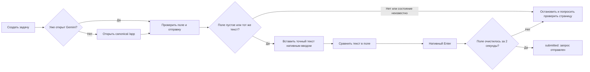

# Быстрая отправка одного запроса в Gemini

Этот режим создаёт короткую задачу, которая отправляет один введённый пользователем запрос в Gemini и завершает задачу после ограниченного подтверждения отправки. Он не ждёт ответа модели и не читает его.

## Как пользоваться

1. Откройте форму новой задачи и выберите **«Быстро отправить запрос в Gemini»**.
2. Введите текст в поле **«Текст для Gemini»**. Это единственный источник запроса: цель задачи не разбирается и не превращается в prompt.
3. Нажмите **«Создать задачу»**. Выбор режима явно разрешает одно автоматическое нажатие Enter для отправки этого текста в Gemini.
4. Следите за статусом задачи. **«Запрос отправлен»** означает, что исполнитель проверил текст перед отправкой и увидел, что поле ввода очистилось после Enter. Это не подтверждает получение ответа или его корректность.

Время старого полного сценария составляло около 91 секунды, из них 14,110 секунды до Enter. Сравнимого замера быстрого режима пока нет.

## Контракт задачи

В `TaskSpec` поле `workflow` необязательно и по умолчанию равно `agent`. Для быстрой отправки укажите `gemini_prompt_submit`. В MCP-инструменте `browser_task_start` `workflow` и `site_capabilities` также необязательны для обычной задачи, но быстрый режим требует их точных значений:

```json
{
  "profile_id": "default",
  "goal": "Submit the exact supplied prompt to Gemini once.",
  "goal_language": "ru",
  "allowed_origins": ["https://gemini.google.com"],
  "verbatim_text": "Точный запрос, строка 1\nСтрока 2",
  "execution_mode": "autonomous",
  "workflow": "gemini_prompt_submit",
  "site_capabilities": ["gemini_prompt_submit"],
  "success_conditions": [],
  "user_inputs": {},
  "secret_refs": [],
  "policy_grant_id": null,
  "limits": {"timeout_s": 900, "max_steps": 80},
  "idempotency_key": "a-new-unique-key-12345"
}
```

`verbatim_text` передаётся как есть, включая регистр, пробелы и переносы строк. Он должен содержать непустой текст. Для быстрого режима разрешён ровно один origin — `https://gemini.google.com`; `execution_mode` должен быть `autonomous`; capability должна быть ровно `gemini_prompt_submit`. Условия проверки ответа, пользовательские входы, ссылки на секреты и policy grant не поддерживаются. При создании задачи платформа выпускает ограниченное одноразовое разрешение для этой capability.

## Что делает исполнитель



Задача использует текущий профиль и одну каноническую вкладку. Если она находится на другом сайте, исполнитель переходит на `https://gemini.google.com/app` в этой же вкладке. Проверки используют Camoufox изолированный JavaScript-мир, а фокус, вставка и Enter выполняются настоящими действиями мыши и клавиатуры. `main_world_eval` не включён. См. [документацию Camoufox об изолированном и основном мирах](https://camoufox.com/python/main-world-eval/).

Перед вводом исполнитель проверяет, что открыт верхний frame точного origin Gemini и найден единственный видимый редактор. Диалоги авторизации, вложения, неизвестная структура поля или черновик с другим текстом блокируют отправку. Точно такой же уже введённый текст может быть проверен и отправлен без повторной вставки.

Capability используется непосредственно перед Enter. Если после Enter состояние не подтверждено, результат считается неизвестным: задача требует проверки человеком, а автоматического повтора нет. Так исполнитель не рискует отправить дубликат.

В этом workflow Fara не вызывается для разбора цели или подготовки текста: исполнитель получает prompt только из `verbatim_text` и делает ровно один фиксированный submit-action.

## Границы результата

Успех этой задачи означает только `phase="submitted"`: текст совпадал с заданным, Enter был отправлен, а редактор очистился в пределах двух секунд. Результат хранит `response_verified=false`; ответ Gemini не извлекается, не оценивается и не выдаётся за результат задачи. Это ограничение сохраняется даже если ответ позже появился на странице.

### Native-click update and live result - 2026-10-28

The fast worker now finds the single visible, enabled, semantically labeled send button in the isolated read-only page world. After exact prompt readback, it rechecks the button hit target and control epoch, consumes the one-use grant, and sends one native mouse click. New receipts report `submit_method="click"`, `submit_dispatched=true`, and `enter_dispatched=false`. The controller also accepts durable receipts from the previous Enter implementation.

Focused worker, runtime, and site-capability tests passed: **24 passed**. The full suite passed **258 tests, 6 skipped** in 43.10 seconds. The overlay images were built from the current production image tags and deployed to the existing Compose services with named volumes retained. Rollback tags are `browser-mcp-local-control:pre-fast-click-rollback-20261028` and `browser-mcp-local-browser:pre-fast-click-rollback-20261028`.

The earlier warm run (about 410 ms) exercised the Enter implementation and is not a native-click benchmark. The first cold native-click run, task `400bb425-f260-48bf-90e8-c927f7e802d3`, ended `recovering` / `ACTION_OUTCOME_UNKNOWN` after its navigation step, at about 4.754 seconds. It did not produce an applied submission receipt and is **not** a performance pass. No retry or further browser action was made after the unknown outcome. The old recovering task was canceled before this run.