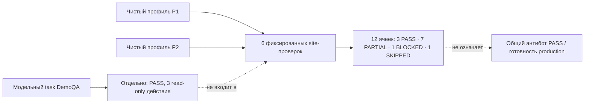

# Антибот-тесты — 31 октября 2026

**Состояние отчёта: завершён с ограничениями · production readiness: NOT CONFIRMED**

## Краткий вывод

Проведены ограниченные проверки в двух чистых профилях Camoufox и отдельная модельная проверка публичного DemoQA. В 12 фиксированных ячейках «сайт × профиль» получено **3 PASS, 7 PARTIAL, 1 BLOCKED и 1 SKIPPED**. Это итог именно этих сценариев, а не общий антибот PASS и не подтверждение готовности production.

| Профиль | PASS | PARTIAL | BLOCKED | SKIPPED |
|---|---:|---:|---:|---:|
| P1 | 1 | 4 | 1 | 0 |
| P2 | 2 | 3 | 0 | 1 |
| **Всего, 12 ячеек** | **3** | **7** | **1** | **1** |

Отдельный model-driven DemoQA task завершился статусом **PASS**: модель выполнила три read-only действия — `navigate → click → history_back`; независимые проверки подтвердили содержимое страницы Elements, возврат на главную и верификацию результата. Эта проверка **не входит** в 12 ячеек site-матрицы и ограничена одним сценарием на DemoQA.

Корректирующий EFF прогон завершён отдельно от 12 ячеек и получил `PARTIAL`. Human/manual lease удерживался 45 секунд и был подтверждённо освобождён; на дедлайне сводка не появилась, challenge не наблюдался, заблокированных ресурсов не зарегистрировано. Два последующих read-only наблюдения зафиксировали `/kcarter`, все пять summary predicates false и по одному заблокированному ресурсу с причиной `origin_not_allowed`. Это подтверждает запоздалый заблокированный cross-origin запрос, но не полную причинную цепочку: взаимодействие тайминга и политики маршрутизации не разрешено. Удержание lease 45 секунд не обеспечило завершение EFF диагностики; по этим данным нельзя оценивать защиту от трекеров. Исходные P1/P2 EFF остаются `PARTIAL`. Отчёт завершает именно описанную ограниченную серию, с указанными ограничениями.

## Среда и границы

- Созданы два отдельных чистых профиля P1/P2; для P2 зафиксированы новый volume и проверенный SHA образа. Cookies между профилями не импортировались.
- Изолированный test viewer: `http://localhost:18081/desktop`; headed Camoufox, viewport 1440×900, browser container 2816 MiB, maintenance включён; control container 768 MiB.
- Production viewer `:8090` не изменялся и не использовался для тестов. Финальная health-проверка: оба viewer `ready=true`, `owner=none`, по одному context/page. Production readiness — **NOT CONFIRMED**.
- Выполнялись заранее заданные ограниченные шаги и bounded проверки видимых URL/текста/состояния. Это не широкое исследование WAF. CAPTCHA и challenge не обходились.
- Финальная сверка среды подтвердила для обоих viewer `available=true`; production control image остаётся `browser-mcp-readiness-control:candidate`, а overlay `browser-mcp-antibot-control:prompt-3184fb4` установлен только на test viewer. Production prompt overlay не обновлялся.
- В проверенных test/runtime temp-путях raw PNG не осталось; сохраняется только безопасный санитизированный Sannysoft banner. Отдельная проверка исполнения сообщила: 8 script checks passed, все 20 JSON evidence успешно разобраны.



## Матрица site/profile

`PARTIAL` означает, что подтверждена только часть заранее заданных условий. `SKIPPED` означает, что ячейка не запускалась. Диагностические страницы не оценивают прохождение WAF.

| Сайт / тип | P1 | P2 | Что подтверждено и чего не хватает |
|---|---|---|---|
| Sannysoft · диагностика | PARTIAL | PARTIAL | Ожидаемый URL и фиксированные строки доступны; WebDriver missing (passed), Chrome missing (failed), permissions prompt. Advanced не проверен; plugins/languages — только наличие подписей. Не общий PASS. |
| BrowserLeaks · диагностика | PARTIAL | PARTIAL | Ожидаемые URL и JavaScript/WebGL подписи обнаружены; точная подпись `BrowserLeaks.com` отсутствует. Challenge-текст не обнаружен. |
| EFF Cover Your Tracks · диагностика | PARTIAL | PARTIAL | По одному CTA на профиль; итог и summary не подтверждены, challenge не обнаружен. Дополнительный P2 прогон: lease удержан 45 секунд и отпущен; на дедлайне summary нет, blocked counts пусты. Два post-deadline read-only снимка: `/kcarter`, summary predicates false, `origin_not_allowed: 1`. Диагностика не завершена; причина тайминга/политики полностью не установлена. |
| Amazon · гостевой путь | BLOCKED | SKIPPED | P1 остановлен на странице с текстом `Click the button below to continue shopping` / `Continue shopping`, до поиска. Причина неизвестна; это не доказательство CAPTCHA или конкретного bot detection. Ничего не нажимали и не повторяли. P2 пропущен после P1 blocker. |
| eBay · гостевой путь | PARTIAL | PASS | P1: поиск, карточка и history back проверены; точный signed-out marker подтверждён только после поиска, scroll не имеет отдельного receipt. P2: marker проверен до поиска; поиск, результаты, карточка, возврат и scroll подтверждены. Ограниченный публичный guest flow. |
| DemoQA · гостевой путь | PASS | PASS | Ограниченный read-only путь: главная → Elements → history back, с проверкой URL и видимых заголовков; challenge не обнаружен. Brand marker `DemoQA` не входил в критерий пути; ранняя P1 попытка была ошибочно остановлена лишним предикатом harness. |

### Отдельная модельная проверка DemoQA

```mermaid
sequenceDiagram
  participant U as Ограниченная задача
  participant M as Model client (P2)
  participant V as Независимая проверка
  U->>M: DemoQA: открыть Elements и вернуться
  M->>M: navigate → click → history_back
  M->>V: Завершение task, 3 действия
  V->>V: Elements URL + content; home URL; read-only=true
  V-->>U: PASS · phase verified · verified=true
```

Task `ca2d93cb-3156-4b11-a5e9-58722f91d789` завершился с `status=succeeded`, `phase=verified`, `step_count=3`, `verified=true`. В сохранённом evidence указаны три действия `navigate`, `click`, `history_back`, независимое наблюдение URL и содержимого Elements, возврат на домашний URL и только read-only действия. Независимая проверка живого UI/API подтвердила `succeeded`, `verified`, `result.verified=true`; helper подтвердил Elements URL/content, финальную главную страницу и read-only scope. Это единичный DemoQA task, не оценка общей надёжности модели и не дополнительная ячейка матрицы.

## Изменение prompt и проверки клиента

Commit `3184fb4` поправил обработку действий моделью: ждать загрузки и свежего скриншота; не повторять действие с неопределённым результатом; при блокировке обращаться к пользователю; объявлять завершение только после видимой проверки результата. В P2, только в изолированной тестовой среде, установлен control overlay `browser-mcp-antibot-control:prompt-3184fb4`; согласно provenance, source hash совпадает с тестовым control. **46 model-client unit tests passed.** Production `:8090` этот overlay не получал. Тесты и prompt fix проверяют клиентскую обработку, но не доказывают общий антибот PASS и сами по себе не подтверждают production readiness.

## Что остаётся проверить

1. **P0 — EFF:** реализовать ограниченную event-driven маршрутизацию для явно известных разрешённых origin и получение summary; не вводить постоянный публичный cross-origin bypass. Затем подтвердить завершение диагностики свежим evidence. Тайминг и политика пока не разведены.
2. **P0 — baseline:** провести отдельное сравнение в обычном headed browser, если нужна сравнительная оценка; такого baseline в этой серии нет.
3. **P1 — диагностика:** расширить безопасный сбор санитизированных результатов Sannysoft/BrowserLeaks и проверить недостающие bounded predicates; отсутствие challenge не считать успешной диагностикой.
4. **P1 — модель:** расширить покрытие отдельными read-only задачами; текущий model PASS относится только к одному DemoQA task.
5. Amazon P1 остаётся остановленным, P2 — пропущенным. Не нажимать Continue shopping и не повторять сценарий в рамках этого отчёта.
6. Production readiness остаётся `NOT CONFIRMED`: тестовый overlay не установлен в production. На момент финальной сверки временные raw PNG в проверенных путях отсутствовали; при новых запусках сохранять только санитизированные artifacts.

## Evidence

Все ссылки относительны к `docs/antibot-2026-10-31/`.

- Профили: [P2 provenance](evidence/p2-profile-provenance.json); [P1 Sannysoft metadata](evidence/sannysoft/p1/metadata.json), [safe banner](evidence/sannysoft/p1/page-banner.png); [P2 Sannysoft metadata](evidence/sannysoft/p2/metadata.json), [bounded outcomes](evidence/sannysoft/p2/outcomes.json).
- BrowserLeaks: [P1 JavaScript](evidence/browserleaks/p1/javascript-p1.json), [P1 WebGL](evidence/browserleaks/p1/webgl-p1.json), [P2 JavaScript](evidence/browserleaks/p2-javascript.json), [P2 WebGL](evidence/browserleaks/p2-webgl.json).
- EFF: [P1](evidence/eff/p1-metadata.json), [P2](evidence/eff/p2/metadata.json), [корректирующий прогон P2](evidence/eff/corrective-gate-hold/metadata.json), [два post-deadline read-only наблюдения](evidence/eff/corrective-gate-hold/post-deadline-observation.json). Корректирующий прогон остаётся PARTIAL: summary нет, поздний путь `/kcarter`, в каждом снимке `origin_not_allowed: 1`; полная причинная цепочка не установлена. Временная метка исходного P2 относится к post-click состоянию, не к точному времени начала.
- Amazon: [P1 guest flow](evidence/amazon/p1-metadata.json), [проверенный interstitial](evidence/amazon/verified-interstitial.json).
- eBay: [P1 home](evidence/ebay/p1-metadata.json), [P1 guest flow](evidence/ebay/p1-guest-flow.json), [P2 guest flow](evidence/ebay/p2/guest-flow.json).
- DemoQA: [P1](evidence/demoqa/p1-metadata.json), [P2 deterministic path](evidence/demoqa/p2/metadata.json), [P2 model task](evidence/demoqa/p2/model-task.json).

В evidence оставлены только bounded проверки и безопасные сводки; raw fingerprints, cookies, IP и авторизационные данные не публикуются. План сценариев: [`docs/15-antibot-compatibility-test-plan.md`](../15-antibot-compatibility-test-plan.md). Подробности prompt/client test принадлежат [RUNBOOK.md](RUNBOOK.md).
