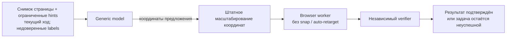
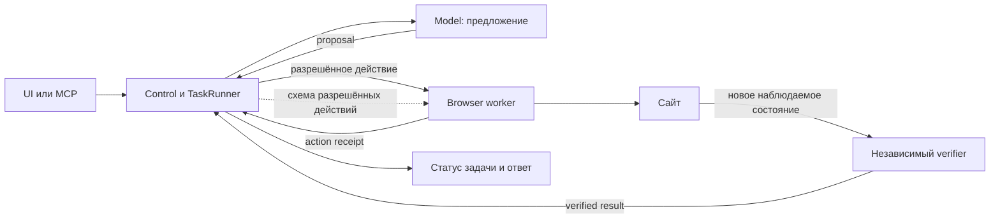
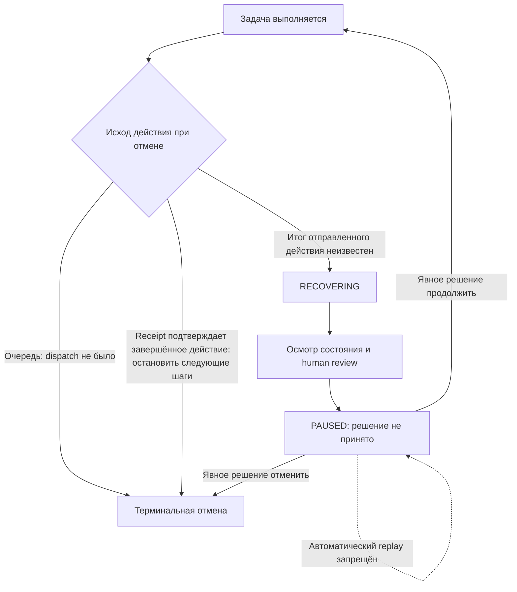
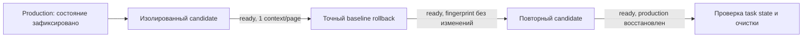

# Инженерный отчёт о готовности к выпуску

**Снимок состояния:** 30 октября 2026; bounded lifecycle/cookie bridge run PASS. Docker Desktop VM cap 8 GiB применён; production postflight пройден. Soak при VM 8 GiB / browser cgroup 4 GiB завершился FAIL через 670,56/900 с. Отдельный GC-контраст `memorygc4gb1` завершился как DIAGNOSTIC: после успешного запроса сбора памяти наблюдалось снижение cgroup memory и anon memory; без matched idle-only контроля его нельзя приписать именно запросу GC. NO-GO сохраняется.

**Решение:** **NO-GO для production release**, пока обязательные release gates не закрыты фактическими результатами.

## Краткое резюме

Повторяемость P0 подтверждена: checkbox и web_table прошли по 3/3 запуска; полный bounded G3 прошёл 8/8 с независимым verifier при лимитах 120 секунд / 30 шагов. Hints остаются opt-in/default-off и не включались в production. Свежий полный suite на 41438d8: 494 PASS / 8 SKIPPED / 0 FAIL за 91,46 с; [JUnit-derived summary](evidence/unit-suite-attribution-final.json). Предыдущие suite numbers остаются историческими; этот общий suite не является утверждением, что новые periodic-GC или memory-report CLI режимы были проверены live.

| Gate | Текущий статус | Основание / следующий результат |
|---|---|---|
| G0 — tests | **Проверки пройдены в указанном объёме** | Свежий полный suite на 41438d8: 494 passed / 8 skipped / 0 failed за 91,46 с. [JUnit-derived summary](evidence/unit-suite-attribution-final.json). Исторический suite 475/8/0 на 7bc09cf: [summary](evidence/unit-cookie-probe-summary.json). |
| G1 — API/MCP security | **PASS, bounded** | Auth/CSRF: 16/16; worker bearer проверен отдельными task-control checks. |
| G2 — worker/control integration | **PASS, bounded** | Runtime cancel/overlay и synthetic cookie bridge PASS на disposable stack. Cookie source — synthetic extension protocol; реальный Chrome E2E не выполнялся. |
| G3 — live browser + model | **PASS, bounded** | P0: checkbox 3/3 и web_table 3/3; full G3: 8/8. Только disposable конфигурация с MODEL_PROTOCOL=generic и BROWSER_OBSERVATION_HINTS=1; production setting остаётся выключенным. |
| G4 — cancel/restart/concurrency | **PASS, bounded** | Lifecycle PASS: uncertain response и RUNNING restart сохранили RECOVERING/review, по одному click на каждый сценарий, без redispatch; concurrent create отклонён с PROFILE_BUSY. |
| G5 — ресурсы/нагрузка | **FAIL: capacity blocker** | При VM 8 GiB / browser cgroup 4 GiB повторный soak также завершился FAIL: 670,56/900 с, 3 446 циклов, 106 замеров за 669,34 с, memory peak 99,998% и functional failures `MANUAL_ACTION_NOT_APPLIED:navigate` и cleanup/idle. OOM deltas остались 0 в сохранённых samples; причина не установлена. [Allowlisted timeline](evidence/soak-8gvm-4gb-failed.json). |
| G6 — deploy/rollback | **PASS, DB migration N/A** | Candidate rollback проверен; control DB schema не менялась относительно базы 96, изменён только storage redaction regex. |
| G7 — production release | **NO-GO** | Оба capacity soak завершились FAIL; повышенные лимиты продлили run, но второй тоже достиг почти 100% RAM hard limit и дал functional failure. Требуется устранить функциональный отказ и установить/снизить ресурсный рост, затем повторить 15-минутный soak. G2/G4 PASS ограничены указанными disposable сценариями. GC-контраст дал наблюдаемое снижение памяти, но причинность forced GC против естественного idle пока не установлена; matched idle-only контроль ожидает выполнения. |

### Последнее bounded runtime evidence: lifecycle и cookie bridge

Исходный runtime/demoqa/results-lifecycle-cookie2.jsonl содержит PASS для queued/in-flight cancel, overlay, lifecycle и cookie bridge. Lifecycle проверка прошла через scripts/readiness_lifecycle_integration.py:run_integration: при потерянном ответе task остаётся RECOVERING; единственный forwarded execute дал один click effect, action остаётся unresolved, restart не делает redispatch. Отдельный RUNNING restart также переводит task в review/recovery без повторного execute; fixture-проверка наблюдает один click. Concurrent create отклонён с PROFILE_BUSY; worker завершил сценарий с одним context/page.

Cookie bridge прошёл через scripts/readiness_cookie_bridge.py:_run: synthetic extension-protocol source маршрутизирован через ChromeBroker, TaskCookieImporter и WorkerClient. Отсутствующий и неоднозначный source блокируются до import. Проверены baseline MISSING → READY, импорт одного cookie для fixture и исключение unrelated origin; cookie value не записывается в task events. Это synthetic protocol integration, **не реальный Chrome extension или Chrome E2E**.

Агрегат содержит только allowlisted статусы, Boolean и counts; токены, URL, profile data и cookie values исключены. Lifecycle/cookie PASS не меняет release verdict. Soak15m1 при VM 4 GiB / browser cgroup 2,75 GiB завершился за 359,75/900 с, а повтор soak8gvm4gb1 при VM 8 GiB / browser cgroup 4 GiB — за 670,56/900 с. Второй запуск дольше работал, но также достиг почти 100% cgroup memory и завершился с `MANUAL_ACTION_NOT_APPLIED:navigate` и cleanup/idle failure. Это показывает, что увеличение бюджетов само по себе не устранило проблему; причина функционального сбоя и роста памяти не установлена, исправление не подтверждено. Production browser limit остаётся 2816 MiB. Текущий NO-GO сохраняется. [Сравнительная allowlisted timeline](evidence/soak-8gvm-4gb-failed.json) · [GC contrast summary](evidence/memory-gc4gb1-summary.json) · [Docker RAM change и postflight](evidence/docker-memory-change-summary.json).

### Диагностика памяти: изолированные и смешанный режимы

memoryprobe1 проверил отдельно навигацию, снимок экрана и подсказки наблюдения: по 420 операций за фазу, 31 замер, пик 73,20% cgroup-лимита, ошибок/OOM нет. Это диагностическая проба, не PASS по памяти и не исправление. [Агрегат с RSS-изменениями внутри фаз](evidence/memoryprobe1-summary.json).

memorymixed1 выполнил три смешанные фазы за 190,31 с: навигация+наблюдение (418 операций), навигация+клик+проверка (416), полный цикл (391). Во всех фазах росла anon memory; file memory оставалась около 500 MiB. Контент-процесс браузера и WebExtensions также росли внутри каждой активной фазы, но эти агрегаты не устанавливают единственную причину. Пик cgroup памяти — 1 939 750 912 / 2 952 790 016 B (65,69%); 30 замеров, ошибок и OOM-счётчиков — 0. Worker сохранял один context/page и освобождал control owner.

| Фаза | Δ anon, B | Δ file, B | Δ RSS, КиБ: Camoufox / Web Content / WebExtensions |
|---|---:|---:|---:|
| Навигация + наблюдение | +410 025 984 | +6 594 560 | +172 132 / +243 756 / +43 040 |
| Навигация + клик + проверка | +288 727 040 | +57 344 | +10 376 / +212 108 / +32 588 |
| Полный цикл | +300 232 704 | −20 234 240 | +51 128 / +195 648 / +30 472 |

RAM и RSS указаны как изменение от первого к последнему замеру каждой фазы, не как абсолютное сравнение между фазами. Полная allowlist-сводка: [memorymixed1-summary.json](evidence/memorymixed1-summary.json).

#### Live bounded GC-контраст: memorygc4gb1

В смешанном диагностическом workload (404 полных цикла) запрос GC подтвердился. Независимая проверка в 17:08:02.693898 UTC подтвердила стабильность identity и generation, один context/page и idle состояние; значения идентификаторов не сохранялись.

| Метрика | Перед запросом, 17:07:54.6077964 UTC | После запроса, 17:08:00.8861808 UTC | Δ (после − до) |
|---|---:|---:|---:|
| cgroup memory | 3 128 995 840 B (2 984,04 MiB) | 2 569 310 208 B (2 450,29 MiB) | −559 685 632 B (−533,76 MiB) |
| anon | 1 251 229 696 B (1 193,27 MiB) | 696 233 984 B (663,98 MiB) | −554 995 712 B (−529,29 MiB) |
| file | 1 842 036 736 B (1 756,70 MiB) | 1 842 036 736 B (1 756,70 MiB) | 0 B |
| Web Content RSS | 615 272 KiB (600,85 MiB) | 222 180 KiB (216,97 MiB) | −393 092 KiB (−383,88 MiB) |
| Browser parent RSS | 643 884 KiB (628,79 MiB) | 560 972 KiB (547,82 MiB) | −82 912 KiB (−80,97 MiB) |
| WebExtensions RSS | 251 664 KiB (245,77 MiB) | 187 688 KiB (183,29 MiB) | −63 976 KiB (−62,48 MiB) |
| Python / Node RSS | 151 624 / 120 040 KiB | 151 624 / 120 040 KiB | 0 / 0 KiB |

File memory не изменилась; снижение пришлось главным образом на anon и наблюдаемые RSS процессов браузера. Это указывает, какие группы памяти изменились в этом окне, но не устанавливает, что именно вызвало снижение. Перед запросом было около 2 с idle, после — 8 с idle; второй sample снят внутри post-request окна. Matched idle-only run ещё не выполнен. Поэтому результат — диагностический сигнал, не доказательство исправления или live mitigation; два 15-минутных capacity soak остаются FAIL, production — NO-GO. OOM и OOM-kill counters в обоих выбранных samples равны нулю. [Allowlisted GC evidence](evidence/memory-gc4gb1-summary.json).

#### Пятивариантная матрица attribution (`memory-attribution-matrix/v1`)

Пять bounded-прогонов завершили по 600 одинаковых циклов. Для каждого подтверждены тот же общий seed Camoufox 0.4.11, matching worker configuration, стабильная identity, один context/page и отсутствие error codes. Измеренная скорость на отрезке cycle 100–600 была 6,65–6,97 cycles/s. Host sampler снимал RSS процессов и cgroup `anon`/`file`; для графика использованы только точки до `workload_end`, а для таблицы idle — ближайший host sample к `contrast_end` примерно через 25 секунд после cycle 600. Каждый host sample привязан к UTC и signed offset относительно cycle timestamp в [allowlisted JSON](evidence/memory-attribution-matrix.json).

| Вариант | Web Content RSS, cycle 100 → 600 | Δ Web Content RSS | `anon` на cycle 600 → ~25 s idle | `file` на cycle 600 → ~25 s idle |
|---|---:|---:|---:|---:|
| Baseline | 241,6 → 653,7 MiB | +412,1 MiB | 1 628,1 → 775,7 MiB (−852,4) | 237,6 → 237,6 MiB |
| No action snapshots | 279,6 → 685,2 MiB | +405,7 MiB | 1 557,1 → 831,7 MiB (−725,4) | 229,5 → 229,5 MiB |
| No default addons | 271,5 → 805,9 MiB | +534,4 MiB | 1 234,4 → 1 210,8 MiB (−23,7) | 91,2 → 91,2 MiB |
| No snapshots + no addons | 245,7 → 745,1 MiB | +499,4 MiB | 1 158,9 → 1 082,8 MiB (−76,1) | 91,2 → 91,2 MiB |
| Baseline + GC contrast | 350,4 → 531,7 MiB | +181,3 MiB | 1 461,9 → 675,8 MiB (−786,1) | 229,6 → 229,6 MiB |

Главный вывод: рост RSS процесса Web Content сохранялся во всех вариантах. Отключение action snapshots практически не изменило рост относительно baseline; отключение addons уменьшило RSS WebExtensions, но не предотвратило рост Web Content. Поэтому neither вариант также продолжил расти. Это указывает, что измеренный рост Web Content не зависит от наличия default addons или action snapshots в этом bounded случае. WebExtensions показывал отдельные стартовые/пиковые всплески, но рост page-content процесса возникал и без него; Python/Node RSS менялись заметно меньше. Эти измерения не определяют конкретную подсистему браузера и не доказывают leak.

В baseline естественный idle за ~25 секунд снизил `anon` на 852 MiB при неизменной `file`. В no_addons после такого же idle `anon` почти не снизился. В GC-contrast большинство снижения `anon` произошло в первые 15 секунд естественного idle до explicit GC request; ближайшая последующая выборка была примерно на 32 MiB ниже. Idle продолжался и во время GC-окна, поэтому этот остаточный сдвиг нельзя приписать принудительному GC. Это диагностическое наблюдение, не forced-GC mitigation или доказанное исправление. [График Web Content RSS](REPORT.html) · [Полная матрица и timestamps](evidence/memory-attribution-matrix.json).

Отдельный эксперимент с periodic GC (шесть запросов за 600 циклов без добавленных пауз) и более intrusive memory-report endpoint ещё готовятся; результатов нет. Матрица не меняет NO-GO и сама не закрывает 900-секундный capacity gate.

#### Среда и ограничения причинного вывода

Docker сообщает MemTotal 8 384 647 168 B после увеличения VM cap с 4096 до 8192 MiB. Изменена только настройка MemoryMiB; после диагностического прогона production containers были восстановлены. Независимый postflight подтвердил ready production, 29 задач (одна suspended/waiting_human), неизменные profile fingerprints. Disposable soak подтвердил временный browser cgroup limit 4 294 967 296 B (4 GiB), тогда как production browser limit остался 2816 MiB. Soak достиг 4 294 901 760 B (99,998% hard limit); host cgroup OOM/OOM-kill/group-kill deltas — 0 среди сохранённых samples. Подробная очищенная timeline: [soak-8gvm-4gb-failed.json](evidence/soak-8gvm-4gb-failed.json). [Сводка VM change/postflight](evidence/docker-memory-change-summary.json).

Счётчик cgroup OOM равен нулю; Docker OOM не установлен, давление памяти всей VM не измерялось. Наблюдения не указывают на единственную причину роста.

#### Следующие проверки

1. Разобрать `MANUAL_ACTION_NOT_APPLIED:navigate` и рост/удержание памяти в одном и том же bounded workload.
2. После конкретного исправления повторить 900-секундный soak с теми же workload, sampling и критериями. Ни увеличение VM/browser лимитов, ни unit-тесты сами по себе не закрывают G5. Live GC contrast завершился как диагностика; снижение памяти наблюдалось, но matched idle-only сравнения ещё нет, поэтому это не доказанный fix.

### G5 · повторный soak при увеличенных лимитах (soak8gvm4gb1)

| Измерение | Результат | Gate |
|---|---:|---|
| Условия | VM 8 GiB; временный browser cgroup 4 GiB; production browser limit 2816 MiB | Disposable only |
| Длительность / cycles | 670,56 / 900 с; 3 446 cycles | FAIL: duration |
| Samples / coverage | 106 / 669,34 с | FAIL: <885 с |
| Memory peak | 4 294 901 760 / 4 294 967 296 B (99,998%) | FAIL: threshold <90% |
| PID peak | 189 / 512 (36,91%) | PASS по PID бюджету |
| Median memory growth: последние 36 минус первые 36 samples | 481 738 752 B (11,22% limit) | FAIL: budget ≤10% |
| OOM / OOM-kill / group-kill deltas | 0 / 0 / 0 в сохранённых samples | Без OOM-события в этом окне |
| Functional outcome | `MANUAL_ACTION_NOT_APPLIED:navigate`; `cleanup_or_idle_invariant_failed` | FAIL |
| HTTP failure counters | API 0; action 0 | Не отражают functional failure counters; soak всё равно FAIL |

Оба soak завершились у потолка памяти: исходный VM 4 GiB / browser 2,75 GiB run остановился на 359,75 с и 99,88%; повторный VM 8 GiB / browser 4 GiB run дошёл до 670,56 с, но достиг 99,998% и также завершился функциональной ошибкой. Увеличение лимитов продлило прогон, но не закрыло G5 и не устанавливает причину. [Sanitized measurements and relative timeline](evidence/soak-8gvm-4gb-failed.json). GC diagnostic live comparison завершился; наблюдаемое снижение памяти не отделено от естественного idle, matched control ожидается.

### G5 · первый неуспешный capacity run (soak15m1)

| Измерение | Результат | Gate |
|---|---:|---|
| Длительность | 359,75 / 900 с | FAIL |
| Циклы / API / manual actions | 2 138 / 11 042 / 6 414 | run остановлен |
| Samples / покрытие | 59 / 356,58 с | FAIL: <60 и <885 с |
| Memory peak | 2 949 316 608 / 2 952 790 016 B (99,88%) | FAIL: threshold <90% |
| PID peak | 185 / 512 (36,13%) | PASS по PID бюджету |
| Median growth: последние 20 минус первые 20 samples | 48,95% memory limit (1 445 380 096 B) | FAIL: budget ≤10% |
| OOM, OOM-kill, group-kill deltas среди samples | 0 / 0 / 0 | PASS только в наблюдённом sample window |
| Functional outcome | BROWSER_UNAVAILABLE:api; cleanup_or_idle_invariant_failed | FAIL |

Memory event counter max вырос на 319; он не является OOM counter. Из-за прерывания run PS summary не заполнил итоговые поля; таблица рассчитана напрямую из 59 complete raw samples. [Sanitized allowlisted measurements](evidence/soak-failed-1.json); исходные метрики остаются локальным runtime evidence.

### Текущие bounded результаты и ограничения

- P0: checkbox — 3/3 PASS; web_table — 3/3 PASS. Full G3 — 8/8 PASS с независимой проверкой, 120 с / 30 шагов на сценарий.
- Свежий полный suite на source revision 41438d8: 494 passed, 8 skipped, 0 failed за 91,46 с; группировка тестовых файлов рассчитана из JUnit XML. [Сводка текущего suite](evidence/unit-suite-attribution-final.json). Предыдущие 486/8/0 на ffa80c1 и 475/8/0 на 7bc09cf — исторические baselines. Unit suite не доказывает live periodic-GC или memory-report эффекты. Отдельный GC contrast завершился с наблюдаемым снижением памяти; forced-GC causality и production memory improvement не доказаны, matched idle control ожидается.
- Runtime cancellation, overlay, lifecycle и cookie bridge integration прошли в bounded disposable runs. См. lifecycle-cookie2-summary.json. Cookie bridge использовал synthetic extension protocol через ChromeBroker → TaskCookieImporter → WorkerClient; это не реальный Chrome E2E. Проверены блокировки при отсутствии/неоднозначности source, baseline MISSING → READY, исключение unrelated cookie и отсутствие cookie value в task events.
- Hints включались только для disposable test worker через BROWSER_OBSERVATION_HINTS=1; в production feature остаётся default-off.
- Исправления текущей ревизии включают тестовую конфигурацию: MODEL_PROTOCOL передаётся control, BROWSER_OBSERVATION_HINTS передаётся browser только для проверки; эта wiring не активирует hints в production.
- Короткий предварительный soak-smoke2: 209 циклов / 30,14 с / 0 ошибок, память 34,93%, OOM=0. Оба capacity run завершились FAIL: soak15m1 — 359,75 с, 2 138 циклов, 99,88%, API failure и cleanup/idle failure; soak8gvm4gb1 — 670,56 с, 3 446 циклов, 99,998%, functional navigation failure и cleanup/idle failure.
- Capacity gate остаётся FAIL даже при VM 8 GiB / browser cgroup 4 GiB: повторный run занял 670,56/900 с, 106 samples покрыли 669,34 с, peak 99,998%, PID peak 36,91%, median growth последних 36 минус первых 36 samples 11,22% лимита (budget ≤10%); функциональные сбои `MANUAL_ACTION_NOT_APPLIED:navigate` и cleanup/idle. OOM deltas — 0 среди сохранённых samples. Более высокий лимит продлил прогон, но не исправил failure. [Новый run и измеренная timeline](evidence/soak-8gvm-4gb-failed.json); первый run: [soak-failed-1.json](evidence/soak-failed-1.json).
- Product guidance пока описывает проверку ожидаемого account, но нет жёсткого typed identity proof. Не заявляется готовность всех авторизованных сайтов. Данные не подтверждают at-rest encryption или наличие vault.
- Отчёт о неуспешной попытке сохранён как [soak-failed-1.json](evidence/soak-failed-1.json) и построен только из измеренных samples. Успешный soak-summary.json не создан. Bounded lifecycle/cookie агрегат сохранён отдельно в evidence/lifecycle-cookie2-summary.json; это не capacity evidence.

~~~mermaid
stateDiagram-v2
    [*] --> Planned: action planned persisted
    Planned --> WorkerEffect: one worker execute
    WorkerEffect --> ReplyLost: response held or dropped
    ReplyLost --> Recovering: task requires review
    Recovering --> RestartReview: reopen database and runner
    RestartReview --> NoReplay: no automatic redispatch
    NoReplay --> [*]: independent effect and idle-worker checks
~~~

Состояния на диаграмме — контракт lifecycle сценария. Lifecycle rerun завершён с bounded PASS; см. актуальное evidence выше. Более широкий охват за пределами synthetic fixture остаётся отдельной задачей.

## Текущий follow-up: P0 и полный G3 (30 октября 2026)

На коде продукта из коммита `7f5151d` bounded observation hints были включены только в disposable worker для этой проверки (`BROWSER_OBSERVATION_HINTS=1`, action trace выключен). Feature остаётся **opt-in, default-off и не развёрнута в production**. Три отдельных прогона дали по 3/3 PASS для checkbox и web_table; затем полный набор прошёл 8/8 с независимой проверкой. Лимиты полного набора: 120 секунд и 30 шагов на сценарий. Суммарное wall time сценариев — 385,48 с; это измерение конкретного прогона, не latency/SLO вывод.

| P0-критичный сценарий | Прогон 1 | Прогон 2 | Прогон 3 | Результат |
|---|---:|---:|---:|---|
| checkbox | PASS, 3 шага, 31,286 с | PASS, 3 шага, 29,247 с | PASS, 3 шага, 29,249 с | **3/3 PASS** |
| web_table | PASS, 15 шагов, 113,373 с | PASS, 15 шагов, 111,380 с | PASS, 15 шагов, 115,385 с | **3/3 PASS** |

| Полный G3, hints-fullg3 | Шаги | Время | Независимая проверка |
|---|---:|---:|---|
| text_box | 9 | 69,40 с | PASS |
| invalid_email | 11 | 93,42 с | PASS |
| checkbox | 3 | 31,17 с | PASS |
| radio | 1 | 12,96 с | PASS |
| double_click | 3 | 28,97 с | PASS |
| web_table | 15 | 111,31 с | PASS |
| dynamic | 1 | 19,31 с | PASS |
| notify_then_click | 2 | 18,94 с | PASS |
| **Итого** | **45** | **385,48 с** | **8/8 PASS** |

Каждый full-G3 сценарий завершился `succeeded`, имел `independent_verified=true`, `baseline_verified=false` и один context/page. Evidence намеренно содержит только агрегаты и allowlisted поля: [полная сводка G3](evidence/p0-hints-full-g3.json). Для трёх P0 повторов: [run 1](evidence/p0-hints-1.json), [run 2](evidence/p0-hints-2.json), [run 3](evidence/p0-hints-3.json). Эти цифры подтверждают успешное выполнение только указанного набора на disposable stack; они не доказывают production rollout, устойчивость на произвольных сайтах или улучшение latency. В P0-повторах были промахи до попадания в expander/поле, поэтому результат не означает безошибочное наведение.

Hints содержат ограниченный набор видимых элементов и геометрию относительно того же снимка; значения полей не передаются. Они не меняют policy, не выбирают цель автоматически, не корректируют координаты и не ослабляют независимую проверку. Postflight production остался ready/idle; 29 задач и историческая waiting-human задача не изменились. Последний полный suite на коммите 7bc09cf: **475 passed, 8 skipped, 0 failed** за 88,30 с ([сводка](evidence/unit-cookie-probe-summary.json)). Шесть сфокусированных тестов harness на a0cc278 прошли; полный suite на a0cc278 не запускался. Шесть skip связаны с изолированными Camoufox/X11 или disposable browser окружениями; два opt-in real-worker checks исполняются отдельными CLI и проверены отдельно.

**Решение остаётся NO-GO.** P0 воспроизводимость и full G3 в opt-in test конфигурации выполнены, но feature не включена в production. Runtime cancel, overlay, lifecycle и synthetic cookie bridge прошли bounded integration checks; это не реальный Chrome E2E. soak15m1 завершился FAIL через 359,75/900 с при memory peak 99,88%; короткий smoke не закрывает capacity gate. Storage redaction regex изменён, но control DB schema относительно базы 96 не менялась, поэтому migration gate для candidate N/A. Upload, browser dialog, frame targeting и multiple windows не запускались и не считаются поддержанными этим evidence. Авторизованные account scope остаются ограниченными: hard typed identity proof не реализован.

---

## Как результат проходит через систему

Запрос приходит через UI или MCP, управление задачей формирует предложение модели и передаёт разрешённое действие worker-у. Worker воздействует на сайт. Отдельный verifier сравнивает наблюдаемое состояние с условием успеха. Три уровня результата нельзя смешивать: **proposal** — что модель предлагает; **action** — что worker получил/применил; **verified result** — что независимая проверка действительно увидела на странице.

Положительный receipt сам по себе не равен результату: synthetic overlay test зафиксировал receipt `applied`, хотя overlay перехватил клик и целевой элемент не активировался. Именно поэтому итоговые UI PASS опираются на независимое подтверждение состояния.

## Исторический снимок live UI до opt-in hints: восемь сценариев

Для каждого PASS был указан независимый verifier. Время — зафиксированное wall time конкретного запуска, не прогноз производительности. Сценарии synthetic и не включают реальные аккаунты, покупки или отправку сообщений.

| Сценарий | Результат | Шаги | Время | Проверка / основание |
|---|---:|---:|---:|---|
| `text_box` | **PASS** | 9 | 57.71 с | Поле заполнено; независимая проверка прошла |
| `invalid_email` | **PASS** | 14 | 98.05 с | Невалидный email обработан ожидаемым UI путём; проверка прошла |
| `notify_then_click` | **PASS** | 10 | 102.15 с | Действие после уведомления подтверждено verifier-ом |
| `radio` | **PASS** | 4 | 47.20 с | Выбор radio подтверждён независимо |
| `double_click` | **PASS** | 7 | 99.24 с | Двойной клик подтвердил ожидаемое состояние |
| `dynamic` | **PASS** | 1 | 15.21 с | Динамический элемент найден и проверен |
| `checkbox` | **FAIL** | 16 | 191.98 с | `TASK_EXPIRED`; Home раскрылся и 4 checkbox role были видны, но Desktop остался unchecked. Предыдущая ошибка формы вывода `MODEL_OUTPUT_INVALID` устранена, однако end-to-end условие не достигнуто. |
| `web_table` | **FAIL** | 20 | 186.27 с | `TASK_EXPIRED`; требуемая строка не была независимо подтверждена до deadline. |

История отказов сохранена: в readiness2 checkbox завершился `MODEL_OUTPUT_INVALID` после 2 шагов, а web_table — `TASK_EXPIRED` после 23 шагов/185.48 с. Исправление prompt убрало именно ранний shape error checkbox, но targeted4 всё ещё завершился с checkbox unchecked и повторным timeout web_table. Оба отказа учитываются как FAIL, а не переименовываются в setup block.

## Исправления в коде и тестовой инфраструктуре

| Область | Было | Стало | Проверка | Ограничение |
|---|---|---|---|---|
| Продукт: приватность API/MCP | Чувствительные пользовательские значения могли попадать в ответы/повторное использование задачи. | Значения редактируются в API/MCP ответах; при повторе секрет требуется ввести заново, он не копируется из прошлой задачи. | Полный pytest на `b8c319a`; commit `953bf8d` добавил secret re-entry. | Не доказывает отсутствие всех классов утечки во всех интеграциях. |
| Продукт: транспорт и отмена | Chunked HTTP body мог читаться без достаточной границы; неизвестный исход действия мог выглядеть как завершённая отмена. | Чтение body ограничено; неопределённый outcome остаётся `RECOVERING` и требует review, без автоматического replay. | Regression suite и отдельный `runtimeint3`: in-flight action observed, `RECOVERING`, без replay; worker вернулся ready/idle. | Это подтверждает один bounded controlled case, не все uncertain-response, restart или concurrency варианты. |
| Продукт: инструкции модели и формы действий | Общая guidance недостаточно чётко задавала доверие к источникам, аргументы действий, деревья и формы. | Уточнены generic prompt и требования к shape/аргументам действий, работа с деревьями и формами (`43b3dad`, `c895246`, `ac8a7bf`). | 40 focused prompt cases PASS; synthetic Chromium smoke PASS; live targeted retest. | Не все ошибки модели исправлены: checkbox и web_table остаются FAIL. |
| Тестовая инфраструктура: запуск и конфигурация | Неоднозначные test URLs/cookie sync, нестабильный startup extension worker и некорректная обработка завершения/отчёта. | Уточнены URLs, sync отключён явно; стабилизирован generic auto setup/startup; поправлены failed-exit и evidence export. | Соответствующие regression cases входят в полный pytest; итоговые live security/cancel summary экспортированы. | Инфраструктурный PASS не является продуктовой capability проверкой. |
| Тестовая инфраструктура: очистка и владение | Остановленные fixtures от предыдущих запусков учитывались как leftovers текущего прогона и давали ложный failure. | Cleanup отличает pre-existing stopped fixture IDs от ресурсов текущего запуска; проверяются новые leftovers, поправлен per-run ownership/exit/report путь. | Regression suite и проверки cleanup/restore в control3. | Targeted4 runner не дошёл до собственного profile digest postcheck после сценарных FAIL; отдельный read-only postflight подтвердил digest. |
| Тестовая инфраструктура: Windows/Docker | Rollback harness некорректно читал Docker labels из-за quoting; ручной запуск без init зависал на Xvfb. | Исправлен Windows quoting (`b8c319a`); audit повторён корректным способом с init. | Shim guard tests входят в 418 pytest PASS; candidate → baseline → candidate прошёл. | Ранний запуск без `--init` — NOT RUN, а не browser PASS. |

Тестовая дисциплина: шесть native runtime wrapper тестов отмечены как **SKIPPED** в полном host pytest и не выполнялись там. Отдельный `test_runtime_audit` прошёл в disposable browser image; эти две группы не следует смешивать.

## Неопределённый исход отмены

Если отмена приходит после передачи действия, система не может считать, что сайт его не выполнил: ответ мог потеряться после эффекта на странице. В этом случае задача остаётся в `RECOVERING`; автоматический повтор запрещён, поскольку он способен применить внешнее действие дважды. Следующий шаг — наблюдение/review и сверка результата. Схема ниже концептуальная: подписи переходов описывают условия, а не точные enum/API статусы; verifier не переводит задачу в `COMPLETED` автоматически.

Фактический control smoke достиг стабильного `RECOVERING`, выдержал 2 секунды без дополнительных planned actions и оставил worker ready/idle с одним context/page. Это подтверждает bounded поведение control smoke, но **не** отмену уже dispatched/in-flight действия, рестарт TaskRunner или concurrency.

## Изолированный deployment rollback

Rollback проверялся отдельным Compose project и раздельными volumes control/worker; host profiles не монтировались. Fingerprint профиля оставался неизменным, production task state совпал до и после, временные контейнеры удалены, production восстановлен.

Изолированный candidate → baseline → candidate rollback прошёл. Для этого candidate control DB schema не менялась относительно базы 96; изменён только storage redaction regex, поэтому DB migration gate N/A. Это не утверждение о будущих schema migrations.

## Ресурсы и границы измерений

В bounded Live2 read-only прогоне было 6/6 HTTP 200 при concurrency 2 и 3 итерациях; p95 — 14.23 мс. Browser container достиг peak **1,522,884,608 B из 2,952,790,016 B (51.58%)**, PID peak **189/512**, OOM/OOM-kill/high counters — 0; отмечено 6 throttled CPU periods.

Soak15m1 завершился FAIL на 359,75 с с 2 138 циклами; сохранены 59 валидных samples за 356,58 с. Peak memory 99,88% лимита и memory growth превышают budgets; API unavailable и cleanup/idle invariant также завершились failure. PIDs были в пределах budget; OOM/kill counters не увеличились среди сохранённых samples. API отказ совпал с почти исчерпанной памятью, но причинная связь ещё не установлена. Исправление/диагностика компонента и повторный capacity run ожидаются.

## Остаточные риски

- Checkbox и web_table — повторяемые live path failures, подтверждённые targeted retest.
- Нативные dialog и file upload не поддержаны/не проверены; overlay test показал корректный BLOCKED при перехвате клика. Worker edge audit: 8 PASS, 0 FAIL, 4 BLOCKED, в том числе overlay, dialog, upload и worker-only cancel. Iframe был подтверждён только synthetic fixture.
- Runtime audit и восстановление после закрытия страницы/SIGKILL прошли. Bounded `runtimeint3` подтвердил queued cancellation и один in-flight `RECOVERING` сценарий; он не заменяет тесты uncertain response, restart во время каждого этапа dispatch или concurrency.
- Readiness1 security export имел ошибку; его можно считать только summary 16 checks. Поздний control3 export успешно подтвердил реализованную матрицу 16/16.
- Успешный model smoke был локальной synthetic Chromium fixture, 4 шага за 17.82 с; он не включал Camoufox и полный control↔worker/MCP/UI путь. Отдельный smoke 18.288 с также не является полным G3.
- G6 не проверил migration marker control DB; миграционная совместимость и DB rollback не доказаны.
- Внешний egress/proxy, stealth/CAPTCHA и multi-worker readiness не входят в подтверждённые PASS.

## План доделок и выпускной критерий

P0-критерий трёх последовательных PASS на checkbox и web_table и повтор полного G3 теперь выполнен в bounded disposable конфигурации. Исходная таблица ниже сохраняется как план, записанный до этих результатов; дальнейшие P1/release gates остаются открытыми.

Аудит завершён, работа над продуктовой готовностью — нет. По имеющимся evidence unrestricted production release рекомендовать нельзя. Сначала нужно закрыть два доказанных live отказа. Ограниченный пилот допустимо рассматривать только для явно описанного поддерживаемого потока, после отдельного решения владельца выпуска и проверки его критериев; текущие результаты сами по себе не являются рекомендацией запускать production или пилот.

### P0 — выполнено в bounded disposable scope

Критерий выполнен: checkbox и web_table прошли по три независимых свежих повтора, затем full G3 дал 8/8 PASS. Feature hints остаётся opt-in/default-off и не развёрнута в production. Ниже приведён план, написанный до завершения этих прогонов; он сохранён как исторический контекст, не как открытые P0 задачи.

| Задача | Владелец по роли | Зависимости | Критерий приёмки |
|---|---|---|---|
| Установить причину checkbox и web_table FAIL до изменения prompt/поведения. Снять минимальную санитизированную трассу: тип действия (`kind`), координаты, задержки, имена полей схемы, наблюдения до/после и ожидаемая/фактическая цель. Не включать введённый текст, секреты или raw reasoning модели. | Владелец browser automation; совместно с тестированием | Повторяемый disposable stack и synthetic fixtures | Для каждого шага можно сопоставить proposal/action receipt с фактической целью и следующим наблюдением; причины различают ошибку выбора модели/vision от неверного ввода/координаты или недостатка наблюдений. Трасса не содержит пользовательского ввода, секретов или chain-of-thought. |
| Добавить маленькие детерминированные fixtures: раскрытие tree expander с отдельным checkbox target; отдельно — небольшую таблицу с фокусом/целью на конкретной строке. Сравнить ожидаемый hit target с фактическим hit target/координатой и проверяемым состоянием страницы. | Владелец тестовой инфраструктуры | P0 трассировка; доступные verifier assertions | Fixture стабильно создаёт исходное состояние; verifier отдельно проверяет, что раскрылась нужная ветка и checkbox checked, а в таблице изменилась нужная строка; тест отличает неверную цель/координату от правильного действия с неверным наблюдением/верификацией. |
| Исправить установленную первопричину ограниченным изменением и повторить исходные сценарии с прежним пределом 180 с / 40 шагов. Не проводить слепые prompt retries: каждый новый прогон должен проверять конкретную гипотезу о причине. | Владелец browser automation; ревью тестирования | Причина установлена; fixture и acceptance assertions готовы | Checkbox действительно checked, строка внесена; оба условия подтверждены независимым verifier до deadline. Никаких ложных PASS по receipt или тексту модели. |
| Подтвердить устойчивость исправления несколькими свежими прогонами. Предлагаемый выпускной порог — **3 последовательных PASS на каждый критичный сценарий** в disposable stack, затем повтор полного обязательного G3. | Владелец тестирования / release owner | Предыдущие пункты P0 | Порог записан до прогонов; он выполнен в текущем follow-up выше: три последовательных PASS на каждый критичный сценарий и full G3 8/8. |

P0 закрывает только подтверждённые UI failures. Он не закрывает автоматически необязательные функции, concurrency, capacity или DB migration evidence: их обязательность следует определить в release contract.

### P1 — закрыть, если входит в release contract

| Работа / статус для GO | Владелец по роли | Зависимости | Критерий приёмки |
|---|---|---|---|
| Dialog, file upload и расширенная overlay capability остаются непроверенными/неподдержанными по заявленному contract. Один bounded overlay test подтвердил безопасное поведение при перехвате: receipt `applied`, но task завершился `waiting_human/verification_required` без подтверждения целевого эффекта. **Обязательно для GO, если заявленная поддержка включает эти действия.** | Владелец browser worker | Явная политика разрешённых действий и безопасные synthetic fixtures | Для dialog/upload есть отдельные поддержанные операции и независимая проверка; при перехваченном клике task/verifier не сообщает достижение целевого результата без фактического эффекта. Неподдерживаемый путь явно блокируется. |
| In-flight cancellation, busy/profile ownership, uncertain dispatch и запрет повторного side effect; один controlled in-flight case завершился `RECOVERING` без replay, bounded lifecycle contract проверен на synthetic fixture; охват на произвольных внешних сайтах не доказан. **Обязательно для GO, если разрешены внешние действия с возможным повторным эффектом или concurrent tasks.** | Владелец control/TaskRunner | Трассируемый dispatch lifecycle; управляемый synthetic endpoint | Расширить проверку cancel до dispatch, во время dispatch и после неизвестного ответа; отсутствие автоматического replay; idempotent/stable status; подтверждённая сверка результата; profile/context/page инварианты при занятости и recovery. |
| Cookie source, live identity/account policy и log redaction. **Synthetic cookie bridge integration прошёл; реальный Chrome E2E и live identity/account policy остаются открытыми для авторизованных сессий или чувствительных данных.** | Владелец security/privacy | Завершить тест cookie-source и зафиксировать identity/session policy | Проверить ожидаемый account перед действием и перед отправкой; hard typed identity proof пока отсутствует. Не заявлять поддержку всех авторизованных сайтов; at-rest encryption/vault не подтверждены. |
| Soak/capacity. **Оба run завершились FAIL.** Повторный soak при VM 8 GiB / browser cgroup 4 GiB шёл 670,56/900 с и достиг 99,998% memory; функциональные сбои — navigate not applied и cleanup/idle. | Владелец SRE/performance | Разобрать functional failure и рост/удержание памяти; после исправления повторить 15-минутный смешанный прогон. Условия PASS: ≤90% memory/PID, OOM=0, рост медиан ≤10% лимита, ≥60 samples за ≥885 с. | [Первый run](evidence/soak-failed-1.json); [повторный run и timeline](evidence/soak-8gvm-4gb-failed.json); [memorymixed1 diagnostic](evidence/memorymixed1-summary.json); [live GC contrast](evidence/memory-gc4gb1-summary.json). capacity PASS нет. |
| Control DB migration/rollback marker. **N/A для текущего candidate:** control DB schema не менялась относительно базы 96; изменён только storage redaction regex. | Владелец control persistence / release engineering | Пересмотреть применимость при следующем изменении schema | Нынешний candidate rollback evidence не заявляет DB migration coverage и не требует schema migration. |

### P2 — расширение уверенности, не текущие доказанные блокеры по умолчанию

| Работа | Владелец по роли | Зависимости | Критерий результата |
|---|---|---|---|
| Расширить synthetic browser dataset: динамические элементы, iframe, shadow DOM, overlay и вариации форм. | Владелец QA automation | P0 deterministic fixtures | Повторяемые regression cases с независимыми assertions; BLOCKED и unsupported cases остаются раздельными от PASS. |
| Добавить наблюдательные метрики и regression CI для ошибок схемы действий, verifier mismatch, task expiration и recovery. | Владелец observability/CI | Согласованные event schema и redaction | В CI доступны агрегаты этапов proposal/action/verification; артефакты санитизированы; regression сравнивается с известными baseline без raw model reasoning. |
| Уточнить публичные сетевые/WAF диагностики и egress границы. Это проверка доступности/совместимости, не попытка обхода защит. | Владелец network/platform | Зафиксированная разрешённая сеть и тестовые публичные endpoints | Сетевые блокировки диагностируются и классифицируются; никакого обхода WAF/CAPTCHA; заявленные egress ограничения отражены в release docs. |
| Рассмотреть расширение smoke с single-worker на дополнительные поддерживаемые сценарии/профили. | Архитектор runtime + QA | P1 busy/profile ownership и capacity при необходимости | Для каждого добавленного профиля/worker есть отдельные resource, ownership и isolation assertions; не заявлять multi-worker readiness до этих проверок. |

### Историческая последовательность из исходного аудита

Пункты ниже показывают план до P0 повторов и P1 bounded integration checks. Текущие результаты перечислены выше; P0 и эти узкие P1 проверки завершены.

1. Сохранить текущий baseline и артефакты; начать с P0 трассировки, не меняя повторно prompt без диагностической гипотезы.
2. Локализовать для checkbox и web_table: выбранная цель, фактическое попадание, receipt, наблюдение, verifier и причина timeout.
3. Исправить конкретную причину, проверить deterministic fixture и повторить сценарий в пределах исходных лимитов.
4. Выполнить предложенный порог 3 последовательных свежих PASS на каждый из двух критичных сценариев и полный G3. Это новый критерий, не свершившийся факт текущего отчёта.
5. До release определить контракт поддерживаемых функций и применить соответствующие P1 gates. Если отмена внешних действий/авторизованные сессии входят в scope, закрыть соответствующие P1 до пилота/GO.
6. Для заявлений capacity или изменений схемы БД завершить соответствующие P1 прогоны. Повторно проверить regression suite и осознанно разобрать 6 SKIPPED тестов.
7. Пересмотреть G0–G7 по новым evidence. Production GO возможен только после закрытия обязательных критериев; ограниченный пилот требует отдельного решения и явно урезанного supported scope.

## Источники и происхождение

Сводные результаты аудита: [RESULTS.md](RESULTS.md) и [план проверки](PLAN.md). Санитизированные артефакты: [полный regression summary](evidence/regression-final-summary.json), [readiness2](evidence/demoqa-readiness2-summary.json), [targeted4](evidence/demoqa-targeted4-summary.json), [control3](evidence/control3-live-summary.json), [task control](evidence/task-control-summary.json), [browser edge audit](evidence/browser-fault-edge-report.json), [runtime/recovery summary](evidence/browser-fault-summary.json), [load metrics](evidence/live2-load-summary.json), [model smoke](evidence/model-smoke-release-summary.json), [rollback](evidence/rollback-summary.json).

Ключевые источники кода: `src/browser_mcp/{app,auth,config,model_client,runtime,storage}.py`, `worker/{app,site_capabilities,native_input}.py`, `ui/{app,desktop,task-status}.js`, `config/fara-system-prompt.txt`, `config/fara-tool-schema.json`. Коммиты исправлений включают `1d0aace` (ограничение body и неизвестный outcome), `953bf8d` (повторный ввод секрета), `43b3dad`/`c895246`/`ac8a7bf` (guidance и формы действий), `b8c319a` (Windows Docker label quoting). Итоговый аудиторский HEAD: **`54ce49f`**; последний полный тестовый source revision: **`b8c319a`**. Идентификаторы браузера, абсолютные model paths, секреты и пользовательские данные в этот отчёт не включались.
