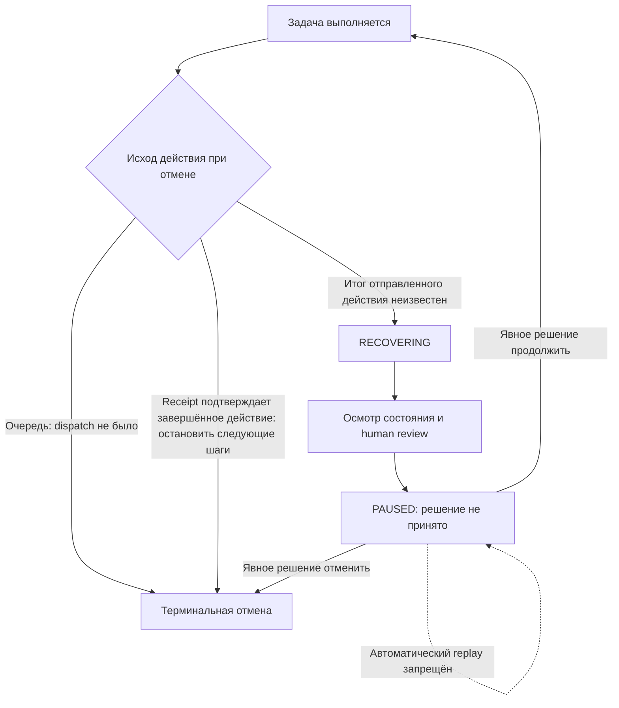
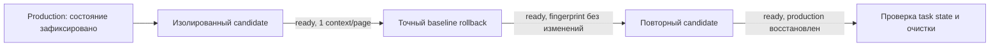

# Инженерный отчёт о готовности к выпуску

## Текущий итог — 31 октября 2026, 00:15 (Asia/Qyzylorda)

**Локальный кандидат установлен и проверен.** Ручное управление восстановлено; переходы на другие сайты включены. Общая готовность к промышленной эксплуатации за пределами проверенных сценариев не подтверждена. [Postflight](evidence/deployment-candidate-summary.json).

| Gate | Текущий результат | Границы проверки |
|---|---|---|
| G0 — полный набор тестов | **533 passed, 8 skipped, 0 failed** на `ec922b8`, 94,77 с; 541 тест собран. | [Сводка JUnit](evidence/unit-suite-manual-public-final.json). Последующая малая правка quoting в runner не вошла в этот полный прогон. |
| G2 — worker/control | **PASS в ограниченном disposable scope** | Lifecycle/cancel и синтетический cookie bridge прошли. Cookie source был синтетическим протоколом расширения; реальный Chrome extension E2E и аккаунтные сессии не проверялись. |
| G3 — браузерные сценарии | Checkbox 3/3, web_table 3/3, полный G3 8/8; четыре публичные страницы доступны. | Для публичных страниц использовались гостевые страницы без авторизации, model calls и CAPTCHA bypass. Это доступность страниц, а не anti-bot PASS. [Результаты](evidence/public-web-summary.json). |
| G4 — lifecycle/concurrency | **PASS в ограниченном disposable scope** | Восстановление/review сохранено, повторного dispatch нет; конкурентная задача отклонена как `PROFILE_BUSY`. |
| G5 — ресурсы | **PASS для maintenance soak; два ранних прогона без maintenance — FAIL** | `soak-maint2`: 900,07 с; 5 902 цикла; 59/59 maintenance requests; 141 sample / 895,54 с; пик памяти 50,40%, PID 32,23%, рост 5,66%, OOM delta 0. Только конфигурация VM 8 GiB / browser cgroup 4 GiB и фиксированная нагрузка. [Evidence](evidence/soak-maintenance-pass.json). |
| G6 — rollback/DB | Candidate rollback проверен; DB migration N/A | Схема БД не менялась относительно baseline 96. Это не production deployment. |
| G7 — deployment/readiness | **Кандидат установлен локально; ручное управление восстановлено** | Candidate images active; rollback images preserved. Локальный postflight PASS не является сертификатом широкой production readiness. Реальные аккаунты/сессии, protected-site/CAPTCHA flows и unsupported dialogs/uploads/frames/multiple windows не проверялись. Intrusive memory report не классифицировал renderer peak. [Postflight](evidence/deployment-candidate-summary.json). |

**Manual cross-origin:** стандартная навигация и клик по целевому элементу прошли; opt-out и навигация от agent отклонены с `POLICY_DENIED`; один context/page сохранён. [Сводка](evidence/manual-browsing-summary.json).

**Публичные гостевые страницы:** `public-final3` (30 октября, 19:02 UTC) показал положительные признаки ожидаемого origin для DemoQA, Amazon, eBay и Sannysoft. Скриншоты: [DemoQA](evidence/public-web/demoqa.png), [Amazon](evidence/public-web/amazon.png), [eBay](evidence/public-web/ebay.png), [Sannysoft](evidence/public-web/sannysoft.png). На Sannysoft результаты смешанные: WebDriver missing и WebDriverAdvanced passed, Chrome (New) missing failed, присутствовал permissions prompt. Это не утверждение о stealth/anti-bot прохождении.

Ранние no-maintenance soaks остаются историческими FAIL; maintenance-enabled soak прошёл только в проверенной конфигурации. Общая production readiness не подтверждена.
## Исторический снимок live UI до opt-in hints: восемь сценариев

Для каждого PASS был указан независимый verifier. Время — зафиксированное wall time конкретного запуска, не прогноз производительности. Сценарии synthetic и не включают реальные аккаунты, покупки или отправку сообщений.

| Сценарий | Результат | Шаги | Время | Проверка / основание |
|---|---:|---:|---:|---|
| `text_box` | **PASS** | 9 | 57.71 с | Поле заполнено; независимая проверка прошла |
| `invalid_email` | **PASS** | 14 | 98.05 с | Невалидный email обработан ожидаемым UI путём; проверка прошла |
| `notify_then_click` | **PASS** | 10 | 102.15 с | Действие после уведомления подтверждено verifier-ом |
| `radio` | **PASS** | 4 | 47.20 с | Выбор radio подтверждён независимо |
| `double_click` | **PASS** | 7 | 99.24 с | Двойной клик подтвердил ожидаемое состояние |
| `dynamic` | **PASS** | 1 | 15.21 с | Динамический элемент найден и проверен |
| `checkbox` | **FAIL** | 16 | 191.98 с | `TASK_EXPIRED`; Home раскрылся и 4 checkbox role были видны, но Desktop остался unchecked. Предыдущая ошибка формы вывода `MODEL_OUTPUT_INVALID` устранена, однако end-to-end условие не достигнуто. |
| `web_table` | **FAIL** | 20 | 186.27 с | `TASK_EXPIRED`; требуемая строка не была независимо подтверждена до deadline. |

История отказов сохранена: в readiness2 checkbox завершился `MODEL_OUTPUT_INVALID` после 2 шагов, а web_table — `TASK_EXPIRED` после 23 шагов/185.48 с. Исправление prompt убрало именно ранний shape error checkbox, но targeted4 всё ещё завершился с checkbox unchecked и повторным timeout web_table. Оба отказа учитываются как FAIL, а не переименовываются в setup block.

## Исправления в коде и тестовой инфраструктуре

| Область | Было | Стало | Проверка | Ограничение |
|---|---|---|---|---|
| Продукт: приватность API/MCP | Чувствительные пользовательские значения могли попадать в ответы/повторное использование задачи. | Значения редактируются в API/MCP ответах; при повторе секрет требуется ввести заново, он не копируется из прошлой задачи. | Полный pytest на `b8c319a`; commit `953bf8d` добавил secret re-entry. | Не доказывает отсутствие всех классов утечки во всех интеграциях. |
| Продукт: транспорт и отмена | Chunked HTTP body мог читаться без достаточной границы; неизвестный исход действия мог выглядеть как завершённая отмена. | Чтение body ограничено; неопределённый outcome остаётся `RECOVERING` и требует review, без автоматического replay. | Regression suite и отдельный `runtimeint3`: in-flight action observed, `RECOVERING`, без replay; worker вернулся ready/idle. | Это подтверждает один bounded controlled case, не все uncertain-response, restart или concurrency варианты. |
| Продукт: инструкции модели и формы действий | Общая guidance недостаточно чётко задавала доверие к источникам, аргументы действий, деревья и формы. | Уточнены generic prompt и требования к shape/аргументам действий, работа с деревьями и формами (`43b3dad`, `c895246`, `ac8a7bf`). | 40 focused prompt cases PASS; synthetic Chromium smoke PASS; live targeted retest. | Не все ошибки модели исправлены: checkbox и web_table остаются FAIL. |
| Тестовая инфраструктура: запуск и конфигурация | Неоднозначные test URLs/cookie sync, нестабильный startup extension worker и некорректная обработка завершения/отчёта. | Уточнены URLs, sync отключён явно; стабилизирован generic auto setup/startup; поправлены failed-exit и evidence export. | Соответствующие regression cases входят в полный pytest; итоговые live security/cancel summary экспортированы. | Инфраструктурный PASS не является продуктовой capability проверкой. |
| Тестовая инфраструктура: очистка и владение | Остановленные fixtures от предыдущих запусков учитывались как leftovers текущего прогона и давали ложный failure. | Cleanup отличает pre-existing stopped fixture IDs от ресурсов текущего запуска; проверяются новые leftovers, поправлен per-run ownership/exit/report путь. | Regression suite и проверки cleanup/restore в control3. | Targeted4 runner не дошёл до собственного profile digest postcheck после сценарных FAIL; отдельный read-only postflight подтвердил digest. |
| Тестовая инфраструктура: Windows/Docker | Rollback harness некорректно читал Docker labels из-за quoting; ручной запуск без init зависал на Xvfb. | Исправлен Windows quoting (`b8c319a`); audit повторён корректным способом с init. | Shim guard tests входят в 418 pytest PASS; candidate → baseline → candidate прошёл. | Ранний запуск без `--init` — NOT RUN, а не browser PASS. |

Тестовая дисциплина: шесть native runtime wrapper тестов отмечены как **SKIPPED** в полном host pytest и не выполнялись там. Отдельный `test_runtime_audit` прошёл в disposable browser image; эти две группы не следует смешивать.

## Неопределённый исход отмены

Если отмена приходит после передачи действия, система не может считать, что сайт его не выполнил: ответ мог потеряться после эффекта на странице. В этом случае задача остаётся в `RECOVERING`; автоматический повтор запрещён, поскольку он способен применить внешнее действие дважды. Следующий шаг — наблюдение/review и сверка результата. Схема ниже концептуальная: подписи переходов описывают условия, а не точные enum/API статусы; verifier не переводит задачу в `COMPLETED` автоматически.

Фактический control smoke достиг стабильного `RECOVERING`, выдержал 2 секунды без дополнительных planned actions и оставил worker ready/idle с одним context/page. Это подтверждает bounded поведение control smoke, но **не** отмену уже dispatched/in-flight действия, рестарт TaskRunner или concurrency.

## Изолированный deployment rollback

Rollback проверялся отдельным Compose project и раздельными volumes control/worker; host profiles не монтировались. Fingerprint профиля оставался неизменным, production task state совпал до и после, временные контейнеры удалены, production восстановлен.

Изолированный candidate → baseline → candidate rollback прошёл. Для этого candidate control DB schema не менялась относительно базы 96; изменён только storage redaction regex, поэтому DB migration gate N/A. Это не утверждение о будущих schema migrations.

## Ресурсы и границы измерений

В bounded Live2 read-only прогоне было 6/6 HTTP 200 при concurrency 2 и 3 итерациях; p95 — 14.23 мс. Browser container достиг peak **1,522,884,608 B из 2,952,790,016 B (51.58%)**, PID peak **189/512**, OOM/OOM-kill/high counters — 0; отмечено 6 throttled CPU periods.

Soak15m1 завершился FAIL на 359,75 с с 2 138 циклами; сохранены 59 валидных samples за 356,58 с. Peak memory 99,88% лимита и memory growth превышают budgets; API unavailable и cleanup/idle invariant также завершились failure. PIDs были в пределах budget; OOM/kill counters не увеличились среди сохранённых samples. API отказ совпал с почти исчерпанной памятью, но причинная связь ещё не установлена. Исправление/диагностика компонента и повторный capacity run ожидаются.

## Остаточные риски

- Checkbox и web_table — повторяемые live path failures, подтверждённые targeted retest.
- Нативные dialog и file upload не поддержаны/не проверены; overlay test показал корректный BLOCKED при перехвате клика. Worker edge audit: 8 PASS, 0 FAIL, 4 BLOCKED, в том числе overlay, dialog, upload и worker-only cancel. Iframe был подтверждён только synthetic fixture.
- Runtime audit и восстановление после закрытия страницы/SIGKILL прошли. Bounded `runtimeint3` подтвердил queued cancellation и один in-flight `RECOVERING` сценарий; он не заменяет тесты uncertain response, restart во время каждого этапа dispatch или concurrency.
- Readiness1 security export имел ошибку; его можно считать только summary 16 checks. Поздний control3 export успешно подтвердил реализованную матрицу 16/16.
- Успешный model smoke был локальной synthetic Chromium fixture, 4 шага за 17.82 с; он не включал Camoufox и полный control↔worker/MCP/UI путь. Отдельный smoke 18.288 с также не является полным G3.
- G6 не проверил migration marker control DB; миграционная совместимость и DB rollback не доказаны.
- Внешний egress/proxy, stealth/CAPTCHA и multi-worker readiness не входят в подтверждённые PASS.

## План доделок и выпускной критерий

P0-критерий трёх последовательных PASS на checkbox и web_table и повтор полного G3 теперь выполнен в bounded disposable конфигурации. Исходная таблица ниже сохраняется как план, записанный до этих результатов; дальнейшие P1/release gates остаются открытыми.

Аудит завершён, работа над продуктовой готовностью — нет. По имеющимся evidence unrestricted production release рекомендовать нельзя. Сначала нужно закрыть два доказанных live отказа. Ограниченный пилот допустимо рассматривать только для явно описанного поддерживаемого потока, после отдельного решения владельца выпуска и проверки его критериев; текущие результаты сами по себе не являются рекомендацией запускать production или пилот.

### P0 — выполнено в bounded disposable scope

Критерий выполнен: checkbox и web_table прошли по три независимых свежих повтора, затем full G3 дал 8/8 PASS. Feature hints остаётся opt-in/default-off и не развёрнута в production. Ниже приведён план, написанный до завершения этих прогонов; он сохранён как исторический контекст, не как открытые P0 задачи.

| Задача | Владелец по роли | Зависимости | Критерий приёмки |
|---|---|---|---|
| Установить причину checkbox и web_table FAIL до изменения prompt/поведения. Снять минимальную санитизированную трассу: тип действия (`kind`), координаты, задержки, имена полей схемы, наблюдения до/после и ожидаемая/фактическая цель. Не включать введённый текст, секреты или raw reasoning модели. | Владелец browser automation; совместно с тестированием | Повторяемый disposable stack и synthetic fixtures | Для каждого шага можно сопоставить proposal/action receipt с фактической целью и следующим наблюдением; причины различают ошибку выбора модели/vision от неверного ввода/координаты или недостатка наблюдений. Трасса не содержит пользовательского ввода, секретов или chain-of-thought. |
| Добавить маленькие детерминированные fixtures: раскрытие tree expander с отдельным checkbox target; отдельно — небольшую таблицу с фокусом/целью на конкретной строке. Сравнить ожидаемый hit target с фактическим hit target/координатой и проверяемым состоянием страницы. | Владелец тестовой инфраструктуры | P0 трассировка; доступные verifier assertions | Fixture стабильно создаёт исходное состояние; verifier отдельно проверяет, что раскрылась нужная ветка и checkbox checked, а в таблице изменилась нужная строка; тест отличает неверную цель/координату от правильного действия с неверным наблюдением/верификацией. |
| Исправить установленную первопричину ограниченным изменением и повторить исходные сценарии с прежним пределом 180 с / 40 шагов. Не проводить слепые prompt retries: каждый новый прогон должен проверять конкретную гипотезу о причине. | Владелец browser automation; ревью тестирования | Причина установлена; fixture и acceptance assertions готовы | Checkbox действительно checked, строка внесена; оба условия подтверждены независимым verifier до deadline. Никаких ложных PASS по receipt или тексту модели. |
| Подтвердить устойчивость исправления несколькими свежими прогонами. Предлагаемый выпускной порог — **3 последовательных PASS на каждый критичный сценарий** в disposable stack, затем повтор полного обязательного G3. | Владелец тестирования / release owner | Предыдущие пункты P0 | Порог записан до прогонов; он выполнен в текущем follow-up выше: три последовательных PASS на каждый критичный сценарий и full G3 8/8. |

P0 закрывает только подтверждённые UI failures. Он не закрывает автоматически необязательные функции, concurrency, capacity или DB migration evidence: их обязательность следует определить в release contract.

### P1 — закрыть, если входит в release contract

| Работа / статус для GO | Владелец по роли | Зависимости | Критерий приёмки |
|---|---|---|---|
| Dialog, file upload и расширенная overlay capability остаются непроверенными/неподдержанными по заявленному contract. Один bounded overlay test подтвердил безопасное поведение при перехвате: receipt `applied`, но task завершился `waiting_human/verification_required` без подтверждения целевого эффекта. **Обязательно для GO, если заявленная поддержка включает эти действия.** | Владелец browser worker | Явная политика разрешённых действий и безопасные synthetic fixtures | Для dialog/upload есть отдельные поддержанные операции и независимая проверка; при перехваченном клике task/verifier не сообщает достижение целевого результата без фактического эффекта. Неподдерживаемый путь явно блокируется. |
| In-flight cancellation, busy/profile ownership, uncertain dispatch и запрет повторного side effect; один controlled in-flight case завершился `RECOVERING` без replay, bounded lifecycle contract проверен на synthetic fixture; охват на произвольных внешних сайтах не доказан. **Обязательно для GO, если разрешены внешние действия с возможным повторным эффектом или concurrent tasks.** | Владелец control/TaskRunner | Трассируемый dispatch lifecycle; управляемый synthetic endpoint | Расширить проверку cancel до dispatch, во время dispatch и после неизвестного ответа; отсутствие автоматического replay; idempotent/stable status; подтверждённая сверка результата; profile/context/page инварианты при занятости и recovery. |
| Cookie source, live identity/account policy и log redaction. **Synthetic cookie bridge integration прошёл; реальный Chrome E2E и live identity/account policy остаются открытыми для авторизованных сессий или чувствительных данных.** | Владелец security/privacy | Завершить тест cookie-source и зафиксировать identity/session policy | Проверить ожидаемый account перед действием и перед отправкой; hard typed identity proof пока отсутствует. Не заявлять поддержку всех авторизованных сайтов; at-rest encryption/vault не подтверждены. |
| Soak/capacity. **Оба run завершились FAIL.** Повторный soak при VM 8 GiB / browser cgroup 4 GiB шёл 670,56/900 с и достиг 99,998% memory; функциональные сбои — navigate not applied и cleanup/idle. | Владелец SRE/performance | Разобрать functional failure и рост/удержание памяти; после исправления повторить 15-минутный смешанный прогон. Условия PASS: ≤90% memory/PID, OOM=0, рост медиан ≤10% лимита, ≥60 samples за ≥885 с. | [Первый run](evidence/soak-failed-1.json); [повторный run и timeline](evidence/soak-8gvm-4gb-failed.json); [memorymixed1 diagnostic](evidence/memorymixed1-summary.json); [live GC contrast](evidence/memory-gc4gb1-summary.json). capacity PASS нет. |
| Control DB migration/rollback marker. **N/A для текущего candidate:** control DB schema не менялась относительно базы 96; изменён только storage redaction regex. | Владелец control persistence / release engineering | Пересмотреть применимость при следующем изменении schema | Нынешний candidate rollback evidence не заявляет DB migration coverage и не требует schema migration. |

### P2 — расширение уверенности, не текущие доказанные блокеры по умолчанию

| Работа | Владелец по роли | Зависимости | Критерий результата |
|---|---|---|---|
| Расширить synthetic browser dataset: динамические элементы, iframe, shadow DOM, overlay и вариации форм. | Владелец QA automation | P0 deterministic fixtures | Повторяемые regression cases с независимыми assertions; BLOCKED и unsupported cases остаются раздельными от PASS. |
| Добавить наблюдательные метрики и regression CI для ошибок схемы действий, verifier mismatch, task expiration и recovery. | Владелец observability/CI | Согласованные event schema и redaction | В CI доступны агрегаты этапов proposal/action/verification; артефакты санитизированы; regression сравнивается с известными baseline без raw model reasoning. |
| Уточнить публичные сетевые/WAF диагностики и egress границы. Это проверка доступности/совместимости, не попытка обхода защит. | Владелец network/platform | Зафиксированная разрешённая сеть и тестовые публичные endpoints | Сетевые блокировки диагностируются и классифицируются; никакого обхода WAF/CAPTCHA; заявленные egress ограничения отражены в release docs. |
| Рассмотреть расширение smoke с single-worker на дополнительные поддерживаемые сценарии/профили. | Архитектор runtime + QA | P1 busy/profile ownership и capacity при необходимости | Для каждого добавленного профиля/worker есть отдельные resource, ownership и isolation assertions; не заявлять multi-worker readiness до этих проверок. |

### Историческая последовательность из исходного аудита

Пункты ниже показывают план до P0 повторов и P1 bounded integration checks. Текущие результаты перечислены выше; P0 и эти узкие P1 проверки завершены.

1. Сохранить текущий baseline и артефакты; начать с P0 трассировки, не меняя повторно prompt без диагностической гипотезы.
2. Локализовать для checkbox и web_table: выбранная цель, фактическое попадание, receipt, наблюдение, verifier и причина timeout.
3. Исправить конкретную причину, проверить deterministic fixture и повторить сценарий в пределах исходных лимитов.
4. Выполнить предложенный порог 3 последовательных свежих PASS на каждый из двух критичных сценариев и полный G3. Это новый критерий, не свершившийся факт текущего отчёта.
5. До release определить контракт поддерживаемых функций и применить соответствующие P1 gates. Если отмена внешних действий/авторизованные сессии входят в scope, закрыть соответствующие P1 до пилота/GO.
6. Для заявлений capacity или изменений схемы БД завершить соответствующие P1 прогоны. Повторно проверить regression suite и осознанно разобрать 6 SKIPPED тестов.
7. Пересмотреть G0–G7 по новым evidence. Production GO возможен только после закрытия обязательных критериев; ограниченный пилот требует отдельного решения и явно урезанного supported scope.

## Источники и происхождение

Сводные результаты аудита: [RESULTS.md](RESULTS.md) и [план проверки](PLAN.md). Санитизированные артефакты: [полный regression summary](evidence/regression-final-summary.json), [readiness2](evidence/demoqa-readiness2-summary.json), [targeted4](evidence/demoqa-targeted4-summary.json), [control3](evidence/control3-live-summary.json), [task control](evidence/task-control-summary.json), [browser edge audit](evidence/browser-fault-edge-report.json), [runtime/recovery summary](evidence/browser-fault-summary.json), [load metrics](evidence/live2-load-summary.json), [model smoke](evidence/model-smoke-release-summary.json), [rollback](evidence/rollback-summary.json).

Ключевые источники кода: `src/browser_mcp/{app,auth,config,model_client,runtime,storage}.py`, `worker/{app,site_capabilities,native_input}.py`, `ui/{app,desktop,task-status}.js`, `config/fara-system-prompt.txt`, `config/fara-tool-schema.json`. Коммиты исправлений включают `1d0aace` (ограничение body и неизвестный outcome), `953bf8d` (повторный ввод секрета), `43b3dad`/`c895246`/`ac8a7bf` (guidance и формы действий), `b8c319a` (Windows Docker label quoting). Итоговый аудиторский HEAD: **`54ce49f`**; последний полный тестовый source revision: **`b8c319a`**. Идентификаторы браузера, абсолютные model paths, секреты и пользовательские данные в этот отчёт не включались.
